# Antwerp Port Simulation — Mathematical Model and Mechanics

As of 2 November 2026.

## 1. Overview

The simulation is a time-stepped, agent-based model of all shipping on the Scheldt from the North Sea to Antwerp, with container ships modelled in full detail and all other traffic as stochastic background fitted to AIS observations. Every ship is an agent with its own hull, route, state and timers; port services (pilots, tugs, locks, berths, anchorages) are shared resources with queues.

- **Area.** The North Sea approaches (Wandelaar, Steenbank, Westhinder), the Western Scheldt (Vlissingen to the Dutch-Belgian border), the Lower Sea Scheldt up to Hoboken, the Antwerp docks behind the locks, and the canals and ports branching off (Ghent–Terneuzen, Zuid-Beveland, Schelde-Rijn, Albert canal, Vlissingen, Terneuzen).
- **Level 1 — container ships.** Full agents: dimensions from TEU, terminal and quay allocation, tidal berthing windows, STS crane handling, ULCV rules, full VTS clearance.
- **Level 2 — background traffic.** Bulk and general cargo, tankers, inland cargo, inland tankers and passenger ships. They use the same river, locks, anchorages, pilots and tugs, but their time at berth is a random dwell time instead of a handling model.
- **Time.** A fixed step of Δt = 5 minutes (the AIS snapshot interval). Processes shorter than a step are countdown timers in minutes, so no time is lost to rounding. A run usually covers 1–4 weeks after a warm-up of 2 days, whose ships are excluded from the statistics.
- **Randomness.** One seeded random generator drives all draws (arrivals, attributes, delays, weather days, tie-breaks), so a run is reproducible from its seed.

The sections follow the model's layers: the data and what is taken from it (§2), the environment — space, water and weather (§3–5) — the ships and how they are generated (§6–7), the step loop and the decision makers (§8–10), ship movement (§11), the resources (§12–15), the special rules for the largest container ships (§16), and the outputs and limitations (§17–18). Regulation references ("regs") point to the Antwerp and Scheldt port regulations as summarised for the model.

## 2. Data and what is taken from it

The model is built from twelve datasets. Each one supplies either geometry, water, traffic behaviour or rules; nothing in the simulation is tuned by hand where a dataset can supply it.

| Dataset | Source | What is taken from it | How |
| --- | --- | --- | --- |
| AIS snapshots | Every 5 min, the whole area; 1,559 snapshots from 26 Oct to 1 Nov 2026, about 1.0 million positions of 3,391 ships | Arrival rates, entry points, ship sizes, destinations, berth and anchorage times, berth use, tug and pilot-boat bases, mooring times, dock speeds, pilot demand, fairway centrelines, the area sea traffic uses, current calibration | The pipeline of §2.1 |
| Container schedule | Liner calls 20 Oct–22 Nov 2026: vessel, TEU, scheduled berth arrival and departure, terminal code (322 calls) | Container arrivals (replayed or fitted), TEU per call, terminal | §6.1 |
| Depth chart | Rijkswaterstaat 20 m bed levels (surveys to 2024) converted to LAT with the NLLAT2018 separation; EMODnet bathymetry (\~115 m) elsewhere; blended over 200 m | Depth below LAT of every sea, Western Scheldt and Dutch port cell | Cell value = chart value at the cell (§3.2) |
| Port soundings | Port of Antwerp-Bruges sounded bed levels (TAW), 5 m raster | Depths of the Zeeschelde and the Antwerp docks | Median of the raster within 25 m of the cell, TAW converted to LAT (§3.2) |
| Harbour-master berth register | Port of Antwerp-Bruges, every berth: allowed draught, sounded depth (TAW), minimum under-keel clearance, category, quay type | Berth limits; depth at berths without soundings; berth suitability for tankers and sea-going ships | §3.3, §15 |
| Berth catalogue | Charted berth slots with polygons and quay lines | Quay lines of the terminals, berth positions and the cells that serve them | §15 |
| OpenStreetMap water and locks | Water polygons and lock gate lines | Water mask where the chart has no data (canals, docks); lock chamber positions | §3.1, §14 |
| Navigation chart layers | Buoys, anchorages (official polygons or circles where published), traffic separation schemes | Fairway outline, regulated stretches between named buoys, anchorage areas and anchor berths | §3.4, §12 |
| Tide gauges | Rijkswaterstaat 10-minute water levels at 11 gauges (Westkapelle, Cadzand, Vlissingen, Terneuzen, Hansweert, Walsoorden, Bath, Schaar van den Oord, Liefkenshoek, Kallo lock, Antwerp Loodsgebouw), about 2 years | Harmonic tide per gauge, LAT, surge model | §4.1–4.2 |
| Weather | KNMI station 310 Vlissingen, hourly wind, gusts, direction, pressure and visibility | Weather sequences, surge input, weather gates | §5 |
| Current atlas | Flanders Hydraulics Research, Stroomatlas Zeeschelde (2022, SCALDIS model): depth-averaged speeds every half hour for spring and neap tide | Calibration of the Zeeschelde currents | The 95th percentile of the vector speeds on each map (§4.4) |
| Regulations and port documents | Port and Scheldt regulations, COLREG, terminal equipment and quay-allocation notes, the tug and pilot-tender fleet lists | Rules (flags, encounter bans, weather limits, berthing windows, ULCV rules), crane counts and productivity, fleet sizes | Encoded as rules and constants |

### 2.1 How AIS becomes distributions

1. **Positions.** Snapshots taken seconds apart by two collectors are counted once. A gap of more than 12 minutes between snapshots is collector downtime, and its time is excluded from all rates.
2. **Visits.** A ship's positions are split into visits: a new visit starts when the ship reappears elsewhere after more than 6 hours. A gap caused by downtime never starts a visit.
3. **Classes.** Container: the name is in the schedule, is a container line's name, or the ship is cargo of 250 m or more. Sea-going bulk/general cargo and tankers: a valid IMO number. Inland cargo and inland tankers: no valid IMO number and LOA ≥ 50 m. Passenger ships. Service craft and unknown types are dropped.
4. **Scheldt only.** A visit is kept if the ship gets east of the Vlissingen–Breskens line, enters a Scheldt port or canal, or waits with a Scheldt destination. North Sea through traffic and Zeebrugge-only calls are dropped.
5. **Entry point.** Each visit is assigned the place it entered by: a sea gate (west, north or south-west edge of the area), an anchorage (widened by 1.5 km), or a port or canal box.
6. **Censoring.** A ship first seen within 20 minutes of a collector start was already in the area and is not an arrival. The observed exposure is the collector's uptime: T = 123.4 h for the current fits.
7. **Stops.** A stop is lying still (< 1 kn) for at least 30 minutes within 1 km. It is a berth stop, an anchorage stop or other. In a lock zone a stop under 3 h is a lock passage, not a berth call.

From these, the fitted quantities are:

- **Arrival rate** of class c at source s, and its hour-of-day factor (counts per hour of day over the exposure in that hour, smoothed over 3 hours and normalised to mean 1):

```math
\lambda_{c,s} = \frac{N_{c,s}}{T}, \qquad f_c(h) = \frac{\tilde n_c(h) / T(h)}{\frac{1}{24}\sum_{k} \tilde n_c(k) / T(k)}
```

- **Ship attributes:** the list of whole observed ships per class (LOA, beam, largest reported draught, dangerous-goods category), resampled as a unit so the correlations between dimensions are kept.
- **Destination** given class and source: the berth zone of the visit's longest stop, or the exit it left by when it never stopped. **Exit** given class and last berth zone. Both are empirical frequencies.
- **Time at berth and at anchor:** a lognormal per class (and per berth zone where there are enough stops), fitted by maximum likelihood. A stop still running when the data ends is right-censored; stops under 0.5 h (3 h in lock zones) are never recorded, so the likelihood is left-truncated there. With d\_i = 1 for a completed stop of x\_i hours and truncation point t\_i:

```math
\ell(\mu,\sigma) = \sum_i \Big[ d_i \big(\ln\phi(z_i) - \ln\sigma - \ln x_i\big) + (1-d_i)\ln\big(1-\Phi(z_i)\big) - \ln\big(1-\Phi(\tfrac{\ln t_i-\mu}{\sigma})\big)\Big], \quad z_i = \frac{\ln x_i - \mu}{\sigma}
```

- **Container dimensions from TEU:** log-log regressions on the 111 scheduled ships seen in AIS (R² 0.81–0.89), with correlated residuals drawn through the Cholesky factor L of their covariance:

```math
\begin{pmatrix}\ln \mathrm{LOA}\\ \ln B\\ \ln T\end{pmatrix} = \begin{pmatrix}3.204\\1.405\\0.788\end{pmatrix} + \begin{pmatrix}0.277\\0.259\\0.190\end{pmatrix}\ln \mathrm{TEU} + L\,z, \qquad z \sim N(0, I_3)
```

- **Schedule delay:** actual start of the AIS berth stop minus the scheduled arrival, matched within ±96 h (45 calls, median 30 h); drawn by resampling the observed values.
- **Port infrastructure:** berth use per class (berth stops ≥ 0.5 h within 150 m of a berth; a tanker berth has ≥ 2 tanker calls making ≥ 50 % of its calls); tug and pilot-boat bases (600 m clusters of their stops with ≥ 50 vessel-hours from ≥ 2 vessels); mooring and unmooring times (§15.3); dock speeds (median and 95th percentile of sea-going ships under way per dock basin); the most ships needing a pilot at once per zone (§13).
- **Geometry:** the fairway centrelines are fitted to the tracks of large ships, and the sea grid covers only where Scheldt traffic sails (§3.1). Ships' speeds over ground calibrate the Western Scheldt currents (§4.4).

## 3. Spatial model

The water is a graph of about 67,000 cells (nodes) joined by edges, laid only on water that ships use. Every distance is computed in a metric projection (UTM zone 31N), never in degrees.

### 3.1 The mesh

| Grid | Cell | Orientation | Where |
| --- | --- | --- | --- |
| Sea | 250 × 250 m | Grid-aligned | Inside the AIS area, only where Scheldt-bound traffic sails (the AIS tracks dilated by 4 cells) and over the anchorages (+ 500 m) |
| River | 200 m along × 50 m across | Follows the fairway centreline | Western Scheldt from Vlissingen, Zeeschelde to Hoboken |
| Canal | 200 × 50 m | Follows the canal centreline | Ghent–Terneuzen, Zuid-Beveland, Schelde-Rijn, up to the area edge |
| Port | 50 × 50 m | Grid-aligned | Antwerp docks, Terneuzen, Vlissingen(-Oost), Breskens |

- **Centrelines.** The river and canal centrelines are fitted to the AIS tracks of large ships, so the curvilinear grid follows where ships actually sail. Canal grids are laid before the river grid, so the wide river grid never claims canal water where the two run close.
- **Edges.** Neighbouring cells within a grid are joined; the grids are stitched by "link" edges to the nearest cells of the other grid (up to 2 per cell, within 250 m, 330 m at sea). An edge is kept only if all of 11 points sampled along it are water (the depth chart, and OpenStreetMap water within 20 m where the chart has no data). Only the largest connected part is kept.
- **Edge length** is its Euclidean length in metres; it is the routing weight.

### 3.2 Depths

Every cell has a depth below LAT (lowest astronomical tide; negative on drying banks).

- **Sea, Western Scheldt and Dutch ports:** the chart value at the cell. An edge's depth is the shallowest of its sampled points.
- **Zeeschelde and Antwerp docks:** the port's sounded bed levels. The cell's depth is the median of the 5 m raster within 25 m of its centre, used when at least 30 % of those pixels hold a sounding. Bed levels are in TAW and converted to depth below LAT at the nearest tide gauge: with z the bed level in TAW, 2.33 m the TAW–NAP offset and LAT\_g the gauge's LAT in NAP,

```math
d_{\mathrm{LAT}} = \mathrm{LAT}_g - (z_{\mathrm{TAW}} - 2.33)
```

An edge between two such cells takes the shallower of the two.

- **Where no data exists**, a nominal depth per zone, taken from the governing draught or lock sill: Zeeschelde 14.5 m, Upper Sea Scheldt 8.8 m, Antwerp north docks 13.6 m, left-bank docks 14.0 m, central docks 10.3 m, city docks 6.4 m, Deurganckdok 18.7 m, Ghent–Terneuzen canal 13.75 m, Zuid-Beveland and Schelde-Rijn canals 6.0 m.
- **Lock approaches.** Where the chart misses a dredged approach (Hansweert, the Walcheren canal), the shortest way of at most 3 km from the lock's tidal side to main-channel water as deep as the lock's deepest sill is set to that sill depth.

### 3.3 Locks, basins and berth access

- **Locks.** Each lock is one node. The cells inside its chambers are removed and gate edges join the lock node to the water at both ends (depth = the chamber's sill). Any remaining connection between a lock's two sides (a link across a dike, a thin quay) is found as a minimum edge cut between the sides and removed, so a ship can only pass through the lock.
- **Basins.** The water behind locks is split into basins with a fixed managed level instead of the tide (Antwerp docks +4.30 m TAW, Ghent–Terneuzen canal +2.13 m NAP, others NAP 0).
- **Berth access.** Every berth must be reachable by a ship at its allowed draught. For each 10 cm draught class, a widest-path search from the deepest river cell finds, for every cell, the deepest draught that can reach it: the path whose shallowest point is deepest, counting mean high water on tidal water, the fixed level in basins, and at a lock its sill plus the level on the side the ship comes from. With D(e) the depth of edge e plus that level,

```math
W(v) = \max_{\text{paths } P \to v} \; \min_{e \in P} D(e)
```

A berth whose access W is less than its allowed draught plus its minimum under-keel clearance has its access path deepened to exactly that value (about 77 cells). Locks are never deepened. An independent check confirms all 697 berths with an allowed draught are reachable at that draught.

### 3.4 Cell attributes

- **Lane offset:** the signed distance from the channel axis, positive on the right bank looking upstream (starboard for an inbound ship). Lane = offset / 50 m.
- **Fairway:** in the Western Scheldt, inside the lateral buoys of the main fairway (the union of convex hulls of every 6 consecutive buoys); in the Zeeschelde, within 150 m of the axis (no buoy data); off Vlissingen below the first buoy, within 500 m; at sea, the buoyed channels and the deep-water route; canals entirely.
- **Speed zone:** sea (pilot station to Vlissingen), river (Vlissingen to Antwerp), canal, dock — the legs of the planning speeds (§7).
- **Speed limit:** none on the river (only safe speed applies); in the docks and within reach of the locks, the 95th percentile of the AIS speeds of sea-going ships in that basin, since no published number exists.
- **Main dock waterways:** the right-bank route from Kreekrak to Royers and the left-bank route to Kallo, which have right of way over side docks (§11.4).
- **Regulated stretches:** the stretches with encounter rules (Pas van Borssele, Nauw van Bath, Bocht van Bath and others), each defined between named buoys or chainages along the axis.
- **Clearance:** the distance from a cell's centre to the edge of the water. The mesh's edges are drawn on a 25 m raster, the drawing is closed over the gaps between grid lines, and a Euclidean distance transform DT gives the distance to non-water. A border cell stands for water half a lane beyond its centre:

```math
c(n) = \mathrm{DT}(n) - 25\,\mathrm{m} + \tfrac{1}{2}\,\mathrm{lane}(n), \qquad c = 1000\,\mathrm{m} \text{ at sea}
```

A ship of beam B fits on a cell when c(n) ≥ B/2.

### 3.5 The coarse graph

For long-range planning (a future planning VTS), the cells are grouped into regions around seed cells spaced about 4 km at sea, 2 km on the river and canals and 800 m in the port; each seed is the deepest cell of its block, so the coarse graph follows the channels. Every lock, anchorage and terminal is a region of its own. Each cell belongs to the seed it reaches first through the water (a multi-source Dijkstra), so a region never jumps across land. Two touching regions are joined by a coarse edge carrying its length, its crossing depth (the deepest fine edge across the border) and the deepest region cell.

## 4. Water: tide, surge, depth and current

All water levels are metres above LAT, the same datum as the depths, so the water under a ship is simply depth plus level.

### 4.1 Astronomical tide

Each gauge g has a harmonic tide fitted by least-squares harmonic analysis to about two years of 10-minute observations, with about 60 constituents including the shallow-water overtides (M4, MS4, M6, …) that make the Scheldt tide asymmetric (short rise, long fall):

```math
\eta_g(t) = Z_g + \sum_{k} f_k(t)\, A_{g,k} \cos\big(\omega_k t + V_k(t) + u_k(t) - \varphi_{g,k}\big)
```

with Z the mean level, A and φ the fitted amplitude and phase, ω the constituent's speed, and f, u, V the nodal and astronomical corrections. Each gauge's LAT is the lowest level of 19 years of its predicted tide, which puts the tide on the chart datum.

### 4.2 Surge

The surge (observed level minus tide) is explained per gauge by a linear regression on the North Sea wind stress over the previous two days and the air pressure, both from the Vlissingen weather station. With U the wind speed and θ the direction it blows from, the stress components towards east and north are τx = −U² sin θ and τy = −U² cos θ, and

```math
s_g(t) = \beta_0 + \sum_{\ell \in L} \big(\beta_{x,\ell}\,\tau_x(t-\ell) + \beta_{y,\ell}\,\tau_y(t-\ell)\big) + \sum_{\ell \in \{0,12\}} \gamma_\ell\,\big(1013 - p(t-\ell)\big), \quad L = \{0,3,6,9,12,18,24,36,48\}\ \mathrm{h}
```

The residual is an AR(1) process, available as optional noise for stochastic runs. The level at a gauge is η\_g(t) + s\_g(t), with the surge computed from the simulated weather (§5), so a storm raises the water.

### 4.3 Level at a cell and passability

- A tidal cell takes its level from the two gauges either side of it along the estuary, interpolated by its position between them (weight w): h(n,t) = (1 − w) h\_a(t) + w h\_b(t). A cell behind locks keeps its basin's fixed level.
- A ship needs a depth of draught plus under-keel clearance: 10 % of the draught for sea-going ships, 0.3 m for inland craft. A cell or edge is passable when

```math
d(n) + h(n,t) \;\ge\; T + \mathrm{UKC}
```

- Passability masks are computed once per time step and depth class (the required depth rounded up to 0.5 m) and shared by all ships of that class.

### 4.4 Tidal current

The current along the estuary comes from conservation of water. The estuary is cut into 500 m slices along its axis (chainage s from the mouth). The water passing a slice is what is needed to raise or lower everything upstream of it, plus the tidal storage above the head of the mesh (Upper Sea Scheldt, Rupel, Durme, Nete), which fills later than the head itself, minus the river's outflow:

```math
Q(s,t) = \sum_{j \ge s} S_j(h_j)\,\frac{\partial h_j}{\partial t} \;+\; S_{\mathrm{up}}\,\frac{\partial h_{\mathrm{head}}}{\partial t}(t - \tau) \;-\; Q_{\mathrm{river}}
```

```math
u(s,t) = k(s)\,\frac{Q(s,t) + Q_{\mathrm{river}}}{A(s,h)} \;-\; \frac{Q_{\mathrm{river}}}{A(s,h)}
```

- S\_j(h) is the wet surface of slice j at level h and A(s,h) the wet cross-section (wet volume of the slice over its length), both from the mesh's own cells, smoothed over 5 slices and never below 80 % of the 10 km running median. Positive u is flood (upstream).
- Q\_river = 120 m³/s (the mean Scheldt discharge at Schelle).
- **Western Scheldt:** k = 0.94, fitted on AIS. Within each passage of a ship, its speed through the water hardly changes, so its speed over ground minus the passage mean is regressed on the modelled current along its track (54,000 positions of 1,650 passages; R² 0.33).
- **Zeeschelde:** calibrated on the current atlas. For each atlas section (Prosperpolder–Boudewijnsluis, Boudewijnsluis–Antwerpen, Antwerpen–Hoboken), the section mean of |u| at each half hour of the model's own spring and neap tides (tidal coefficient 1.12 and 0.84 at Antwerp), timed on high water at Antwerp, is fitted by least squares to the atlas's 95th-percentile speed, which stands for the fairway. The fit gives one scale per section, the upstream storage and its lag:

| Parameter | Value |
| --- | --- |
| Scale k, Prosperpolder–Boudewijnsluis | 1.31 |
| Scale k, Boudewijnsluis–Antwerpen | 1.44 |
| Scale k, Antwerpen–Hoboken | 0.84 |
| Upstream storage S\_up | 25 km² (bounded to 5–25 km², the area of that water) |
| Lag τ of the upstream storage | 60 min |
| Fit error against the atlas | 0.15 m/s RMSE (0.64 before) |

- k(s) is piecewise linear along the chainage: the Western Scheldt value up to Bath, a ramp to the first atlas section, then each section's value with 2 km transitions, so the current has no jumps.
- The scales also correct the mesh's cross-sections, which are too narrow up the river, and turn the cross-section mean into the fairway speed.
- **Effect on a ship.** The speed over ground is the speed through the water plus the current along the ship's heading, times a response factor r: 1 in the Western Scheldt, and 0.335 in the Zeeschelde, where AIS shows that pilots take back most of a fair or foul tide. r is the slope of the same within-passage regression on the atlas current.

```math
v_{\mathrm{SOG}} = v_{\mathrm{STW}} + r\, u(s,t)\, \cos\alpha
```

where α is the angle between the ship's heading and the upstream direction of its cell.

## 5. Weather

The weather is a sequence of real observed days, resampled in whole-day blocks, so fog that lasts the night, a storm that lasts a day, the daily cycle and the links between wind, gusts, pressure and visibility are kept without being modelled.

- **Block bootstrap.** Each simulated day d is a complete observed day (24 hourly records) drawn uniformly from all years of the Vlissingen record whose day of year lies within 45 days of d's, with the circular distance |doy′ − doy| taken modulo 365. A replay mode uses the observed hours of the simulated dates instead, where the record has them.
- **Variables per hour:** 10-minute mean wind U (m/s), highest gust, direction, pressure, visibility. Visibility is decoded from the station code: codes 0–49 are × 100 m, 56–79 are (code − 50) km, 80–89 are 30 km + (code − 80) × 5 km.
- **Beaufort force** from the mean wind, by the standard upper bounds 0.3, 1.6, 3.4, 5.5, 8.0, 10.8, 13.9, 17.2, 20.8, 24.5, 28.5, 32.7 m/s.
- **Uses:** the surge input (§4.2), the weather gates below, crane stops and extra tugs (§15), and the speed cap in restricted visibility (§11.6).

### 5.1 Weather gates

Before clearing a ship, the VTS asks whether the weather lets it start. A ship that fails any gate waits (at anchor, at its berth or in port) and is asked again at the next planning round.

| Gate | Ships | Rule |
| --- | --- | --- |
| Visibility | Marginal ships (LOA ≥ 300 m, B ≥ 45 m or T ≥ 12.5 m) | No start below 1,000 m |
| Gas tankers (IMO2) | Sea-going tankers carrying gas | 1,000 m at sea, 2,000 m upstream of the De Nolle–Nieuwe Sluis line |
| ULCV through a lock | Container ships ≥ 350 m or B ≥ 51 m | No start above 5 Bft |
| ULCV to or from a tidal terminal | Same | No start above 6 Bft arriving or 7 Bft leaving, and the forecast must stay within the limit for 3 h after its arrival |
| Deep-draught anchorages | T ≥ 12.5 m at Everingen or Put van Terneuzen | No departure at 7 Bft or more |
| Cruise ships at the locks | Passenger LOA 170–200 m / 200–265 m | At most 7 / 6 Bft |
| Extreme weather | All sea-going ships | No start at 9 Bft or more (assumed threshold) |
| Pilot boarding at sea | Ships boarding a pilot at sea | At 8 Bft or more only ships shore-based pilotage can take (LOA ≤ 175 m, T ≤ 8 m, no gas tankers) |

The forecast used for the 3 h trend is the simulated weather itself: the model assumes a perfect forecast.

## 6. Ship generation

Container ships come from the liner schedule, either replayed or as a Poisson process fitted to it; every other class arrives by a non-homogeneous Poisson process fitted to AIS.

### 6.1 Container ships

**Replay mode.** Every schedule line is one ship. Its berth time is the scheduled arrival plus a delay Δ drawn from the 45 observed delays (resampled with replacement; switchable off), and it enters the area 8 h before that:

```math
t_{\mathrm{berth}} = t_{\mathrm{sched}} + \Delta, \qquad t_{\mathrm{enter}} = t_{\mathrm{berth}} - 8\,\mathrm{h}
```

Ships due to enter before the run starts are dropped; the warm-up fills the port instead.

**Fitted mode.** Berth arrivals form a Cox process: a Poisson process whose rate varies with the weekday and hour (Brussels time) and is multiplied by a random factor per day, because liner calls bunch (the schedule's calls per day have variance 18.7 against a mean of 9.8; a plain Poisson process would have them equal).

```math
\lambda(t) = \bar\lambda \cdot w_{\mathrm{dow}(t)} \cdot f_{\mathrm{hour}(t)} \cdot G_{\mathrm{day}(t)} \cdot \rho, \qquad G \sim \mathrm{Gamma}(k, 1/k)
```

- λ̄ = calls / hours over the whole days of the schedule (0.41 per hour, 9.8 per day).
- w = calls per occurrence of each weekday, over their mean (Monday 0.81 to Sunday 1.44). f = calls per hour of day, smoothed over 3 hours, over their mean. Both have mean 1.
- The gamma shape k matches the extra variance left after the weekday pattern. With m\_d the expected count of day d and n\_d the observed one, Var(n) = m + m²/k gives

```math
k = \frac{\sum_d m_d^2}{\sum_d (n_d - m_d)^2 - \sum_d m_d} = 23.6
```

- ρ scales the whole rate for scenarios (+20 % traffic: ρ = 1.2).
- In each 5-minute step the number of arrivals is Poisson(λ Δt), with the rate taken at the berth time the entering ships will have (8 h ahead). Each arrival is one schedule line drawn uniformly, which keeps its TEU, terminal code and scheduled time at berth together.

**Both modes.**

- **Size:** LOA, beam and draught from TEU with correlated scatter (§2.1). The draught is capped at 16 m and at the deepest draught its terminal's quay allows for a ship of that length, since a real ship calls loaded to what the berth allows.
- **Call size and cranes:** container moves and the crane count the terminal would give, both from TEU (§15.4).
- **Terminal:** the schedule code maps to MPET, DP World Antwerp Gateway, PSA Noordzee or PSA Europa; a missing code is drawn from the codes' shares. Other codes go to the dock zone where that code's ships berth in AIS, with the schedule's own time at berth as the dwell.
- **Entry point:** a sea gate drawn from the AIS shares of container ships.

### 6.2 Background traffic

For each class c and entry source s, the number of ships entering in a step is

```math
N_{c,s} \sim \mathrm{Poisson}\big(\lambda_{c,s}\, f_c(h)\, \Delta t\big)
```

| Class | Rate | Main sources |
| --- | --- | --- |
| Inland cargo | 4.28 /h (103 /day) | Schelde-Rijn canal, Zuid-Beveland canal, Ghent–Terneuzen canal, Albert canal |
| Inland tanker | 2.85 /h (68 /day) | Schelde-Rijn canal, Zuid-Beveland canal, Antwerp port |
| Bulk / general cargo | 1.22 /h (29 /day) | North and south-west sea gates, Westhinder anchorage, Ghent–Terneuzen canal |
| Tanker | 0.78 /h (19 /day) | North and south-west sea gates, Westhinder anchorage |
| Passenger | 0.28 /h (7 /day) | Schelde-Rijn canal, Upper Sea Scheldt, Albert canal |

Each new ship gets:

1. **Destination** drawn from P(destination | class, source): a berth zone, a port, or straight through to an exit.
2. **Attributes:** one whole observed ship of its class (LOA, beam, draught, dangerous-goods category). A missing beam is LOA/7, a missing draught the class median. A ship entering from or leaving to a canal behind a lock is redrawn (up to 100 times) until it fits that lock's largest chamber: Schelde-Rijn 320 × 24 m, Zuid-Beveland 280 × 24 m, Albert canal 180 × 22 m.
3. **Later, at the berth:** a dwell time from the lognormal of its class and zone, and an exit from P(exit | class, berth zone).

A ship entering at an anchorage starts at anchor with a pilot request; one entering from sea that needs a pilot first sails to its pilot station (Wandelaar, or Steenbank for northern arrivals when it can reach the river from there). Time at anchor is not drawn: it emerges from the VTS and the queues, and the AIS anchorage waits serve only as a check.

## 7. Ship attributes and regulatory flags

Every rule in the model keys on a handful of flags derived from a ship's class, length (LOA), beam (B), draught (T) and dangerous-goods category. Sea-going classes are container, bulk/general cargo, tanker and passenger; inland craft are inland cargo and inland tanker.

| Flag | Definition |
| --- | --- |
| Needs a pilot | Sea-going and (LOA > 80 m or a tanker) |
| Pilots needed on the river | 2 if LOA ≥ 340 m or B ≥ 51 m, or on a voyage through a lock with LOA ≥ 300 m or B ≥ 45 m; else 1. One elsewhere |
| Tugs | Sea-going ships by length: ≥ 350 m 3 arriving / 2 leaving; ≥ 250 m 2 / 2; ≥ 150 m 1 / 1; shorter none. A tanker over 120 m at least 1. Plus 1 in strong wind (§15) |
| Boatmen | Sea-going and LOA ≥ 80 m: one boatmen crew per mooring and unmooring in Antwerp |
| ULCV | Container ship with LOA ≥ 350 m or B ≥ 51 m |
| Marginal | Sea-going and (LOA ≥ 300 m, B ≥ 45 m or T ≥ 12.0 m): needs a permit |
| Marginal for visibility | Sea-going and (LOA ≥ 300 m, B ≥ 45 m or T ≥ 12.5 m) |
| Tide-dependent | T > 13.10 m: can only sail in a tidal window |
| Oversized | River and sea: LOA ≥ 210 m or T ≥ 10 m; Oostgat–Sardijngeul: 170 m or 7 m; above Doel–Lillo: 170 m or 8 m; docks: LOA ≥ 200 m, B ≥ 27 m and T ≥ 10 m |
| Gas tanker (IMO2) | Sea-going tanker in hazard category A |
| Under-keel clearance | 10 % of T for sea-going ships, 0.3 m for inland craft |

**Speed through the water.** Container ships, bulk carriers and tankers sail at the planning speeds of the joint nautical rules, by leg and direction; other classes at an assumed class speed.

| Class | Arriving, sea | Arriving, river | Leaving, sea | Leaving, river |
| --- | --- | --- | --- | --- |
| Container, T ≤ 14.5 m | 15.0 kn | 13.0 kn | 16.0 kn | 12.0 kn |
| Container, T > 14.5 m | 14.5 kn | 12.5 kn | 15.5 kn | 11.5 kn |
| Bulk / general cargo, tanker | 12.0 kn | 12.0 kn | 12.0 kn | 10.0 kn |
| Passenger | 12 kn | 12 kn | 12 kn | 12 kn |
| Inland cargo and tanker | 8 kn | 8 kn | 8 kn | 8 kn |

The sea leg runs from the pilot station to Vlissingen, the river leg from Vlissingen to Antwerp. In the docks and on the last 1,500 m before a berth or lock, ships slow to the dock speed (§11.6).

## 8. Time stepping and the ship's life cycle

Each 5-minute step runs the same seven stages in a fixed order, and every ship moves through one state machine whose two gates are the VTS clearances.

1. **Environment:** the water level at every cell for this step (tide, surge, basins); the current field is precomputed for the whole run.
2. **Arrivals:** new ships from the generators enter at their source.
3. **VTS:** every third step (15 minutes) the clearance round of §9.
4. **Resources:** the locks advance their chambers; timers count down (boarding, pilot changes, mooring, handling, dwell), and finished ones move their ships on.
5. **Movement:** proposals, resolution and the simultaneous move of §11.
6. **Route ends:** ships that reached the end of a route arrive at their berth, lock, anchorage, pilot change or exit.
7. **Logging:** counts by state, resources in use and the weather; positions every 15 minutes.



```mermaid
stateDiagram-v2
    direction LR
    [*] --> Spawned
    Spawned --> ToStation
    ToStation --> WaitClearanceIn
    WaitClearanceIn --> Boarding: cleared
    WaitClearanceIn --> ToAnchorage: not cleared
    ToAnchorage --> Anchored
    Anchored --> Boarding: cleared
    Boarding --> Sailing
    Sailing --> AlongTheWay
    AlongTheWay --> Sailing
    Sailing --> Mooring: at its berth
    Mooring --> AtBerth
    AtBerth --> WaitClearanceOut: dwell or handling done
    WaitClearanceOut --> Unmooring: cleared
    Unmooring --> Exited: sails to its exit
    Exited --> [*]
    ToStation: To station
    WaitClearanceIn: Wait clearance (arrival)
    ToAnchorage: To anchorage
    AlongTheWay: Pilot change, wait pilot, lock queue, in lock
    AtBerth: At berth
    WaitClearanceOut: Wait clearance (departure)
```

*A ship asks the VTS for clearance twice: to come in and to leave.*

A ship needing no pilot skips the station, the anchorage and both clearances. Ships calling at Vlissingen, Terneuzen or Breskens lie in port for their dwell instead of the berth states. A ship whose voyage can never be made (no route even at high water, no berth that fits) is removed at the check that finds it, with the reason logged.

## 9. Vessel traffic service (VTS)

The VTS is a first-come-first-served gatekeeper: every 15 minutes it walks the open clearance requests in priority order and lets a ship start when five checks pass. It makes no reservations and no optimisation; a planning VTS is future work.

**Who asks.** Every ship that needs a pilot asks for clearance: on reaching its pilot station, at anchor, when ready to leave its berth, or when leaving a port. Ships without a pilot (inland craft, small ships) sail as soon as a route exists.

**Order.** Requests are sorted by (priority class, request time): 0 a ship in distress, 1 a tide-dependent ship (T > 13.10 m), 3 all others. A cleared ship receives a clearance rank that later gives it right of way on the water (§11.4).

**The checks, in order:**

1. **Route.** A route exists from where the ship lies to its target for its depth need, length and beam (§10). If none exists even at high water, the voyage is infeasible and the ship is removed with its reason logged.
2. **Weather.** No weather gate stops it (§5.1).
3. **Tide.** The whole route stays deep enough at the time the ship gets to each cell, leaving now and leaving 60 minutes later (the regulations require at least a 60-minute window at the start). With s\_i the distance along the route to cell i and v the planning speed of its leg, the arrival times and the test are

```math
t_i = t_0 + \sum_{k=1}^{i} \frac{s_k - s_{k-1}}{v_k}, \qquad d(n_i) + h(n_i, t_i) \ge T + \mathrm{UKC} \;\; \forall i, \quad t_0 \in \{t,\; t + 60\,\mathrm{min}\}
```

Lock, anchorage and approach nodes are skipped in this test (they have no water of their own).

4. **Pilot.** Enough pilots are free in the zone where the voyage starts (two on the river for the largest ships), and, for a boarding at sea or at Vlissingen, a free pilot boat.
5. **Destination.** The ship's terminal has a free stretch of quay that fits it, or a berth in its zone is free.

A ship that fails a check keeps its request and is tried again at the next round; the first failing check is logged as its waiting reason (route, weather, tide, pilot, destination). An arriving ship at the pilot station that is not cleared at once is sent to an anchorage (§12).

**On clearance** the VTS orders, in this order: the lock chamber reservation for a ULCV (§16); the pilots for the first zone; tugs ordered to meet the ship 15 km before its berth (buoy 35 for arrivals from sea) or at its berth when leaving; boatmen; and the ship starts boarding (20 minutes) or unmooring.

## 10. Destinations and routing

A route is a shortest path (Dijkstra) on the fine mesh, using only water deep and wide enough for the ship, with a penalty for sailing on the wrong side of the river and for passing locks.

### 10.1 Choosing the target

- **Container ship to a terminal:** the first position along the quay where the ship's length plus the mooring gap to each neighbour fits on quay whose berths allow its draught and accept sea-going ships (§15.1). The target cell is the reachable berth cell nearest the middle of that stretch. A full quay means wait; a quay that can never fit the ship makes the voyage infeasible (a ULCV first tries a fallback terminal, §16).
- **Ship to a berth zone:** a berth in the zone that fits it, drawn uniformly among the free ones. A berth fits when the harbour master's limits allow it (allowed draught, maximum length and beam, sea-going or inland category, tanker berth only for tankers and only tankers at tanker berths); where those limits are missing, the berth's depth plus the water level (mean tide + 1 m on tidal berths) must exceed T + 0.3 m, and its length at least half the LOA. The berth must be reachable at the ship's draught.
- **Ship to a port or an exit:** that place's cell. A ship too deep for its planned sea exit uses another one.

### 10.2 The shortest path

The edge weight is its length, raised by 30 % where the move runs upstream on the left bank or downstream on the right bank (more than 25 m off the axis), so routes keep to starboard. Passing a lock costs 10 km of extra distance, so locks are used only when needed:

```math
w(u,v) = \ell(u,v)\,\big(1 + 0.3\,[\text{wrong side}]\big) + 5\,\mathrm{km}\,[\text{lock gate edge}]
```

An edge may be used only when:

- its depth plus the water level is at least T + UKC;
- through a lock, a chamber is long, wide and deep enough (sill depth plus the level on the ship's side ≥ T + UKC);
- an anchorage is the start or the end, never a way through;
- for a ship with B/2 > 25 m, both its cells have clearance c ≥ B/2 (§3.4). If no such route exists, a route without that condition is taken and logged as narrow.

**Water level.** A route is first sought at LAT (zero tide): it is valid at any tide and is cached. Only if none exists is it sought at the current level, and that result is checked against the tide by the VTS (§9).

**Cache.** Routes are cached by (start, target, depth need in 0.5 m classes, LOA in 25 m classes, beam in 5 m classes). A search that failed at the current level is not repeated within the same hour.

**Feasibility.** Whether a ship can ever reach a target is tested once per ship size with one search from the source to all cells at mean high water. A voyage that fails it is removed rather than left waiting forever.

**Segments.** The route is split at each lock: the ship sails to the lock, queues, passes it, then continues on the next segment.

### 10.3 Detours

A ship blocked for several steps looks for a detour round the cells other hulls hold: a shortest path from its position to the farthest free cell of its own route within 3 km ahead, inside a 3.6 km circle and using only free cells (when overtaking, also avoiding the other ship's starboard side and bow). If one exists, it replaces that part of the route.

The coarse graph (§3.5) is built for a future planning VTS (route reservations); the present routing runs on the fine mesh directly.

## 11. Movement on the water

Ships are hulls of their real length and beam moving along their routes; each step, every ship proposes a move from the same starting state, and conflicts are resolved in right-of-way order, so no ship gains from being processed first.

### 11.1 Hull geometry

- **Centre line.** A sailing ship's hull is the polyline along its route from its bow back over its length: the route's cumulative distance s is known, the bow is at s\_bow and the stern at s\_bow − LOA. The ship can be longer and wider than the cells it covers.
- **Cells covered.** The route cells under the centre line, and every cell within B/2 plus half a cell of it, found by sampling the centre line every 25 m. These cells tell who blocks whom and keep detours clear.
- Lock, anchorage and approach nodes hold no hull: the resource holds the ship there.

### 11.2 Separation

Two hulls conflict when their centre lines (as polylines) come closer than the required distance, which is the sum of the half-beams plus a clearance of 20 % of the wider beam, less the room each ship has to shift sideways inside its own lane:

```math
D_{ij} = \frac{B_i + B_j}{2} + 0.2\,\max(B_i, B_j) - \sigma_i - \sigma_j, \qquad \sigma_i = \max\Big(0,\, \frac{L(n_i) - B_i}{2}\Big)
```

with L(n) the lane width of the ship's cell (50 m on the river, 250 m at sea, the cell size in port). Two inland barges pass in one 50 m lane; two 32 m bulk carriers need neighbouring lanes; two 61 m ULCVs need two lanes between them; at sea ships pass freely.

### 11.3 The step

1. **Proposal.** Each sailing ship wants to advance its bow by v\_SOG × Δt along its route, from its position at time t (§11.6).
2. **Resolution.** Ships are processed in right-of-way order (§11.4). Each takes the farthest position up to its proposal for which both the swept hull (from its old bow to its new bow, with its length behind) and the new hull conflict with no other ship (the positions already granted to higher-ranked ships, the current positions of the rest) and no traffic rule forbids the move (§11.5). A ship stopped by one processed after it tries again, up to 3 passes.
3. **Apply.** All granted moves are applied together, giving the positions at t + Δt.

A ship whose granted move is zero accumulates blocked steps; after 3 it seeks a detour (§10.3), at most 15 detours per step across the fleet.

### 11.4 Right of way

The ranking is lexicographic; the first key that differs decides:

1. a ship in distress or not under command;
2. an oversized ship in a regulated stretch;
3. in the docks, a ship oversized for the docks;
4. in the docks, a ship on a main dock waterway over one in a side dock or leaving a lock;
5. on the river, a ship in the fairway over one crossing or entering it;
6. the VTS clearance rank (earlier first);
7. a seeded random tie-break.

### 11.5 Traffic rules

**Encounter bans.** Before a ship enters a regulated stretch, it is checked against the ships under way in that stretch in the other direction (meeting) or the same direction (overtaking). Ships stuck for 3 steps or more do not count as passing through.

| Rule | Stretch | Forbidden | Pair |
| --- | --- | --- | --- |
| Sardijngeul | Sardijngeul | Meeting, overtaking | Both ships ≥ 80 m |
| ULCV | Pas van Borssele, Nauw van Bath | Meeting | A ULCV and a gas tanker, special transport or oversized ship |
| Gas tankers | Pas van Borssele, Bocht van Bath | Meeting, overtaking | A gas tanker and a special transport, an oversized ship or another gas tanker |
| Walsoorden | Walsoorden harbour mouth (1 km) | Meeting, overtaking | Two oversized ships |

**Spacing.** Between buoy 35 and the coordination point CP, a ULCV and a ship of 300 m or more sailing the same way keep at least 3 nautical miles apart.

**Overtaking.** A move overtakes when it brings the ship alongside or past another ship under way in the same direction (headings within cos ≥ 0.7) that is ahead of it and within 400 m sideways. With u the other ship's heading unit vector and p the overtaker's new position relative to the other's bow, the lateral offset is

```math
\delta = u_x\,p_y - u_y\,p_x \qquad (\delta > 0:\ \text{on its port side})
```

The move is refused where a regulated stretch bans overtaking for the pair, and, on the river, in the docks and in canals, when it passes on the other ship's starboard side (δ < −L/2): ships overtake on the port side. A detour to overtake keeps clear of the other ship's starboard side within 1.5 km of its bow.

**Release valves.** A ship held 12 steps (1 h) by an encounter rule is let through by the VTS, and a head-on or crossing deadlock with no detour is let pass after 12 steps; both are logged, so their frequency is an output.

### 11.6 Speed

```math
v_{\mathrm{SOG}} = \min\Big( v_{\mathrm{STW}} + r\,u\cos\alpha,\; v_{\mathrm{limit}}(n),\; v_{\mathrm{vis}} \Big)
```

- v\_STW is the planning speed of the ship's class, leg and direction (§7); the current term is §4.4.
- v\_limit is the cell's limit (AIS dock speed in the docks and lock approaches; none on the river), and within 1,500 m of the end of a route (a berth or lock) at most the dock speed.
- In restricted visibility (assumed values): at most 8 kn below 1,000 m and 5 kn below 500 m.

## 12. Anchorages

An arriving ship that the VTS cannot clear goes to the nearest anchorage it is allowed to use and that has room; there it waits with a pilot request until a later planning round clears it.

**Which anchorages.** The regulations' rules give the allowed set, filtered to those with room:

| Ship | Allowed anchorages |
| --- | --- |
| Dangerous cargo that must show signals | Wielingen Noord |
| Tide-dependent, T ≥ 14 m | Wielingen Zuid |
| All others | Rede Vlissingen (both parts), Westhinder, Oostdyck, Everingen A–E, Put van Terneuzen A–B, Springergeul, Zuid Everingen, Marlemon, Schaar van Ouden Doel |

Among the allowed ones with room, the ship sails to the one nearest to it that it can reach.

**Room.** Anchorage areas are official polygons, official circles, or the hull of their boundary buoys where only those are published. A ship at anchor swings round its anchor on a circle of radius

```math
R = \mathrm{LOA} + 5\,\max(d, 5\,\mathrm{m})
```

(about five times the water depth of chain). A ship fits in an area anchorage when:

- there is a cell deep enough (depth + tide ≥ T + 1 m) whose distance to every anchored ship j is at least R + R\_j (the circles do not overlap);
- and the swing circles together cover at most 55 % of the area: π R² + Σ π R\_j² ≤ 0.55 A. The first ship always fits.

An anchor berth (a single official position) holds one ship whose R is within the berth's radius. Within an area, a ship anchors at the free cell farthest from the ships already there.

**Queue and limits.** Departure order follows the VTS priority (§9): distress, then tide-dependent ships, then first come first served by pilot request time. A stay over 24 hours raises an event (the regulations' maximum stay in the Western Scheldt); the ship is not removed.

## 13. Pilots, pilot boats, boatmen and tugs

These are pools of light agents with a state (free, on a job, returning). A ship that needs one waits until enough are free; nothing is pre-booked except at clearance.

### 13.1 Pilots

- **Zones.** A pilot works in one zone: sea (pilot station to Vlissingen), river (Vlissingen to Antwerp) or dock (behind the locks; canals count as docks). Pilots change at Vlissingen (sea to river) and at a lock (river to dock), each change taking 10 minutes; a ship arriving at a change with no pilot free for the next zone waits there.
- **Pool size.** No count of pilots was available, so each zone's pool is sized from AIS: the most ships that needed a pilot at once in that zone, N\_max, times a peak factor of 1.25, times the extra time each pilot is away on the return trip (AIS sees only pilots on board):

```math
P_z = \Big\lceil 1.25\; N_{\max,z} \Big(1 + \frac{t_{\mathrm{return},z}}{t_{\mathrm{leg},z}}\Big) \Big\rceil
```

| Zone | N\_max (AIS) | Time on board (assumed) | Return time (assumed) | Pilots |
| --- | --- | --- | --- | --- |
| Sea | 7 | 150 min | 120 min | 16 |
| River | 22 | 180 min | 90 min | 42 |
| Dock | 12 | 60 min | 30 min | 23 |

- **Use.** At clearance the ship takes the pilots its first zone needs (two on the river for the largest ships, §7); at each change it drops them, and they become free after their zone's return time.

### 13.2 Pilot boats and boatmen

- **Pilot boats:** the 8 pilot tenders of the fleet list. Each boarding or landing at sea or at Vlissingen takes one boat for 30 minutes; boarding takes 20 minutes.
- **Boatmen:** 42 crews (the Brabo boats). Every mooring and unmooring of a sea-going ship of 80 m or more behind the locks holds one crew for the whole manoeuvre.

### 13.3 Tugs

- **Fleet:** the 42 Antwerp harbour tugs of the fleet list, spread over the Antwerp tug bases found in AIS in proportion to the vessels seen at each (largest remainders get the rounding), plus the tugs AIS saw at the other bases (Vlissingen, Terneuzen, …).
- **Number needed:** §7, plus one for sea-going ships of 200 m or more at 6 Bft or more (assumed).
- **Assignment.** The tugs are ordered when an arriving ship is 15 km from its berth, or when a departing ship is ready: the n nearest free tugs are taken. Each sails to the ship at 8 kn along the straight line times a detour factor of 1.3; the manoeuvre starts when the last one arrives, and afterwards each sails back to its base the same way:

```math
t_{\mathrm{ready}} = t + \max_{k \le n} \frac{1.3\, \lVert x_k - x_{\mathrm{ship}} \rVert}{8\,\mathrm{kn}}
```

## 14. Locks

Each lock is a resource of one or more chambers, each running its own cycle of countdown timers and packing ships in two dimensions.

| Lock | Chambers (length × width, sill) |
| --- | --- |
| Berendrecht | 500 × 68 m, 13.6 m TAW (preferred for B ≥ 43 m) |
| Zandvliet | 500 × 57 m, 13.6 m |
| Kieldrecht | 500 × 68 m, 17.8 m |
| Kallo | 310 × 50 m, 12.58 m |
| Boudewijn | 360 × 45 m, 10.33 m |
| Van Cauwelaert | 270 × 35 m, 9.83 m |
| Royers | 180 × 22 m, 6.42 m |
| Kattendijk | 25 m wide, 6.4 m (nominal) |
| Terneuzen | 427 × 55 m and 290 × 40 m, 13.75 m; 260 × 24 m, 6.0 m (nominal) |
| Kreekrak, Hansweert | Two chambers each: 320 × 24 m at Kreekrak, 280 × 24 m at Hansweert; 6.0 m (nominal) |
| Vlissingen (Walcheren canal) | 24 m and 10 m wide (nominal) |

**Choosing a chamber.** A ship queues at the chamber that is big enough (LOA ≤ length, B ≤ width) and deep enough (T + UKC ≤ sill depth + level), with the fewest ships waiting on its side, preferring one already at its level, then the narrowest. Each ship receives a turn number; a chamber's queue on each side is sorted by (VTS priority class, turn).

**Packing.** Ships in a chamber are placed by greedy first fit in two dimensions: ships sorted by (LOA descending, beam descending, turn), each placed at the first free corner, sorted by distance along then across the chamber, where its rectangle (LOA × B) fits inside the chamber and keeps 10 m lengthwise and 2 m sideways from every ship already placed. Every placement adds two new corners (behind it and beside it). The biggest ship thus goes at the front, and a later, smaller ship may fill a gap.

**Cycle (level-changing lock).** With the chamber open at side S:

1. the ships inside, which came from the other side, leave one by one (8 min each; 3 min for ships up to 135 m);
2. the ships waiting at S enter one by one, in queue order, as long as the packing still fits them (12 min each; 4 min for ships up to 135 m);
3. the gates close (5 min);
4. levelling takes a time that grows with the level difference between the two sides:

```math
t_{\mathrm{level}} = 5\,\mathrm{min} + 3\,\mathrm{min/m} \times |h_a - h_b|
```

5. the gates open (5 min) at the other side, and the cycle repeats from there.

The levels are the tide on the tidal side and the basin's fixed level on the other. All durations are first estimates to be calibrated.

**Tidal gate.** A lock of the tidal-gate type lets ships pass straight through (10 min each) while the two levels differ by less than 0.10 m, and works as above otherwise.

**Exclusive use.** A container ship of 350 m or more gets an empty chamber, reserved for it from a given time (§16): no other ship enters that chamber after the reservation starts.

## 15. Terminals, berths and handling

Container terminals are quay lines on which ships are placed by length; other berths hold one ship each; a container ship's time at berth is its call size over its crane rate, and every other ship's is a random dwell.

### 15.1 Quay allocation (container terminals)

A terminal's quay is a polyline built from the quay-side edges of its berth polygons; positions along it are quay metres s.

- **Free stretches:** the quay minus the stretches occupied by moored ships, each occupying \[s₀ − g, s₀ + LOA + g\] with a mooring gap g = 22.5 m (Antwerp's 20–25 m).
- **Suitable stretches:** the parts of the quay whose berths allow the ship's draught and, for a sea-going ship, are sea-going berths.
- **Position:** the first free and suitable stretch at least LOA long (first fit), the ship lying at its start. No fit means the quay is full and the ship waits.

| Terminal | STS cranes | Moves per crane-hour | Cranes per ship at most | Other rules |
| --- | --- | --- | --- | --- |
| MPET (Deurganckdok) | 41 | 37 | 9 | Ships > 210 m moor bow to the river |
| DP World Antwerp Gateway (Deurganckdok) | 13 | 40 | — | Ships > 210 m moor bow to the river |
| PSA Noordzee | 14 | 37 | — | Ships > 300 m at berths S901–S905 berth and leave only on the rising tide or up to 1 h after high water |
| PSA Europa | 10 | 33.5 | — | — |

**Tidal windows.** Berthing and leaving wait for the windows above. In the Deurganckdok a ship not moored bow to the river leaves only on the rising tide.

### 15.2 Other berths

A berth in a dock zone holds one ship that fits it (§10.1). When none is free the ship waits for one. Tanker berths take only tankers, and tankers only tanker berths, unless nothing in the zone would fit even when empty.

### 15.3 Mooring and unmooring

A manoeuvre starts when the ship's tugs have arrived and, behind the locks, a boatmen crew is free. Its duration is fitted to AIS (the time from the last fix 1 km or more from the berth to lying still, and the reverse when leaving), as a line in LOA with lognormal noise:

```math
t = (a + b\,\mathrm{LOA})\, e^{\varepsilon}, \qquad \varepsilon \sim N(0, \sigma^2)
```

| Manoeuvre | a (min) | b (min/m) | σ | Ships observed |
| --- | --- | --- | --- | --- |
| Arrival, docks | 19.2 | 0.012 | 0.41 | 489 |
| Arrival, tidal quays | 17.8 | 0.009 | 0.40 | 48 |
| Departure, docks | 14.3 | 0.017 | 0.45 | 476 |
| Departure, tidal quays | 15.0 | 0 | 0.65 | 58 |

### 15.4 Container handling

- **Call size** M (container moves), drawn uniformly by ship size: under 3,000 TEU 500–1,000 moves; 3,000–5,000 TEU 1,000–2,500; 5,000–10,000 TEU 2,500–4,500; 10,000–14,000 TEU 4,500–7,000; larger 7,000–11,000.
- **Cranes:** the terminal gives by size 2, 3, 5, 6 or 8 cranes (same TEU classes), capped by the crane density (one crane per 45 m of ship), the terminal's cap per ship and the cranes free:

```math
n = \min\big(n_{\mathrm{wanted}}(\mathrm{TEU}),\; \lfloor \mathrm{LOA}/45 \rfloor,\; n_{\max},\; n_{\mathrm{free}}\big), \qquad t_{\mathrm{handling}} = \frac{M}{n\, r}
```

with r the terminal's moves per crane-hour. A ship that finds no free crane waits for one.

- **Wind:** handling pauses while gusts exceed 20 m/s (assumed crane stop).
- When handling ends, the ship draws its exit and asks the VTS for departure clearance.

### 15.5 Background ships

Their time at berth is a lognormal draw for their class and berth zone (§2.1); ships calling at a port outside Antwerp (Vlissingen, Terneuzen, Breskens) lie there for that time without a berth model. Then they ask for clearance (if they need a pilot) or leave.

## 16. Rules for the largest container ships (ULCV)

A ULCV (container ship with LOA ≥ 350 m or B ≥ 51 m) carries every general rule plus the rules below.

| Rule | Mechanism |
| --- | --- |
| Two river pilots | §7, §13.1 |
| Tugs | 3 arriving, 2 leaving (§7) |
| Weather | At most 5 Bft for a voyage through a lock; at a tidal terminal at most 6 Bft arriving and 7 Bft leaving, holding for 3 h after its arrival (§5.1) |
| Encounters | No meeting with gas tankers, special transports or oversized ships in the Pas van Borssele and Nauw van Bath; 3 nm from ships of 300 m or more between buoy 35 and CP (§11.5) |
| Empty lock chamber | Reserved from the moment the ship reaches CP (below) |
| Lock traffic held | Ships leaving the big locks wait while it passes (below) |
| Fallback berth | When its terminal has no room (below) |

**Empty chamber from CP.** When the VTS clears a ULCV whose route passes a lock, the deepest chamber that fits it is reserved for it from its estimated time at CP (the coordination point at Zuid-Saeftinghe), or, if the route does not pass CP, from 60 minutes before it reaches the lock. With d the distance along the route and v its river planning speed:

```math
t_{\mathrm{reserve}} = t_{\mathrm{clear}} + \frac{d_{\mathrm{CP}}}{v} \quad\text{or}\quad t_{\mathrm{clear}} + \max\Big(\frac{d_{\mathrm{lock}}}{v} - 60\,\mathrm{min},\, 0\Big)
```

From then on no other ship enters that chamber.

**Lock traffic held.** For Zandvliet, Berendrecht, Terneuzen and Hansweert, the chainage of each lock's river side is known. While a ULCV under way on the river is within 5 km of it, ships that would leave that lock towards the river stay in the chamber; they leave as soon as no ULCV is within that distance.

**Fallback berth.** If a ULCV's own terminal has no suitable free stretch of quay, it takes the first of PSA Noordzee, PSA Europa, MPET and DP World Antwerp Gateway that does, and the change is logged.

## 17. Outputs and statistics

A run records every ship's timeline, every event, and the state of the port each step; the statistics are computed over ships that entered after the warm-up.

| Output | Contents |
| --- | --- |
| Ship table | Per ship: class, dimensions, TEU, source, destination, terminal, exit; entry and end time; scheduled and actual berth arrival and departure; ready time; minutes spent in each state (sailing, lock queue, in lock, to station, waiting for clearance, at anchor, boarding, pilot change, mooring, at berth, unmooring) |
| Event log | Every state change and every rule event with its time and details: clearances and the VTS's waiting reason, weather holds, reroutes, refused overtakes, encounter overrides, deadlock passes, lock reservations and ULCV holds, fallback berths, draught caps, removals with their reason |
| Time series | Each step: ships in the area by state, pilots busy per zone, tugs, pilot boats and boatmen busy, wind force and visibility |
| Positions | Every ship's position and state every 15 minutes, for animation and for comparison with the AIS snapshots |
| Summary | Ships generated and finished, ships still in the area, removals, mean ships at anchor, per class the count and mean hours in the area, mean use of each resource |

**Time in port** of a ship is decomposed by state, so time at anchor, on the river, in locks, at berth and in handling add up to its total. A container ship's delay against the schedule is its actual minus scheduled berth time.

**Warm-up.** The run starts empty; ships entering in the first 2 days (by default) are excluded from the statistics, so they cover a port that has filled up.

## 18. Assumptions, approximations and limitations

The largest gaps are the simple VTS, the short AIS record, and a set of durations and thresholds the sources do not give.

**Decision making**

- The VTS is first come first served with five checks. It makes no reservations of river stretches or lock slots (except a ULCV's chamber), plans no horizon and optimises nothing. A planning VTS and a selfish baseline (to measure the price of anarchy) are not built.
- Container ships are not steered to arrive in their berth window, and there is no virtual arrival (speed adjustment at sea).
- The weather forecast is perfect: the 3-hour ULCV wind trend reads the simulated weather itself.

**Data**

- The AIS record covers 6 days (123 observed hours of entries), so background traffic has no weekly pattern and rare classes and routes rest on few ships. Draught is the largest value a ship reported, not its design draught.
- Container ships absent from the schedule (some feeders) are not generated.
- A background ship's destination is drawn without regard to its draught; a ship that can never reach it is removed (logged).
- Pilot pool sizes are derived from AIS with assumed times on board and return times; no official count was found.

**Water and space**

- Depths in the canals and Dutch ports are nominal where the chart has no data; about 35 lock-approach cells and about 77 berth-access cells are set by rule rather than measured.
- Basin levels behind the locks are approximate managed levels.
- The current is one value across the river (the same in the channel and over the shallows), zero at sea and in the docks, and has no wind-driven part. Where the mesh's cross-sections are off, the current is locally wrong (about 1.6 kn at Liefkenshoek, up to 4.3 kn ebb at Hoboken, against an atlas fairway speed of about 2.5 kn), although each atlas section matches on average.
- The Zeeschelde fairway is taken as 150 m either side of the axis (no buoy data upstream of the border).
- No squat, wind drift or bank effects; under-keel clearance is a fixed share of the draught.

**Processes**

- Lock durations (gates, levelling, entry and exit times) are first estimates.
- Container handling uses a fixed rate per crane; the crane-buffer blocking model of the terminal documentation (buffer of 4 containers, yard clearance N(240 s, 30 s)) is not applied.
- Assumed thresholds without a published value: the extreme-weather ban at 9 Bft, no sea boarding at 8 Bft, crane stop at 20 m/s gusts, the extra tug at 6 Bft, and the speed caps in restricted visibility.
- Release valves (an encounter rule overridden after 1 h, a deadlock passed after 1 h) keep the model moving; how often they fire is reported rather than hidden.
- Service craft (dredgers, tugs on other work) and Zeebrugge traffic are not simulated.
