# Antwerp Port Simulation — Mathematical Model and Mechanics

As of 13 November 2026.

## 1. Overview

The simulation is a time-stepped, agent-based model of all shipping on the Scheldt from the North Sea to Antwerp, with container ships modelled in full detail and all other traffic as stochastic background fitted to AIS observations. Every ship is an agent with its own hull, route, state and timers; port services (pilots, tugs, locks, berths, anchorages) are shared resources with queues.

- **Area.** The North Sea approaches (Wandelaar, Steenbank, Westhinder), the Western Scheldt (Vlissingen to the Dutch-Belgian border), the Lower Sea Scheldt up to Hoboken, the Antwerp docks behind the locks, and the canals and ports branching off (Ghent–Terneuzen, Zuid-Beveland, Schelde-Rijn, Albert canal, Vlissingen, Terneuzen).
- **Level 1 — container ships.** Full agents: dimensions from TEU, terminal and quay allocation, tidal berthing windows, STS crane handling, ULCV rules, full VTS clearance.
- **Level 2 — background traffic.** Bulk and general cargo, tankers, inland cargo, inland tankers and passenger ships. They use the same river, locks, anchorages, pilots and tugs, but their time at berth is a random dwell time instead of a handling model.
- **Time.** A fixed step of Δt = 5 minutes (the AIS snapshot interval). Processes shorter than a step are countdown timers in minutes, so no time is lost to rounding. A run usually covers 1–4 weeks after a warm-up of 2 days, whose ships are excluded from the statistics.
- **Randomness.** A run is reproducible from its seed. The seed feeds six independent random streams: when ships arrive, what they are, the weather, durations (stays, mooring, anchor waits), choices (berths, exits, next calls) and tie-breaks in the right of way. Arrivals and weather do not depend on what happens in the port, so two configurations run with the same seed see the same ships in the same weather (common random numbers, §17).

The sections follow the model's layers: the data and what is taken from it (§2), the environment — space, water and weather (§3–5) — the ships and how they are generated (§6–7), the step loop and the decision makers (§8–10), ship movement (§11), the resources (§12–15), the special rules for the largest container ships (§16), and the outputs and limitations (§17–18). Regulation references ("regs") point to the Antwerp and Scheldt port regulations as summarised for the model.

## 2. Data and what is taken from it

The model is built from seventeen datasets. Each one supplies either geometry, water, traffic behaviour or rules; nothing in the simulation is tuned by hand where a dataset can supply it.

| Dataset | Source | What is taken from it | How |
| --- | --- | --- | --- |
| AIS snapshots | Every 5 min, the whole area; 4,581 snapshots from 26 Oct to 12 Nov 2026 | Arrival rates, entry points, ship sizes, destinations, berth and anchorage times, berth use, tug and pilot-boat bases, mooring times, dock speeds, pilot demand, fairway centrelines, the area sea traffic uses, current calibration | The pipeline of §2.1 |
| Container schedule | Liner calls 20 Oct–9 Dec 2026, two files read together: vessel, TEU, scheduled berth arrival and departure, terminal code (466 calls, 7 whole weeks) | Container arrivals (replayed, drawn as whole weeks, or fitted), TEU per call, terminal, time at the berth | §6.1 |
| Depth chart | Rijkswaterstaat 20 m bed levels (surveys to 2024) converted to LAT with the NLLAT2018 separation; EMODnet bathymetry (\~115 m) elsewhere; blended over 200 m | Depth below LAT of every sea, Western Scheldt and Dutch port cell | Cell value = chart value at the cell (§3.2) |
| Port soundings | Port of Antwerp-Bruges sounded bed levels (TAW), 5 m raster | Depths of the Zeeschelde and the Antwerp docks | Median of the raster within 25 m of the cell, TAW converted to LAT (§3.2) |
| Harbour-master berth register | Port of Antwerp-Bruges, every berth: allowed draught, sounded depth (TAW), minimum under-keel clearance, category, quay type | Berth limits; depth at berths without soundings; berth suitability for tankers and sea-going ships | §3.3, §15 |
| Company plots | Port of Antwerp-Bruges harbour-master map, layer 20: every plot of port land with its company and activity (wet bulk, refining, chemicals, containers, ...) | Tanker berths where the berth register gives no berth type | Nearest plot within 150 m of the berth (§15.2) |
| Lock operating times | Rijkswaterstaat, Capaciteit Zeeuwse sluizen (2001), table 3: operating time per lockage of Kreekrak, Hansweert and Terneuzen; IVS90 passage time at Kreekrak (45 min, 1998) | Gate and levelling times of those locks; a check on passage times | §14 |
| Lock counts | Rijkswaterstaat waterways report for the national market and capacity analysis (NMCA, 2017): commercial passages a year at Kreekrak (69,058) and Hansweert (41,112) | Inland arrival scale (§6) | Passages a day compared with the model's |
| Tank-barge stretches | Port of Antwerp-Bruges nautical port map, "Tankvaart" layer: 141 stretches with their blue-cone class | Where inland tankers lie when no tanker berth is free | Cells within 30 m of a stretch (§15.2) |
| Lock registrations | Rijkswaterstaat IVS90 data for 2014 and 2018, analysed by Deltares (2021): passages by ship class, lockages, empty lockages and arrivals by hour and weekday at the Kreekrak and Terneuzen locks | Calibration targets for the locks (ships per lockage, empty lockages, passages per day) | Values taken from the memo's vector charts (§14) |
| Berth catalogue | Charted berth slots with polygons and quay lines | Quay lines of the terminals, berth positions and the cells that serve them | §15 |
| OpenStreetMap water and locks | Water polygons and lock gate lines | Water mask where the chart has no data (canals, docks); lock chamber positions | §3.1, §14 |
| Navigation chart layers | Buoys, anchorages (official polygons or circles where published), traffic separation schemes | Fairway outline, regulated stretches between named buoys, anchorage areas and anchor berths | §3.4, §12 |
| Tide gauges | Rijkswaterstaat 10-minute water levels at 11 gauges (Westkapelle, Cadzand, Vlissingen, Terneuzen, Hansweert, Walsoorden, Bath, Schaar van den Oord, Liefkenshoek, Kallo lock, Antwerp Loodsgebouw), about 2 years | Harmonic tide per gauge, LAT, surge model | §4.1–4.2 |
| Weather | KNMI station 310 Vlissingen, hourly wind, gusts, direction, pressure and visibility | Weather sequences, surge input, weather gates | §5 |
| Current atlas | Flanders Hydraulics Research, Stroomatlas Zeeschelde (2022, SCALDIS model): depth-averaged speeds every half hour for spring and neap tide | Calibration of the Zeeschelde currents | The 95th percentile of the vector speeds on each map (§4.4) |
| Regulations and port documents | Port and Scheldt regulations, COLREG, terminal equipment and quay-allocation notes, the tug and pilot-tender fleet lists | Rules (flags, encounter bans, weather limits, berthing windows, ULCV rules), crane counts and productivity, fleet sizes | Encoded as rules and constants |

### 2.1 How AIS becomes distributions

1. **Positions.** Snapshots taken seconds apart by two collectors are counted once. A gap of more than 12 minutes between snapshots is collector downtime, and its time is excluded from all rates.
2. **Visits.** A ship's positions are split into visits: a new visit starts when the ship reappears elsewhere after more than 6 hours, or when it has been out of the area: under way on one side of a silence of 6 hours or more, with both ends in a zone at the edge of the area or both at sea (out by a canal or by sea and back the same way). The second rule held for inland craft only until the validation (§19): a sea-going ship to Ghent and back, or out to sea and back by the same lane, stayed one visit and its way back was never an arrival. A gap caused by downtime never starts a visit.
3. **Classes.** Container: the name is in the schedule, is a container line's name, or the ship is cargo of 250 m or more. Sea-going bulk/general cargo and tankers: a valid IMO number. Inland cargo and inland tankers: no valid IMO number and LOA ≥ 50 m. Passenger ships. Service craft and unknown types are dropped.
4. **Scheldt only.** A visit is kept if the ship gets east of the Vlissingen–Breskens line, enters a Scheldt port or canal, or waits with a Scheldt destination. North Sea through traffic and Zeebrugge-only calls are dropped.
5. **Entry point.** Each visit is assigned the place it entered by: a sea gate (west, north or south-west edge of the area), an anchorage (widened by 1.5 km), or a port or canal box.
6. **Censoring.** A ship first seen within 20 minutes of a collector start was already in the area and is not an arrival. The observed exposure is the collector's uptime: T = 374.9 h for the current fits (all four fitted modules are made from the same record).
7. **Stops.** A stop is lying still (< 1 kn) for at least 30 minutes within 1 km. It is a berth stop, an anchorage stop or other. In a lock zone a stop under 3 h is a lock passage, not a berth call.

From these, the fitted quantities are:

- **Arrival rate** of class c at source s, and its hour-of-day factor (counts per hour of day over the exposure in that hour, smoothed over 3 hours and normalised to mean 1):

```math
\lambda_{c,s} = \frac{N_{c,s}}{T}, \qquad f_c(h) = \frac{\tilde n_c(h) / T(h)}{\frac{1}{24}\sum_{k} \tilde n_c(k) / T(k)}
```

- **Ship attributes:** the list of whole observed ships per class and per class and destination (LOA, beam, the draught reported on arrival, dangerous-goods category), resampled as a unit so the correlations between dimensions, and between a ship's size and where it goes, are kept. Draughts outside 0.5–17.5 m, and inland draughts above 5 m, count as not reported.
- **Draught change:** the departure draught over the arrival draught of each visit where both were seen, resampled per class (§15.5).
- **Calls:** inland craft, bulk carriers and tankers call at several places on one visit (the sea-going ones make two calls a visit: 58 h at berths, 45 h of it at the longest). Their stops of at least 1 h, with successive stops in one zone merged, give the first call (the destination), each call's stay, and the probability of each next zone or of leaving after a call. An inland craft not heard for 6 h has left, so a stop of one never spans that gap. Inland stays are then scaled so that they reproduce the craft lying in port by Little's law (mean stay = craft lying in port / calls per hour), because with many stays still going on when the data ends the lognormal's tail is an extrapolation. The craft lying in port are the hours of their berth stops over the length of the record. Counting the fixes heard lying still instead (as was done until the validation, §19) takes a berthed craft for gone whenever it is not heard, which is one snapshot in three for dry-cargo craft and one in two for tankers.
- **Destination** given class and source: the berth zone of the visit's first call (inland craft, bulk carriers, tankers) or of its longest stop (container and passenger ships), or the exit it left by when it never stopped. **Exit** given class and last berth zone. Both are empirical frequencies.
- **Time at berth and at anchor:** a lognormal per class (and per berth zone where there are enough stops), fitted by maximum likelihood. A stop still running when the data ends is right-censored; stops under 0.5 h (3 h in lock zones) are never recorded, so the likelihood is left-truncated there. With d\_i = 1 for a completed stop of x\_i hours and truncation point t\_i:

```math
\ell(\mu,\sigma) = \sum_i \Big[ d_i \big(\ln\phi(z_i) - \ln\sigma - \ln x_i\big) + (1-d_i)\ln\big(1-\Phi(z_i)\big) - \ln\big(1-\Phi(\tfrac{\ln t_i-\mu}{\sigma})\big)\Big], \quad z_i = \frac{\ln x_i - \mu}{\sigma}
```

- **Container dimensions from TEU:** log-log regressions on the 111 scheduled ships seen in AIS (R² 0.81–0.89), with correlated residuals drawn through the Cholesky factor L of their covariance:

```math
\begin{pmatrix}\ln \mathrm{LOA}\\ \ln B\\ \ln T\end{pmatrix} = \begin{pmatrix}3.204\\1.405\\0.788\end{pmatrix} + \begin{pmatrix}0.277\\0.259\\0.190\end{pmatrix}\ln \mathrm{TEU} + L\,z, \qquad z \sim N(0, I_3)
```

- **Schedule delay:** actual start of the AIS berth stop minus the scheduled arrival; drawn by resampling the observed values. Lines and calls of a ship are paired one to one within ±84 h (half a week: a weekly service's call is never paired with the line of another week), and only lines scheduled at least 84 h inside the AIS period count, so that no delay within the window goes unseen: 55 calls, mean 29 h, median 30 h, standard deviation 32 h. The delay is real, not a pairing error: matched calls lie at their line's terminal, stay as long as scheduled (departure delay minus arrival delay: mean −0.4 h) and mostly keep their order at a terminal (Kendall τ 0.6 to 1.0). Nine in ten container ships sail from the sea to their berth without anchoring (median 6.3 h), so the delay is lateness at sea, not waiting in the area.
- **Port infrastructure:** berth use per class (berth stops ≥ 0.5 h within 150 m of a berth; a tanker berth has ≥ 2 tanker calls making ≥ 50 % of its calls); tug and pilot-boat bases (600 m clusters of their stops with ≥ 50 vessel-hours from ≥ 2 vessels); mooring and unmooring times (§15.3); dock speeds (median and 95th percentile of sea-going ships under way per dock basin); the most ships needing a pilot at once per zone (§13).
- **Geometry:** the fairway centrelines are fitted to the tracks of large ships, and the sea grid covers only where Scheldt traffic sails (§3.1). Ships' speeds over ground calibrate the Western Scheldt currents (§4.4).

## 3. Spatial model

The water is a graph of about 67,000 cells (nodes) joined by edges, laid only on water that ships use. Every distance is computed in a metric projection (UTM zone 31N), never in degrees.

### 3.1 The mesh

| Grid | Cell | Orientation | Where |
| --- | --- | --- | --- |
| Sea | 250 × 250 m | Grid-aligned | Inside the AIS area, only where Scheldt-bound traffic sails (the AIS tracks dilated by 4 cells) and over the anchorages (+ 500 m) |
| River | 200 m along × 50 m across | Follows the fairway centreline | Western Scheldt from Vlissingen, Zeeschelde to Hoboken |
| Canal | 200 × 50 m | Follows the canal centreline | Ghent–Terneuzen, Zuid-Beveland, Schelde-Rijn, up to the area edge |
| Port | 50 × 50 m | Grid-aligned | Antwerp docks, Terneuzen, Vlissingen(-Oost), Breskens |

- **Centrelines.** The river and canal centrelines are fitted to the AIS tracks of large ships, so the curvilinear grid follows where ships actually sail. Canal grids are laid before the river grid, so the wide river grid never claims canal water where the two run close.
- **Edges.** Neighbouring cells within a grid are joined; the grids are stitched by "link" edges to the nearest cells of the other grid (up to 2 per cell, within 250 m, 330 m at sea). An edge is kept only if all of 11 points sampled along it are water (the depth chart, and OpenStreetMap water within 20 m where the chart has no data). Only the largest connected part is kept.
- **Edge length** is its Euclidean length in metres; it is the routing weight.

### 3.2 Depths

Every cell has a depth below LAT (lowest astronomical tide; negative on drying banks).

- **Sea, Western Scheldt and Dutch ports:** the chart value at the cell. An edge's depth is the shallowest of its sampled points.
- **Zeeschelde and Antwerp docks:** the port's sounded bed levels. The cell's depth is the median of the 5 m raster within 25 m of its centre, used when at least 30 % of those pixels hold a sounding. Bed levels are in TAW and converted to depth below LAT at the nearest tide gauge: with z the bed level in TAW, 2.33 m the TAW–NAP offset and LAT\_g the gauge's LAT in NAP,

```math
d_{\mathrm{LAT}} = \mathrm{LAT}_g - (z_{\mathrm{TAW}} - 2.33)
```

An edge between two such cells takes the shallower of the two.

- **Where no data exists**, a nominal depth per zone, taken from the governing draught or lock sill: Zeeschelde 14.5 m, Upper Sea Scheldt 8.8 m, Antwerp north docks 13.6 m, left-bank docks 14.0 m, central docks 10.3 m, city docks 6.4 m, Deurganckdok 18.7 m, Ghent–Terneuzen canal 13.75 m, Zuid-Beveland and Schelde-Rijn canals 6.0 m.
- **Lock approaches.** Where the chart misses a dredged approach (Hansweert, the Walcheren canal), the shortest way of at most 3 km from the lock's tidal side to main-channel water as deep as the lock's deepest sill is set to that sill depth.

### 3.3 Locks, basins and berth access

- **Locks.** Each lock is one node. The cells inside its chambers are removed and gate edges join the lock node to the water at both ends (depth = the chamber's sill). Any remaining connection between a lock's two sides (a link across a dike, a thin quay) is found as a minimum edge cut between the sides and removed, so a ship can only pass through the lock.
- **Basins.** The water behind locks is split into basins with a fixed managed level instead of the tide (Antwerp docks +4.30 m TAW, Ghent–Terneuzen canal +2.13 m NAP, others NAP 0).
- **Berth access.** Every berth must be reachable by a ship at its allowed draught. For each 10 cm draught class, a widest-path search from the deepest river cell finds, for every cell, the deepest draught that can reach it: the path whose shallowest point is deepest, counting mean high water on tidal water, the fixed level in basins, and at a lock its sill plus the level on the side the ship comes from. With D(e) the depth of edge e plus that level,

```math
W(v) = \max_{\text{paths } P \to v} \; \min_{e \in P} D(e)
```

A berth whose access W is less than its allowed draught plus its minimum under-keel clearance has its access path deepened to exactly that value (about 77 cells). Locks are never deepened. An independent check confirms all 697 berths with an allowed draught are reachable at that draught.

### 3.4 Cell attributes

- **Lane offset:** the signed distance from the channel axis, positive on the right bank looking upstream (starboard for an inbound ship). Lane = offset / 50 m.
- **Fairway:** in the Western Scheldt, inside the lateral buoys of the main fairway (the union of convex hulls of every 6 consecutive buoys); in the Zeeschelde, within 150 m of the axis (no buoy data); off Vlissingen below the first buoy, within 500 m; at sea, the buoyed channels and the deep-water route; canals entirely.
- **Speed zone:** sea (pilot station to Vlissingen), river (Vlissingen to Antwerp), canal, dock — the legs of the planning speeds (§7).
- **Speed limit:** none on the river (only safe speed applies); in the docks, the canals and within reach of the locks (not the river passing the lock heads), the median AIS speed of sea-going ships there, since no published number exists and ships sail at the limit. Inland craft have their own AIS medians in the docks and canals.
- **Main dock waterways:** the right-bank route from Kreekrak to Royers and the left-bank route to Kallo, which have right of way over side docks (§11.4).
- **Regulated stretches:** the stretches with encounter rules (Pas van Borssele, Nauw van Bath, Bocht van Bath and others), each defined between named buoys or chainages along the axis.
- **Clearance:** the distance from a cell's centre to the edge of the water. The mesh's edges are drawn on a 25 m raster, the drawing is closed over the gaps between grid lines, and a Euclidean distance transform DT gives the distance to non-water. A border cell stands for water half a lane beyond its centre:

```math
c(n) = \mathrm{DT}(n) - 25\,\mathrm{m} + \tfrac{1}{2}\,\mathrm{lane}(n), \qquad c = 1000\,\mathrm{m} \text{ at sea}
```

A ship of beam B fits on a cell when c(n) ≥ B/2.

### 3.5 The coarse graph

For long-range planning (a future planning VTS), the cells are grouped into regions around seed cells spaced about 4 km at sea, 2 km on the river and canals and 800 m in the port; each seed is the deepest cell of its block, so the coarse graph follows the channels. Every lock, anchorage and terminal is a region of its own. Each cell belongs to the seed it reaches first through the water (a multi-source Dijkstra), so a region never jumps across land. Two touching regions are joined by a coarse edge carrying its length, its crossing depth (the deepest fine edge across the border) and the deepest region cell.

## 4. Water: tide, surge, depth and current

All water levels are metres above LAT, the same datum as the depths, so the water under a ship is simply depth plus level.

### 4.1 Astronomical tide

Each gauge g has a harmonic tide fitted by least-squares harmonic analysis to about two years of 10-minute observations, with about 60 constituents including the shallow-water overtides (M4, MS4, M6, …) that make the Scheldt tide asymmetric (short rise, long fall):

```math
\eta_g(t) = Z_g + \sum_{k} f_k(t)\, A_{g,k} \cos\big(\omega_k t + V_k(t) + u_k(t) - \varphi_{g,k}\big)
```

with Z the mean level, A and φ the fitted amplitude and phase, ω the constituent's speed, and f, u, V the nodal and astronomical corrections. Each gauge's LAT is the lowest level of 19 years of its predicted tide, which puts the tide on the chart datum.

### 4.2 Surge

The surge (observed level minus tide) is explained per gauge by a linear regression on the North Sea wind stress over the previous two days and the air pressure, both from the Vlissingen weather station. With U the wind speed and θ the direction it blows from, the stress components towards east and north are τx = −U² sin θ and τy = −U² cos θ, and

```math
s_g(t) = \beta_0 + \sum_{\ell \in L} \big(\beta_{x,\ell}\,\tau_x(t-\ell) + \beta_{y,\ell}\,\tau_y(t-\ell)\big) + \sum_{\ell \in \{0,12\}} \gamma_\ell\,\big(1013 - p(t-\ell)\big), \quad L = \{0,3,6,9,12,18,24,36,48\}\ \mathrm{h}
```

The residual is an AR(1) process, available as optional noise for stochastic runs. The level at a gauge is η\_g(t) + s\_g(t), with the surge computed from the simulated weather (§5), so a storm raises the water.

### 4.3 Level at a cell and passability

- A tidal cell takes its level from the two gauges either side of it along the estuary, interpolated by its position between them (weight w): h(n,t) = (1 − w) h\_a(t) + w h\_b(t). A cell behind locks keeps its basin's fixed level.
- A ship needs a depth of draught plus under-keel clearance: 10 % of the draught for sea-going ships on tidal water, at most 0.6 m (the berth register's minimum) behind the locks, 0.3 m for inland craft. A cell or edge is passable when

```math
d(n) + h(n,t) \;\ge\; T + \mathrm{UKC}
```

- Routes and the VTS check use this condition. Under way a ship also checks the cells ahead against its draught alone: masks computed once per time step and draught class (rounded up to 0.5 m) and shared by all ships of that class. A ship that has missed its tide stops and waits for the water (logged as `hold_depth`; after 13 h it proceeds, logged).

### 4.4 Tidal current

The current along the estuary comes from conservation of water. The estuary is cut into 500 m slices along its axis (chainage s from the mouth). The water passing a slice is what is needed to raise or lower everything upstream of it, plus the tidal storage above the head of the mesh (Upper Sea Scheldt, Rupel, Durme, Nete), which fills later than the head itself, minus the river's outflow:

```math
Q(s,t) = \sum_{j \ge s} S_j(h_j)\,\frac{\partial h_j}{\partial t} \;+\; S_{\mathrm{up}}\,\frac{\partial h_{\mathrm{head}}}{\partial t}(t - \tau) \;-\; Q_{\mathrm{river}}
```

```math
u(s,t) = k(s)\,\frac{Q(s,t) + Q_{\mathrm{river}}}{A(s,h)} \;-\; \frac{Q_{\mathrm{river}}}{A(s,h)}
```

- S\_j(h) is the wet surface of slice j at level h and A(s,h) the wet cross-section (wet volume of the slice over its length), both from the mesh's own cells, smoothed over 5 slices and never below 80 % of the 10 km running median. Positive u is flood (upstream).
- Q\_river = 120 m³/s (the mean Scheldt discharge at Schelle).
- **Western Scheldt:** k = 0.94, fitted on AIS. Within each passage of a ship, its speed through the water hardly changes, so its speed over ground minus the passage mean is regressed on the modelled current along its track (54,000 positions of 1,650 passages; R² 0.33).
- **Zeeschelde:** calibrated on the current atlas. For each atlas section (Prosperpolder–Boudewijnsluis, Boudewijnsluis–Antwerpen, Antwerpen–Hoboken), the section mean of |u| at each half hour of the model's own spring and neap tides (tidal coefficient 1.12 and 0.84 at Antwerp), timed on high water at Antwerp, is fitted by least squares to the atlas's 95th-percentile speed, which stands for the fairway. The fit gives one scale per section, the upstream storage and its lag:

| Parameter | Value |
| --- | --- |
| Scale k, Prosperpolder–Boudewijnsluis | 1.31 |
| Scale k, Boudewijnsluis–Antwerpen | 1.44 |
| Scale k, Antwerpen–Hoboken | 0.84 |
| Upstream storage S\_up | 25 km² (bounded to 5–25 km², the area of that water) |
| Lag τ of the upstream storage | 60 min |
| Fit error against the atlas | 0.15 m/s RMSE (0.64 before) |

- k(s) is piecewise linear along the chainage: the Western Scheldt value up to Bath, a ramp to the first atlas section, then each section's value with 2 km transitions, so the current has no jumps.
- The scales also correct the mesh's cross-sections, which are too narrow up the river, and turn the cross-section mean into the fairway speed.
- **Effect on a ship.** The speed over ground is the speed through the water plus the current along the ship's heading, times a response factor r: 1 in the Western Scheldt, and 0.335 in the Zeeschelde, where AIS shows that pilots take back most of a fair or foul tide. r is the slope of the same within-passage regression on the atlas current.

```math
v_{\mathrm{SOG}} = v_{\mathrm{STW}} + r\, u(s,t)\, \cos\alpha
```

where α is the angle between the ship's heading and the upstream direction of its cell.

## 5. Weather

The weather is a sequence of real observed days, resampled in whole-day blocks, so fog that lasts the night, a storm that lasts a day, the daily cycle and the links between wind, gusts, pressure and visibility are kept without being modelled.

- **Block bootstrap.** Each simulated day d is a complete observed day (24 hourly records) drawn uniformly from all years of the Vlissingen record whose day of year lies within 45 days of d's, with the circular distance |doy′ − doy| taken modulo 365. A replay mode uses the observed hours of the simulated dates instead, where the record has them.
- **Variables per hour:** 10-minute mean wind U (m/s), highest gust, direction, pressure, visibility. Visibility is decoded from the station code: codes 0–49 are × 100 m, 56–79 are (code − 50) km, 80–89 are 30 km + (code − 80) × 5 km.
- **Beaufort force** from the mean wind, by the standard upper bounds 0.3, 1.6, 3.4, 5.5, 8.0, 10.8, 13.9, 17.2, 20.8, 24.5, 28.5, 32.7 m/s.
- **Uses:** the surge input (§4.2), the weather gates below, crane stops and extra tugs (§15), and the speed cap in restricted visibility (§11.6).

### 5.1 Weather gates

Before clearing a ship, the VTS asks whether the weather lets it start. A ship that fails any gate waits (at anchor, at its berth or in port) and is asked again at the next planning round.

| Gate | Ships | Rule |
| --- | --- | --- |
| Visibility | Marginal ships (LOA ≥ 300 m, B ≥ 45 m or T ≥ 12.5 m) | No start below 1,000 m |
| Gas tankers (IMO2) | Sea-going tankers carrying gas | 1,000 m at sea, 2,000 m upstream of the De Nolle–Nieuwe Sluis line |
| ULCV through a lock | Container ships ≥ 350 m or B ≥ 51 m | No start above 5 Bft |
| ULCV to or from a tidal terminal | Same | No start above 6 Bft arriving or 7 Bft leaving, and the forecast must stay within the limit for 3 h after its arrival |
| Deep-draught anchorages | T ≥ 12.5 m at Everingen or Put van Terneuzen | No departure at 7 Bft or more |
| Cruise ships at the locks | Passenger LOA 170–200 m / 200–265 m | At most 7 / 6 Bft |
| Extreme weather | All sea-going ships | No start at 9 Bft or more (assumed threshold) |
| Pilot boarding at sea | Ships boarding a pilot at sea | At 8 Bft or more only ships shore-based pilotage can take (LOA ≤ 175 m, T ≤ 8 m, no gas tankers) |

The forecast used for the 3 h trend is the simulated weather itself: the model assumes a perfect forecast.

## 6. Ship generation

Container ships come from the liner schedule, either replayed or as a Poisson process fitted to it; every other class arrives by a non-homogeneous Poisson process fitted to AIS.

Inland craft that come in by the Schelde-Rijn canal, the Kanaal door Zuid-Beveland and the Ghent-Terneuzen canal are scaled by the factor k = 1.37 to the passages of those canals' locks. In the AIS record itself (craft changing basin, §19) inland craft pass Kreekrak 186, Hansweert 103 and Terneuzen 133 times a day, 423 in all; Rijkswaterstaat counts 189 and 113 commercial passages a day at the first two (NMCA 2017) and 126 at Terneuzen (IVS90 2018, Deltares 2021). The fitted trips give 315: a craft out and back by one lock with no call heard in between is one trip, and a craft first heard inside the port has no lock on its way in. Of the 315, 26 are made by craft that came in elsewhere and leave by a canal, so k = (423 − 26) / (315 − 26). The stays of the scaled craft are divided by k, so that the number of craft lying in port stays at the AIS value (arrivals × stay is unchanged). Every inland craft was scaled until the validation; that put a third too many on the river past Antwerp, where every trip is heard. k is set again after a re-fit of the rates.

### 6.1 Container ships

**Replay mode.** Every schedule line is one ship. Its berth time is the scheduled arrival plus a delay Δ drawn from the 55 observed delays (resampled with replacement; switchable off); the berth plan is then made again on paper as in weeks mode (below), and the ship enters the area 8 h before its berth time:

```math
t_{\mathrm{berth}} = t_{\mathrm{sched}} + \Delta, \qquad t_{\mathrm{enter}} = t_{\mathrm{berth}} - 8\,\mathrm{h}
```

Ships due to enter before the run starts are dropped; the warm-up fills the port instead.

**Entry timed to the berth time (virtual arrival).** 8 h is the earliest a ship enters. When it would enter, its planned voyage is worked out: the approach to the pilot station, boarding (20 min), the route to the middle of its terminal's quay at its planning speed (speed limits and 60 min per lock included), 10 min per pilot change and the mean mooring time for its length. A ship that would berth before its berth time slows down at sea and enters that much later:

```math
t_{\mathrm{enter}} = \max\big(t_{\mathrm{berth}} - 8\,\mathrm{h},\; t_{\mathrm{berth}} - t_{\mathrm{voyage}}\big)
```

So a ship that meets no delay berths at its berth time, not before it, and a ship that is late is not held. The time slowed at sea is recorded per ship and is not time in the area. This applies in both modes, to ships bound for one of the four modelled terminals.

**Weeks mode.** A schedule made for the run from whole weeks of the real one, for runs of any length and start date. Liner services are weekly (of the gaps between a vessel's repeat calls, 54 % are a multiple of 7 days), so a real week is a set of calls that fits the quays. Week k of the run is one of the schedule's 7 whole weeks drawn at random, and its calls are moved to that week with their weekday, hour, ship, terminal and stay; delays are drawn as in replay mode. The berth plan is then made again on paper with the ships as late as they are, as a terminal's planner does: the lengths (from TEU, plus a 22.5 m gap) of the ships at a terminal over a call's whole stay against the terminal's quay; a call that does not fit is moved to when a ship there has left, and the ship is told (it slows down at sea, below). This covers a ship still at the quay where two drawn weeks join, a late ship that would meet the next one, and the hours in which the schedule itself puts more ship length at a quay than the model has (4 % of hours at DP World, 6 % at PSA Noordzee, never at the other two). In 60 days it moves about one call in twenty, by 12 to 24 h, with delays or without: late ships do not make the plan harder to keep.

**Fitted mode.** Berth arrivals are drawn one by one, so calls at one terminal overlap as a planned schedule never lets them; use weeks mode unless the arrival rate itself is to be changed. Berth arrivals form a Cox process: a Poisson process whose rate varies with the weekday and hour (Brussels time) and is multiplied by a random factor per day, because liner calls bunch (the schedule's calls per day have variance 18.7 against a mean of 9.8; a plain Poisson process would have them equal).

```math
\lambda(t) = \bar\lambda \cdot w_{\mathrm{dow}(t)} \cdot f_{\mathrm{hour}(t)} \cdot G_{\mathrm{day}(t)} \cdot \rho, \qquad G \sim \mathrm{Gamma}(k, 1/k)
```

- λ̄ = calls / hours over the whole days of the schedule (0.41 per hour, 9.8 per day).
- w = calls per occurrence of each weekday, over their mean (Monday 0.81 to Sunday 1.44). f = calls per hour of day, smoothed over 3 hours, over their mean. Both have mean 1.
- The gamma shape k matches the extra variance left after the weekday pattern. With m\_d the expected count of day d and n\_d the observed one, Var(n) = m + m²/k gives

```math
k = \frac{\sum_d m_d^2}{\sum_d (n_d - m_d)^2 - \sum_d m_d} = 23.6
```

- ρ scales the whole rate for scenarios (+20 % traffic: ρ = 1.2).
- In each 5-minute step the number of arrivals is Poisson(λ Δt), with the rate taken at the berth time the entering ships will have (8 h ahead). Each arrival is one schedule line drawn uniformly, which keeps its TEU, terminal code and scheduled time at berth together.

**Both modes.**

- **Size:** LOA, beam and draught from TEU with correlated scatter (§2.1). The draught is capped at 16 m and at the deepest draught its terminal's quay allows for a ship of that length, since a real ship calls loaded to what the berth allows.
- **Stay and cranes:** the time at the berth is the scheduled stay; the crane count the terminal would give comes from TEU (§15.4). A line without a departure time gets the stay of a random line of its size class.
- **Terminal:** the schedule code maps to MPET, DP World Antwerp Gateway, PSA Noordzee or PSA Europa; a line without a code (one in seven, small ships of a median 1,300 TEU) gets a berth zone drawn from where such lines' ships call in the AIS (39 % right-bank docks, 28 % left-bank docks, 22 % Deurganckdok, 6 % river quays, 6 % elsewhere in the port) and, in a terminal zone, one of its terminals by the schedule's shares. They used to draw from the other lines' codes, so nearly all went to a terminal and the docks lacked their container ships (§19). Other codes go to the dock zone where that code's ships berth in AIS, with the schedule's own time at berth as the dwell.
- **Entry point:** a sea gate drawn from the AIS shares of container ships.
- **Calls the schedule does not list:** the AIS has 2.5 container ships a day calling without a line in the schedule, against 8.7 a day that it lists; nearly all carry a container line's name and 86 % call in Deurganckdok (§2.1, §19). They are added in replay and weeks mode as a Poisson stream at that rate for the zones with a terminal (Deurganckdok: MPET, whose shareholder line most of them sail for; the river quays: the two PSA terminals), each with the size and stay of a schedule line of those terminals drawn at random, at a random time, with no delay (there is no scheduled time to be late against) and through the paper berth plan. The one in ten that berth in the right-bank docks are added there too, with the size and stay of a line of the code ACOT (the right-bank container berths).

### 6.2 Background traffic

For each class c and entry source s, the number of ships entering in a step is

```math
N_{c,s} \sim \mathrm{Poisson}\big(\lambda_{c,s}\, f_c(h)\, \Delta t\big)
```

| Class | Rate | Main sources |
| --- | --- | --- |
| Inland cargo | 4.28 /h (103 /day) | Schelde-Rijn canal, Zuid-Beveland canal, Ghent–Terneuzen canal, Albert canal |
| Inland tanker | 2.85 /h (68 /day) | Schelde-Rijn canal, Zuid-Beveland canal, Antwerp port |
| Bulk / general cargo | 1.22 /h (29 /day) | North and south-west sea gates, Westhinder anchorage, Ghent–Terneuzen canal |
| Tanker | 0.78 /h (19 /day) | North and south-west sea gates, Westhinder anchorage |
| Passenger | 0.28 /h (7 /day) | Schelde-Rijn canal, Upper Sea Scheldt, Albert canal |

Each new ship gets:

1. **Destination** drawn from P(destination | class, source): a berth zone, a port, or straight through to an exit.
2. **Attributes:** one whole observed ship of its class that went to that destination, or of its class where fewer than 5 did (LOA, beam, draught, dangerous-goods category). A missing beam is LOA/7, a missing draught the class median. A ship entering from or leaving to a canal behind a lock is redrawn (up to 100 times) until it fits that lock's largest chamber: Schelde-Rijn 320 × 24 m, Zuid-Beveland 280 × 24 m, Albert canal 180 × 22 m.
3. **Later, at the berth:** a dwell time from the lognormal of its class and zone, and an exit from P(exit | class, berth zone).

A ship entering at an anchorage starts at anchor and asks the VTS for clearance like any other arrival (one that needs no pilot weighs anchor and sails at once); one entering from sea that needs a pilot first sails to its pilot station (Wandelaar, or Steenbank for northern arrivals when it can reach the river from there at any tide). Time at anchor is not drawn: it emerges from the VTS and the queues, and the AIS anchorage waits serve only as a check.

## 7. Ship attributes and regulatory flags

Every rule in the model keys on a handful of flags derived from a ship's class, length (LOA), beam (B), draught (T) and dangerous-goods category. Sea-going classes are container, bulk/general cargo, tanker and passenger; inland craft are inland cargo and inland tanker.

| Flag | Definition |
| --- | --- |
| Needs a pilot | Sea-going and (LOA > 80 m or a tanker) |
| Pilots needed on the river | 2 if LOA ≥ 340 m or B ≥ 51 m, or on a voyage through a lock with LOA ≥ 300 m or B ≥ 45 m; else 1. One elsewhere |
| Tugs | Sea-going ships by length: ≥ 350 m 3 arriving / 2 leaving; ≥ 250 m 2 / 2; ≥ 150 m 1 / 1; shorter none. A tanker over 120 m at least 1. Plus 1 in strong wind (§15) |
| Boatmen | Sea-going and LOA ≥ 80 m: one boatmen crew per mooring and unmooring in Antwerp |
| ULCV | Container ship with LOA ≥ 350 m or B ≥ 51 m |
| Marginal | Sea-going and (LOA ≥ 300 m, B ≥ 45 m or T ≥ 12.0 m): needs a permit |
| Marginal for visibility | Sea-going and (LOA ≥ 300 m, B ≥ 45 m or T ≥ 12.5 m) |
| Tide-dependent | T > 13.10 m: can only sail in a tidal window |
| Oversized | River and sea: LOA ≥ 210 m or T ≥ 10 m; Oostgat–Sardijngeul: 170 m or 7 m; above Doel–Lillo: 170 m or 8 m; docks: LOA ≥ 200 m, B ≥ 27 m and T ≥ 10 m |
| Gas tanker (IMO2) | Sea-going tanker in hazard category A |
| Under-keel clearance | 10 % of T for sea-going ships (at most 0.6 m behind the locks), 0.3 m for inland craft |

**Speed through the water.** Container ships, bulk carriers and tankers sail at the planning speeds of the joint nautical rules, by leg and direction, times a sailing factor; other classes at a class speed. Each ship's speed is its class's times a factor of its own, drawn once, lognormal with median 1 and a standard deviation of the logarithm of 0.10, kept within 0.75 to 1.30 (calibrated, §19): with one speed for a whole class the 90th percentiles of the sailing times were 12 to 17 % short. Planned voyage times (the berth time, §6.1) use the class speed.

| Class | Arriving, sea | Arriving, river | Leaving, sea | Leaving, river |
| --- | --- | --- | --- | --- |
| Container, T ≤ 14.5 m | 15.0 kn | 13.0 kn | 16.0 kn | 12.0 kn |
| Container, T > 14.5 m | 14.5 kn | 12.5 kn | 15.5 kn | 11.5 kn |
| Bulk / general cargo, tanker | 12.0 kn | 12.0 kn | 12.0 kn | 10.0 kn |
| Passenger | 12 kn | 12 kn | 12 kn | 12 kn |
| Inland cargo and tanker | 9 kn | 9 kn | 9 kn | 9 kn |

The sailing factor is calibrated so that the median sailing time between two river sections (km 8 off Vlissingen and km 62 at CP) and between 3.10° E and km 8 is the AIS one (§19):

| Sailing factor | Arriving, sea | Arriving, river | Leaving, sea | Leaving, river |
| --- | --- | --- | --- | --- |
| Container | 0.90 | 1.14 | 0.95 | 1.29 |
| Bulk / general cargo, tanker | 1.00 | 1.06 | 1.07 | 1.31 |

The planning speeds are for planning: out of the river ships sail faster than they say (the AIS median speed over ground is 11.5 kn for bulk carriers and tankers and 13.7 kn for container ships, against 10 and 12 kn). The factor also makes up for what the model loses on the way: its path over the mesh is 3 % longer than a ship's track, and a ship behind a slower one waits for room to pass on the allowed side. The inland speed is set the same way on the sailing time between km 32 and km 48 (AIS median speed over ground 8.6 kn; 8 kn gave 1.4 h where the AIS has 1.17 h).

The sea leg runs from the pilot station to Vlissingen, the river leg from Vlissingen to Antwerp. In the docks and on the last 1,500 m before a berth or lock, ships slow to the dock speed (§11.6).

## 8. Time stepping and the ship's life cycle

Each 5-minute step runs the same seven stages in a fixed order, and every ship moves through one state machine whose two gates are the VTS clearances.

1. **Environment:** the water level at every cell for this step (tide, surge, basins); the current field is precomputed for the whole run.
2. **Arrivals:** new ships from the generators enter at their source.
3. **VTS:** every third step (15 minutes) the clearance round of §9.
4. **Resources:** the locks advance their chambers; timers count down (boarding, pilot changes, mooring, handling, dwell), and finished ones move their ships on.
5. **Movement:** proposals, resolution and the simultaneous move of §11.
6. **Route ends:** ships that reached the end of a route arrive at their berth, lock, anchorage, pilot change or exit.
7. **Logging:** counts by state, resources in use and the weather; every ship's position every step (a ship under way as its distance along its route and its sideways offset, a ship lying still as its node, recorded whenever its state or node changes).

```mermaid
stateDiagram-v2
    direction LR
    [*] --> Spawned
    Spawned --> ToStation
    ToStation --> WaitClearanceIn
    WaitClearanceIn --> Boarding: cleared
    WaitClearanceIn --> ToAnchorage: not cleared
    ToAnchorage --> Anchored
    Anchored --> Boarding: cleared
    Boarding --> Sailing
    Sailing --> AlongTheWay
    AlongTheWay --> Sailing
    Sailing --> Mooring: at its berth
    Mooring --> AtBerth
    AtBerth --> WaitClearanceOut: dwell or handling done
    WaitClearanceOut --> Unmooring: cleared
    Unmooring --> Exited: sails to its exit
    Exited --> [*]
    ToStation: To station
    WaitClearanceIn: Wait clearance (arrival)
    ToAnchorage: To anchorage
    AlongTheWay: Pilot change, wait pilot, lock queue, in lock
    AtBerth: At berth
    WaitClearanceOut: Wait clearance (departure)
```



*A ship asks the VTS for clearance twice: to come in and to leave.*

A ship needing no pilot skips the station, the anchorage and both clearances. Ships calling at Vlissingen, Terneuzen or Breskens lie in port for their dwell instead of the berth states. A ship whose voyage can never be made (no route even at high water, no berth that fits) is removed at the check that finds it, with the reason logged.

## 9. Vessel traffic service (VTS)

The VTS is a first-come-first-served gatekeeper: every 15 minutes it walks the open clearance requests in priority order and lets a ship start when five checks pass. Apart from booking the pilots a voyage needs (and a ULCV's lock chamber) it makes no reservations and no optimisation; a planning VTS is future work.

**Who asks.** Every ship that needs a pilot asks for clearance: on reaching its pilot station, at anchor, when ready to leave its berth, or when leaving a port. Ships without a pilot (inland craft, small ships) sail as soon as a route exists. A ship under way to its anchorage keeps its request but is skipped until it lies there.

**One destination per round.** Each round the VTS chooses the ship's destination once (a dock berth drawn earlier is kept while it stays free) and every check, and the reservation on clearance, uses that same choice. (Choosing again for the destination check could draw another berth than the one the route goes to: the ship was then booked at one berth and moored at the other, on top of the ship that got it.)

**Order.** Requests are sorted by (priority class, request time): 0 a ship in distress, 1 a tide-dependent ship (T > 13.10 m), 3 all others. The request time is that of the present voyage: a departure counts from when the ship is ready to leave (earlier versions kept the time it first asked to come in, which put every departure ahead of every waiting arrival). A cleared ship receives a clearance rank that later gives it right of way on the water (§11.4).

**The checks, in order:**

1. **Route.** A route exists from where the ship lies to its target for its depth need, length and beam (§10), sought at the run's lowest water first, else the deep channel for a tide-bound voyage (§10.2). A voyage to a sea exit is draught-checked only up to its pilot station (§10.1). If none exists even at the usual high water, the voyage is infeasible and the ship is removed with its reason logged.
2. **Weather.** No weather gate stops it (§5.1).
3. **Tide.** The whole route stays deep enough at the time the ship gets to each cell, leaving now and leaving 60 minutes later (the regulations require at least a 60-minute window at the start). With s\_i the distance along the route to cell i and v the planning speed of its leg, the arrival times and the test are

```math
t_i = t_0 + \sum_{k=1}^{i} \frac{s_k - s_{k-1}}{v_k}, \qquad d(n_i) + h(n_i, t_i) \ge T + \mathrm{UKC} \;\; \forall i, \quad t_0 \in \{t,\; t + 60\,\mathrm{min}\}
```

Lock, anchorage and approach nodes are skipped in this test (they have no water of their own), and so is the open-sea leg from the pilot station to a sea exit.

Bulk carriers and tankers also keep the arrival windows of regs §8.6: T 13.5–14.5 m at CP no later than HW + 1 h; T above 14.5 m to the right-bank locks at CP within HW ± 15 min, and to Kieldrecht at the lock's approach (taken for the Deurganckdok mouth) from HW to HW + 40 min, with HW the high water at Antwerp.

4. **Pilot.** Enough pilots are free for the first pilot stretch of the voyage (§13.1; two on the river for the largest ships), a free pilot boat for a boarding at sea or at Vlissingen, and pilots can be booked for every later stretch of the voyage (river after Vlissingen, docks after a lock, sea after Vlissingen going out) for the time the ship gets there: its arrival time at each change of pilot stretch from its planning speed plus 60 min per lock on the way, booked from 30 min before, but never from before now (a change only minutes ahead needs a pilot free now). On clearance these pilots are booked. Bookings are per pilot and per time: a pilot may hold several, and a booking at time t keeps the pilot only for the job starting then (its zone's usual time on board plus return: sea 150 + 120 min, river 180 + 90, docks 60 + 30). A pilot can therefore be booked, or take a job now, whenever that job would not overlap another ship's booking of it; a pilot on board is expected back after its usual time on board plus the return; a booking not taken up 6 h after its time lapses, and when a ship takes the pilots of a zone, all its bookings in that zone end.
5. **Destination.** The ship's terminal has a free stretch of quay that fits it, or a berth in its zone is free.

A ship that fails a check keeps its request and is tried again at the next round; the first failing check is logged as its waiting reason (route, weather, tide, pilot, destination). An arriving ship at the pilot station that is not cleared at once is sent to an anchorage (§12); if no allowed anchorage has room or can be reached now, it waits at the station and is sent at a later round.

**Why the queue used to jam (run 0012).** In the 7-day run 0012 the VTS queue grew steadily, from 12 requests at day 2 to 96 at day 7 (34 of them at anchor), and ships waited up to 165 h. The causes, all fixed:

| Cause | Effect in run 0012 |
| --- | --- |
| A later pilot was booked from 30 min before the ship's arrival at the change, even when that was in the past: no pilot can be free before now, so the booking could never be made | Every departure from Vlissingen (the sea stretch begins 500 m out) and every ship at the Vlissingen roads waited for the VTS forever with reason "pilot" (about 25 ships at the end) |
| The pilot zone was taken cell by cell, and anchorage nodes (which have no zone) counted as river: an anchored ship at Westhinder took a river pilot, a ship leaving the Vlissingen roads changed pilot twice in its first kilometre | 177 pilot changes less than 40 min after the previous one, 138 waits for a sea pilot, the 16 sea pilots kept busy |
| Routes were planned at LAT everywhere, also in the docks, whose water stands about 5 m above LAT: every voyage to or from a dock for a ship deeper than the dock's depth below LAT fell back to a route at the water level of the moment, the shortest path across whatever was deep enough just then, which then failed the tide check | Dock voyages of 9–11 m ships held for "tide" for days |
| A voyage to a sea exit was draught-checked all the way to the exit cell, which lies on the banks at the edge of the AIS area (9 m at the north exit), while arrivals from the same cell sail to the station without a draught check | Departures deeper than about 8 m alternated between "no route" and "tide" for over 100 h |
| An arrival at the station for which no anchorage could be reached was left at the station and never sent again | 66 ships stuck at the station for the rest of the run |
| The destination check drew the destination again (a random free berth) | The reserved berth could differ from the one the route went to (berth double-booking) |

**On clearance** the VTS orders, in this order: the lock chamber reservation for a ULCV (§16); the pilots for the first zone; tugs ordered to meet the ship 15 km before its berth (buoy 35 for arrivals from sea) or at its berth when leaving; boatmen; and the ship starts boarding (20 minutes) or unmooring.

## 10. Destinations and routing

A route is a least-cost path (Dijkstra) on the fine mesh, using only water deep and wide enough for the ship: on the river it follows the ship's lane on the starboard side of the buoyed fairway, and passing a lock carries a penalty (10 km of route). For an inland craft Zandvliet and Berendrecht cost 1.2 km more and Kieldrecht 1 km more: inland craft keep off the sea locks at the head of the big docks where another lock will do (the AIS has 43 % of their right-bank lock passages there and half of the left bank's, where routes by length alone gave 58 % and 60 %; calibrated, §19).

### 10.1 Choosing the target

- **Container ship to a terminal:** the position on the quay (best fit, with a fair queue after 24 h; §15.1) where the ship's length plus the mooring gap to each neighbour fits on quay whose berths allow its draught and accept sea-going ships (§15.1). The target cell is the reachable berth cell nearest the middle of that stretch. A full quay means wait; a quay that can never fit the ship makes the voyage infeasible (a ULCV first tries a fallback terminal, §16).
- **Ship to a berth zone:** a berth in the zone that fits it, drawn among the free ones, weighted by the calls AIS saw there by ships of its class. A berth fits when the harbour master's limits allow it (allowed draught, maximum length and beam, sea-going or inland category, tanker berth only for tankers and only tankers at tanker berths); where those limits are missing, the berth's depth plus the water level (mean tide + 1 m on tidal berths) must exceed T + 0.3 m. A ship longer than a berth lies across the free berths next to it along the same quay, which it holds for its stay; with no such quay free it waits. The berth must be reachable at the ship's draught.
- **Ship to a port or an exit:** that place's cell. Vlissingen lies at the median of its AIS calls, at Vlissingen-Oost (nine calls in ten are there, 7 km up-river of the town). A ship too deep for its planned sea exit uses another one. A voyage to a sea exit is routed for the ship's draught only as far as the pilot station on the way out (Steenbank for the north exit, Wandelaar for the others), where the sea pilot would leave; from there it sails the open sea to the exit like an arrival's approach, keeping to water deep enough for it wherever there is any. The sea gates are snapped to water at least 20 m deep. The sea mesh covers only the AIS tracks, with no way from the north gate to Wandelaar except through the Oostgat and the river, so a ship too deep for the Oostgat at the usual high water enters and leaves by the west gate. The sea pilot leaves the ship there by pilot boat (the ship does not wait if none is free), so a departure's sea pilot is on board from Vlissingen to the station, as an arrival's is.

### 10.2 The route: lanes in the buoyed fairway

On the river, ships hold the starboard side of the buoyed fairway and follow it, rather than taking the shortest line. Under IALA A the buoyage runs from the sea: going upstream, green buoys are to starboard and red ones to port.

For every river cell, its position across the main fairway, p, is measured from the buoys themselves. The red buoys, joined in buoy-number order (they are numbered from the sea), form the red line, and the green buoys the green line. With d_red and d_green a cell's distances to them and w the channel's width there:

```math
p = \frac{d_{\mathrm{red}}}{d_{\mathrm{red}} + d_{\mathrm{green}}} \;\text{inside}, \qquad p = -\frac{d_{\mathrm{red}}}{w} \;\text{beyond the red line}, \qquad p = 1 + \frac{d_{\mathrm{green}}}{w} \;\text{beyond the green line}
```

So p = 0 on the red line and 1 on the green line, whatever the bends. Both lines are resampled every 25 m and smoothed with a Gaussian of 300 m, so p changes smoothly through the bends instead of zigzagging from buoy to buoy.

**Lanes from AIS.** The lanes are placed where ships actually sail. AIS fixes of sea-going ships (container, bulk/general cargo, tanker) of 100 m or more under way at 5 kn or more are split by direction (course against the upstream direction of the river). For each 500 m along the channel (the smoothed line midway between the buoy lines; above the buoys, the chainage), the median p of each direction is that direction's lane, filled across bins with too few fixes (fewer than 6), smoothed along the river (rolling median and mean over 5 bins) and kept on its own half: upstream 0.55–0.95, downstream 0.05–0.45. Typical values: upstream 0.6–0.7 and downstream 0.25–0.35; in the Bocht van Bath the upstream lane lies at 0.55, close to the middle where the deep water is. Above the last buoy (the Zeeschelde, without buoy data) the fairway is a band of 150 m either side of the axis, and p is measured across the axis per 250 m of chainage.

**Side channels.** Besides the main fairway, the buoys mark side channels of the Western Scheldt (Schaar van de Spijkerplaat, Everingen, Zuid Everingen, Middelgat, Vaarwater langs Hoofdplaat, Vaarwater langs de Paulinapolder, Vlissingen roads) and secondary channels at sea (Deurloo, Geul van de Rassen, Geul van de Walvischstaart, Domburger Rassen). Each channel is outlined as the union of the convex hulls of every 4 consecutive buoys along it, widened by 60 m. In each side channel, every cell gets its position across that channel, p_c, the same way as p.

Each ship holds a lane, a target position for its direction of travel:

| Ships | Main fairway | Side channels | Other river water |
| --- | --- | --- | --- |
| Sea-going (pilot required) | the AIS lanes | avoided | avoided |
| ULCVs and tide-dependent ships | the AIS lanes, 30 % closer to the middle | avoided | avoided |
| Small sea-going ships (80 m or less, no compulsory pilot) | the AIS lanes, 0.15 closer to the starboard edge | 0.75 / 0.25 of the channel | a small surcharge |
| Inland craft | at or beyond the starboard edge | 0.75 / 0.25 of the channel | a small surcharge |

The cost of a move along the river to a cell is its length times

```math
f = \min\Big(6,\; 1 + 2\,|p - p^{*}| + 0.5\,[p \notin [0,1]]\Big)
```

for sea-going ships. For small ships and inland craft it is 1 + 2|p_c − p*| in a side channel, the same lane rule in the main fairway (inland craft: 1 + 2 max(0, 1 − p) upstream and 1 + 2 max(0, p) downstream, so only being too far into the fairway costs), and 1.3 in unmarked water. Whether a channel can be used at all is still the depth rule; these costs only choose among water deep enough. The secondary channels at sea are drawn but routing at sea keeps the plain keep-right rule.

With these costs the far side of a channel costs about twice the distance. Moves across the river cost their length. Where there is no lane (at sea, in the docks and canals), the plain keep-right rule applies: the weight is raised by 30 % where a move runs upstream on the left bank or downstream on the right bank. Passing a lock costs 10 km of extra distance, so locks are used only when needed:

```math
w(u,v) = \ell(u,v)\, f(u,v) + 5\,\mathrm{km}\,[\text{lock gate edge}]
```

A run can switch the lanes off (routing "shortest"), which leaves only the keep-right rule everywhere.

An edge may be used only when:

- its depth plus the water level is at least T + UKC;
- through a lock, a chamber is long, wide and deep enough (sill depth plus the level on the ship's side ≥ T + UKC);
- an anchorage is the start or the end, never a way through;
- for a ship with B/2 > 25 m, both its cells have clearance c ≥ B/2 (§3.4). If no such route exists, a route without that condition is taken and logged as narrow.

**Water level.** A route is sought in two steps, with h(n, t) the water level at cell n at time t (tide and surge, §4; in the docks the constant dock level):

1. at the lowest water of the whole run, h_min(n) = min over t of h(n, t): valid at any time;
2. for a tide-bound ship, the deep channel: every cell passable at the usual high water (the median over the run of each tide's high water), with a cell that lacks s metres at h_min costing (1 + 20 s) times its length. The route keeps to the deepest water, and the VTS tide check (§9) finds the time to sail it.

Both are cached: where a ship sails does not depend on when it sails. A route is never sought for the level of the moment, except for a detour or a trip to an anchorage: that takes any cell wet just then and fails the tide check further along.

Because the level at a cell is a weighted mean of the gauges with non-negative weights, A ≥ 0, the lowest water is bounded below cheaply from the gauges' own minima, which is what is used:

```math
h_{\min}(n) \;\ge\; \sum_g A_{ng}\, \min_t L_g(t) + c_n
```

**Cache.** Routes are cached by (start, target, depth need on tidal water and in the docks in 0.5 m classes, LOA in 25 m classes, beam in 5 m classes, lane profile, locks avoided). A detour search that failed is not repeated within the same hour.

**Locks.** Royers and Kattendijk, which AIS shows almost nobody using, are taken only when there is no other way. A sea-going ship draws first the lock complex into each dock system by the AIS shares of sea-going passages: Zandvliet–Berendrecht or Boudewijn–Van Cauwelaert for the right bank (four in five, one in five), Kieldrecht or Kallo for the left bank (two in three, one in three). The share of the second complex is weighted up (Boudewijn–Van Cauwelaert × 1.32, Kallo × 1.35, calibrated, §19): a ship too wide or too deep for the complex it drew takes the other one, and those are all ships that drew the smaller locks, so by the shares alone 17 % of the right bank's sea-going passages went by Boudewijn–Van Cauwelaert and 27 % of the left bank's by Kallo, where the AIS has 21 % and 33 %. Which complex a ship takes is the lock planners' choice, not the shortest route: by route Kallo is 3 to 6 km longer to every left-bank berth and no ship took it, and the river beyond Zandvliet (lanes, keep-right) cost more than the docks, so one in six took Boudewijn or Van Cauwelaert (§19). Then of the locks side by side (Zandvliet and Berendrecht, Boudewijn and Van Cauwelaert) each ship draws one by the AIS shares of sea-going or inland passages. Inland craft take the sea locks at the head of the big docks only when they save that much route: 1.2 km is added to a passage of Zandvliet or Berendrecht and 2 km to one of Kieldrecht (calibrated, §19). A ship takes a lock it did not draw only if its choice will not do (size, sill); ships at least 43 m wide prefer Berendrecht (regs §8).

**Feasibility.** Whether a ship can ever reach a target is tested once per ship size with one search from the source to all cells at the usual high water. A voyage that fails it is removed rather than left waiting forever.

**Segments.** The route is split at each lock: the ship sails to the lock, queues, passes it, then continues on the next segment.

### 10.3 Detours

A ship blocked for several steps looks for a detour round the cells other hulls hold: a shortest path from its position to the farthest free cell of its own route within 3 km ahead, inside a 3.6 km circle and using only free cells (when overtaking, also avoiding the other ship's starboard side and bow). If one exists, it replaces that part of the route.

The coarse graph (§3.5) is built for a future planning VTS (route reservations); the present routing runs on the fine mesh directly.

## 11. Movement on the water

Ships are hulls of their real length and beam moving along their routes; each step, every ship proposes a move from the same starting state, and conflicts are resolved in right-of-way order, so no ship gains from being processed first.

### 11.1 Hull geometry

- **Centre line.** A sailing ship's hull is the polyline along its route from its bow back over its length: the route's cumulative distance s is known, the bow is at s\_bow and the stern at s\_bow − LOA. The ship can be longer and wider than the cells it covers.
- **Cells covered.** The route cells under the centre line, and every cell within B/2 plus half a cell of it, found by sampling the centre line every 25 m. These cells tell who blocks whom and keep detours clear.
- Lock, anchorage and approach nodes hold no hull: the resource holds the ship there.

### 11.2 Separation

Two hulls conflict when their centre lines (as polylines) come closer than the required distance, the sum of the half-beams plus a clearance of 20 % of the wider beam, and shifting sideways cannot make up the difference:

```math
D_{ij} = \frac{B_i + B_j}{2} + 0.2\,\max(B_i, B_j), \qquad \sigma_i = \max\Big(0,\, \frac{L(n_i) - B_i}{2}\Big)
```

with L(n) the lane width of the ship's cell (50 m on the river, 250 m at sea, the cell size in port), or more once the ship has been given room to stand aside (below). Which ships are near each other is found from where their hulls lie, not from shared cells: a short hull between two rows of 200 m river cells covers no cell.

**How two ships stand apart.** Whether a shift separates two ships depends on how they lie, judged where the hulls are closest (same way when the local headings have cos ≥ 0.7, opposite when ≤ −0.7, crossing otherwise, so a ship following a bend alongside another is not crossing it). With y\_ij the distance across the heading from one hull to the other:

```math
d_{ij}^{\max} = \begin{cases} |y_{ij}| + \sigma_i + \sigma_j & \text{side by side: each moves away from the other} \\ \sigma_i + \sigma_j & \text{exactly in line and meeting, each to its starboard, or overtaking on the other's port side} \\ |\sigma_i - \sigma_j| & \text{exactly in line on the same side (one behind the other)} \\ d_{ij} & \text{crossing: it waits for the other (ships that already touch may move, to part)} \end{cases}
```

and the ships conflict when this stays below D\_ij. A ship whose way is blocked on its starboard side by a ship sailing the same way takes the port side of the lane if that is free and the stretch allows overtaking.

**Standing aside.** A ship blocked for 10 minutes by a ship coming the other way, by one stuck under way, or by one stopped for a pilot change moves aside into the water that is there: the room to its side, up to 150 m, with its whole hull in water at least its draught + 0.5 m deep now. It returns to its lane once clear. Only with no such room for either ship do the two pass after 1 h, logged as `squeeze_past`; they stay allowed until they are clear of each other.

**Drawn positions.** A ship that uses the sideways room stands off its centre line by the share of it it needs, away from the ship it is passing, and that offset is recorded with its position (§17), so the viewer draws two ships passing in one lane side by side rather than one over the other:

```math
\ell_i = \text{dir}_i \cdot \sigma_i \cdot \min\Big(1,\; \max_j \frac{D_{ij} - d_{ij}}{d_{ij}^{\max} - |y_{ij}|}\Big)
```

### 11.3 The step

1. **Proposal.** Each sailing ship wants to advance its bow by v\_SOG × Δt along its route, from its position at time t (§11.6).
2. **Resolution.** Ships are processed in right-of-way order (§11.4). Each takes the farthest position up to its proposal for which both the swept hull (from its old bow to its new bow, with its length behind) and the new hull conflict with no other ship (the positions already granted to higher-ranked ships, the current positions of the rest), on the starboard side of its lane or, to overtake, on the port side (§11.2), and no traffic rule forbids the move (§11.5). A ship stopped by one processed after it tries again, up to 3 passes.
3. **Apply.** All granted moves are applied together, giving the positions at t + Δt.

A ship whose granted move is zero accumulates blocked steps; after 3 it seeks a detour (§10.3), at most 15 detours per step across the fleet.

### 11.4 Right of way

The ranking is lexicographic; the first key that differs decides:

1. a ship in distress or not under command;
2. an oversized ship in a regulated stretch;
3. in the docks, a ship oversized for the docks;
4. in the docks, a ship on a main dock waterway over one in a side dock or leaving a lock;
5. on the river, a ship in the fairway over one crossing or entering it;
6. the VTS clearance rank (earlier first);
7. a seeded random tie-break.

### 11.5 Traffic rules

**Encounter bans.** Before a ship enters a regulated stretch, it is checked against the ships under way in that stretch in the other direction (meeting) or the same direction (overtaking). Ships stuck for 3 steps or more do not count as passing through.

| Rule | Stretch | Forbidden | Pair |
| --- | --- | --- | --- |
| Sardijngeul | Sardijngeul | Meeting, overtaking | Both ships ≥ 80 m |
| ULCV | Pas van Borssele, Nauw van Bath | Meeting | A ULCV and a gas tanker, special transport or oversized ship |
| Gas tankers | Pas van Borssele, Bocht van Bath | Meeting, overtaking | A gas tanker and a special transport, an oversized ship or another gas tanker |
| Walsoorden | Walsoorden harbour mouth (1 km) | Meeting, overtaking | Two oversized ships |

**Spacing.** Between buoy 35 and the coordination point CP, a ULCV and a ship of 300 m or more sailing the same way keep at least 3 nautical miles apart.

**Overtaking.** A move overtakes when it brings the ship alongside or past another ship under way in the same direction (headings within cos ≥ 0.7) that is ahead of it and within 400 m sideways. With u the other ship's heading unit vector and p the overtaker's new position relative to the other's bow, the lateral offset is

```math
\delta = u_x\,p_y - u_y\,p_x \qquad (\delta > 0:\ \text{on its port side})
```

The move is refused where a regulated stretch bans overtaking for the pair, and, on the river, in the docks and in canals, when it passes on the other ship's starboard side (δ < −L/2): ships overtake on the port side. A detour to overtake keeps clear of the other ship's starboard side within 1.5 km of its bow.

**Release valves.** A ship held 12 steps (1 h) by an encounter rule is let through by the VTS. A ship blocked 12 steps by a ship coming the other way, or by a ship that is itself stuck under way (a knot: ships stopped across each other's way, several abreast, queues behind them), may pass that ship and every other stuck ship on its way ahead; ships waiting at a lock or berth are a queue and are not passed. The time blocked keeps counting through detours and resets only when the ship moves. A ship stuck 36 steps (3 h) detours without the lanes. All of these are logged, so their frequency is an output.

### 11.6 Speed

```math
v_{\mathrm{SOG}} = \min\Big( v_{\mathrm{STW}} + r\,u\cos\alpha,\; v_{\mathrm{limit}}(n),\; v_{\mathrm{vis}} \Big)
```

- v\_STW is the sailing speed of the ship's class, leg and direction (§7: the planning speed times its sailing factor); the current term is §4.4.
- v\_limit is the cell's limit (AIS dock speed in the docks and lock approaches, inland craft their own: 7.0 kn in the docks, 7.2 kn in the canals, 3.1 kn in the lock approaches where sea-going ships keep 2.5 kn; none on the river), and within 1,500 m of a lock at most the dock speed. Not before a berth: the mooring time (§15.3), fitted on the AIS from 1 km off the berth to lying still, holds that approach, and slowing as well counted it twice (sea-going ships under way in the docks 3.9 at once against 2.8 in the AIS, §19).
- In restricted visibility (assumed values): at most 8 kn below 1,000 m and 5 kn below 500 m.

## 12. Anchorages

An arriving ship that the VTS cannot clear goes to the nearest anchorage it is allowed to use and that has room; there it waits with a pilot request until a later planning round clears it.

**Which anchorages.** The regulations' rules give the allowed set, filtered to those with room:

| Ship | Allowed anchorages |
| --- | --- |
| Dangerous cargo that must show signals | Wielingen Noord |
| Tide-dependent, T ≥ 14 m | Wielingen Zuid |
| All others | Rede Vlissingen (both parts), Westhinder, Oostdyck, Everingen A–E, Put van Terneuzen A–B, Springergeul, Zuid Everingen, Marlemon, Schaar van Ouden Doel |

Among the allowed ones with room, the ship takes the sea anchorages first, which lie outside the pilotage area, then the nearest one, if its route (at the run's lowest water, else the deep channel) passes the tide check. To any but a sea anchorage it takes a sea pilot, who leaves at the anchorage. If none can be reached, or no pilot is free, it waits where it is and the VTS sends it at its next round.

A ship that enters the area at an anchorage lies there for a draw from the fitted anchor stay (§2.1) before it asks the VTS. That stay is fitted on the sea anchorages only (Westhinder, Oostdyck, Schouwenbank), where these ships lie, and scaled so that arrivals × mean stay gives the number of bulk carriers, tankers and container ships at anchor there (Little's law, as for the inland stays). The arrivals are the entries from those anchorages; the anchor stops also hold departing ships and ships anchoring again, and with them the stays came out too short. The scaling may lengthen a stay by a quarter at most (the tail is an extrapolation): tankers 69 h against 61 h fitted, bulk carriers 46 h, container ships 37 h. A bulk carrier's drawn stay is then multiplied by 1.25 (calibrated, §19): about 1.2 of the 5.6 bulk carriers at anchor in the AIS lie at the river anchorages (Everingen, Rede Vlissingen), stopping on the way in, which the model does not do; their time is added to the stay at sea. One container ship in nine (the AIS share of their entries) comes in at anchor: it enters its anchor stay earlier than it would and lies at Westhinder (or the anchorage drawn) before it asks for clearance, so that it still berths at its berth time; slowed at sea instead, as all of them were, the model had 0.4 container ships at anchor against 2.1. The ships at anchor are the hours of their anchor stops over the length of the record: 4.1 bulk carriers and 8.6 tankers at Westhinder. Counted by the fixes heard lying at anchor they were 1.5 and 3.1, because an anchored ship that far out is heard in two snapshots of five, and the stays were scaled to 14 and 21 h where the stops give 40 and 58 h (validation, §19).

**Room.** Anchorage areas are official polygons, official circles, or the hull of their boundary buoys where only those are published. A ship at anchor swings round its anchor on a circle of radius

```math
R = \mathrm{LOA} + 5\,\max(d, 5\,\mathrm{m})
```

(about five times the water depth of chain). A ship fits in an area anchorage when:

- there is a cell deep enough (depth + tide ≥ T + 1 m) whose distance to every anchored ship j is at least R + R\_j (the circles do not overlap);
- and the swing circles together cover at most 55 % of the area: π R² + Σ π R\_j² ≤ 0.55 A. The first ship always fits.

An anchor berth (a single official position) holds one ship whose R is within the berth's radius. Within an area, a ship anchors at the free cell farthest from the ships already there, and it is drawn at that cell (earlier runs drew every ship of an anchorage at the anchorage's one node).

**Queue and limits.** Departure order follows the VTS priority (§9): distress, then tide-dependent ships, then first come first served by pilot request time. A stay over 24 hours raises an event (the regulations' maximum stay in the Western Scheldt); the ship is not removed.

## 13. Pilots, pilot boats, boatmen and tugs

These are pools of light agents with a state (free, on a job, returning). A ship that needs one waits until enough are free; nothing is pre-booked except at clearance.

### 13.1 Pilots

- **Zones.** A pilot works in one zone: sea (pilot station to Vlissingen), river (Vlissingen to Antwerp) or dock (behind the locks; canals count as docks). Pilots change at Vlissingen (sea to river) and at a lock (river to dock), each change taking 10 minutes; a ship arriving at a change with no pilot free for the next zone waits there.
- **Pilot stretches.** A voyage's pilot stretches are read from the zones of the water cells along its route (lock, anchorage and approach nodes have no zone of their own: an anchorage at sea is not "river"). A lock always ends a stretch. Between locks, a run of another zone shorter than 3 km is sailed with the pilot already on board: it joins the stretch before it, or, at the start of the voyage, the one after it. So a departure from Vlissingen to sea takes a sea pilot at once (rather than a river pilot for the first 500 m), and a ship leaving the Vlissingen roads keeps its river pilot through the kilometre of sea cells it crosses. The first stretch gives the pilot taken at clearance, the others the bookings (§9), and the stretch the ship's bow is in decides when a ship changes pilot under way.
- **Pool size.** No count of pilots was available, so each zone's pool is sized from AIS: the most ships that needed a pilot at once in that zone, N\_max, times a peak factor of 1.25, times the extra time each pilot is away on the return trip (AIS sees only pilots on board):

```math
P_z = \Big\lceil 1.25\; N_{\max,z} \Big(1 + \frac{t_{\mathrm{return},z}}{t_{\mathrm{leg},z}}\Big) \Big\rceil
```

| Zone | N\_max (AIS) | Time on board (assumed) | Return time (assumed) | Pilots |
| --- | --- | --- | --- | --- |
| Sea | 30 | 150 min | 120 min | 68 |
| River | 27 | 180 min | 90 min | 51 |
| Dock | 12 | 60 min | 30 min | 23 |

The pools almost never run short (60-day run 0037: 18 of 68 sea pilots, 21 of 51 river pilots and 5 of 23 dock pilots busy on average), which follows from sizing them on the AIS peak. Published figures give no pool per zone: about 340 Flemish pilots in four corps (Flows, October 2025), on call 6 days in 11, about 900 hours on the bridge a year (Beroepsvereniging van Loodsen); the Dutch pilots on the Scheldt and the Brabo dock pilots are not counted in them. A scenario with fewer pilots needs the real numbers on duty (docs/PINNED.md).

- **Use.** At clearance the ship takes the pilots its first zone needs (two on the river for the largest ships, §7) and books those of its later zones (§9); at each change it drops them, takes its booked pilots, and the dropped ones become free after their zone's return time.
- **Waiting for a pilot.** If no pilot is free when a ship reaches a change anyway (the booking's estimate was too early), it does not wait in the fairway: it goes to an anchorage within 5 km on the river or at sea (the Vlissingen roads, the Schaar van Ouden Doel), or off the mesh where it is in the docks, and sails on when a pilot is free.

### 13.2 Pilot boats and boatmen

- **Pilot boats:** the 8 pilot tenders of the fleet list. Each boarding or landing at sea or at Vlissingen takes one boat for 30 minutes; boarding takes 20 minutes.
- **Boatmen:** 42 crews (the Brabo boats). Every mooring and unmooring of a sea-going ship of 80 m or more behind the locks holds one crew for the whole manoeuvre.

### 13.3 Tugs

- **Fleet:** the 42 Antwerp harbour tugs of the fleet list, spread over the Antwerp tug bases found in AIS in proportion to the vessels seen at each (largest remainders get the rounding), plus the tugs AIS saw at the other bases (Vlissingen, Terneuzen, …).
- **Number needed:** §7, plus one for sea-going ships of 200 m or more at 6 Bft or more (assumed).
- **Assignment.** The tugs are ordered when an arriving ship is 15 km from its berth, or when a departing ship is ready: the n nearest free tugs are taken. Each sails to the ship at 8 kn along the straight line times a detour factor of 1.3; the manoeuvre starts when the last one arrives, and afterwards each sails back to its base the same way:

```math
t_{\mathrm{ready}} = t + \max_{k \le n} \frac{1.3\, \lVert x_k - x_{\mathrm{ship}} \rVert}{8\,\mathrm{kn}}
```

## 14. Locks

Each lock is a resource of one or more chambers, each running its own cycle of countdown timers and packing ships in two dimensions.

| Lock | Chambers (length × width, sill) |
| --- | --- |
| Berendrecht | 500 × 68 m, 13.6 m TAW (preferred for B ≥ 43 m) |
| Zandvliet | 500 × 57 m, 13.6 m |
| Kieldrecht | 500 × 68 m, 17.8 m |
| Kallo | 310 × 50 m, 12.58 m |
| Boudewijn | 360 × 45 m, 10.33 m |
| Van Cauwelaert | 270 × 35 m, 9.83 m |
| Royers | 180 × 22 m, 6.42 m |
| Kattendijk | 25 m wide, 6.4 m (nominal) |
| Terneuzen | 427 × 55 m and 290 × 40 m, 13.75 m; 260 × 24 m, 6.0 m (nominal) |
| Kreekrak, Hansweert | Two chambers each: 320 × 24 m at Kreekrak, 280 × 24 m at Hansweert; 6.0 m (nominal) |
| Vlissingen (Walcheren canal) | 24 m and 10 m wide (nominal) |

**Waiting berths.** A ship bound into a lock joins its queue when it is 800 m from the gate: it waits at the lock's waiting berths in the outer harbour, off the approach channel, so ships coming out of the lock find the approach free. A ship leaving a lock is put back on the mesh at the gate only when there is room; until then it waits in the chamber.

**Choosing a chamber.** A ship queues at a chamber that is big enough (LOA ≤ length, B ≤ width) and deep enough (T + UKC ≤ sill depth + level). First it takes a chamber that lies open at its side, is not letting ships out the other way, and has room for it with those inside and waiting there: it can go in at once. (Without this rule a barge joined a group waiting for a chamber across the canal while another stood open at its side; inland craft took 1.4 h to pass Terneuzen and 1.05 h Hansweert where the AIS has 0.92 and 0.67 h, §19. Terneuzen now carries about 1.5 ships a lockage.) Otherwise, like a lock master, it fills one chamber before starting another: it joins the chamber whose group on its side (waiting, or inside and still loading) it still packs into, the biggest group first. Only when there is no such group does it take the chamber with the fewest ships waiting on its side, preferring one already at its level, then the narrowest. (Taking the fewest-waiting chamber every time spread the traffic over Terneuzen's three chambers, giving 1.2 ships per lockage where Rijkswaterstaat's registrations give about 1.8 of the modelled classes, §2.) Each ship receives a turn number; a chamber's queue on each side is sorted by (VTS priority class, turn).

**Packing.** Ships in a chamber are placed by greedy first fit in two dimensions: ships sorted by (LOA descending, beam descending, turn), each placed at the first free corner, sorted by distance along then across the chamber, where its rectangle (LOA × B) fits inside the chamber and keeps 10 m lengthwise and 2 m sideways from every ship already placed. Every placement adds two new corners (behind it and beside it). The biggest ship thus goes at the front, and a later, smaller ship may fill a gap.

**Cycle (level-changing lock).** With the chamber open at side S:

1. the ships inside, which came from the other side, leave one by one (8 min each; 1.5 min for ships up to 135 m);
2. the ships waiting at S enter one by one, in queue order, as long as the packing still fits them (12 min each; 2 min for ships up to 135 m);
3. the gates close (5 min);
4. levelling takes a time that grows with the level difference between the two sides:

```math
t_{\mathrm{level}} = 5\,\mathrm{min} + 3\,\mathrm{min/m} \times |h_a - h_b|
```

5. the gates open (5 min) at the other side, and the cycle repeats from there.

The gates wait so that a lockage carries more than one ship: up to 5 minutes from when the first ship went in, while there is room for another, and up to 5 minutes before sailing empty for a ship on the far side. These waits and the times of small ships to enter and leave are calibrated on the time an inland craft takes to pass Hansweert, Kreekrak and Terneuzen in the AIS (§19); they were 10 min, 4 min and 3 min. Not for a tide-dependent ship or one that has the chamber to itself.

The levels are the tide on the tidal side and the basin's fixed level on the other.

Where Rijkswaterstaat gives a lock's operating time (closing, levelling and opening: "bedieningstijd schutproces", Capaciteit Zeeuwse sluizen, 2001), that time replaces steps 3 to 5, with half of it levelling and a quarter for each gate movement: Kreekrak 11 min, Hansweert 15 min, Terneuzen east chamber 20.5 min, Terneuzen west lock 26.5 min. The Antwerp locks take theirs from data/equipment/locks.csv: Zandvliet 40 min, Berendrecht 35, Kieldrecht 30, Kallo 30, Boudewijn 40, Van Cauwelaert 45, Royers 15, Kattendijk 45. Its source calls the figure operation time and passage time. As the time of one whole passage (the ship sails in, the gates close, the level is made, they open, it sails out) the operating time would be the figure less a ship's entry and exit; as the operating time alone it would be the figure itself. The AIS decides between the two as far as it can (§19): a sea-going ship takes 1.75 h from 1 km before Zandvliet or Berendrecht to 1 km beyond, 1.4 h at Kieldrecht and 1.3 h at Boudewijn and Van Cauwelaert, where the first reading gave 1.35, 1.0 and 1.3 h and the second would give a third of an hour more at each. The operating time is set half-way: the figure less half the entry and exit of the ships the lock takes (12 + 8 min sea-going; 2 + 1.5 min at Royers and Kattendijk, which take inland craft): 30, 25, 20, 20, 13 and 43 min at Zandvliet, Berendrecht, Kieldrecht, Kallo, Royers and Kattendijk. At Boudewijn and Van Cauwelaert the AIS reads the figure as the passage time (half-way, inland craft took 2.1 h to pass where the AIS has 1.1 h, sea-going ships 1.9 h against 1.3 h, and Van Cauwelaert was at work all day): the figure less the whole entry and exit, 20 and 25 min. The new Terneuzen lock keeps the formula above. Entry and exit times are first estimates.

**Tidal gate.** A lock of the tidal-gate type lets ships pass straight through (10 min each) while the two levels differ by less than 0.10 m, and works as above otherwise.

**Exclusive use.** A container ship of 350 m or more gets an empty chamber, reserved for it from a given time (§16): no other ship enters that chamber after the reservation starts.

## 15. Terminals, berths and handling

Container terminals are quay lines on which ships are placed by length; other berths hold one ship each; a container ship's time at berth is its call size over its crane rate, and every other ship's is a random dwell.

### 15.1 Quay allocation (container terminals)

A terminal's quay is a polyline built from the quay-side edges of its berth polygons; positions along it are quay metres s.

- **One quay:** berth slots drawn with a gap of under 60 m between them count as one stretch of quay (PSA Europa's and PSA Noordzee's slots leave 50 m on quays that are straight and unbroken, and a 340 m ship found no place across the gap).
- **Free stretches:** the quay minus the stretches occupied by moored ships, each occupying \[s₀ − g, s₀ + LOA + g\] with a mooring gap g = 22.5 m (Antwerp's 20–25 m).
- **Planned for the arrival:** the quay is booked when the ship is cleared, for the time it gets there. For a ship at sea (at the pilot station or a sea anchorage) that is its planned voyage later (§6.1), less 1 h: the metres of a ship planned to have left by then count as free, so the next ship sails in while the one before it is still working. A ship's planned leaving is the end of its stay plus 1 h for unmooring; both hours are assumed. A ship that arrives while the one before it is still there (it waits for its tide or a pilot) waits off the quay until it has left. For a ship already on the river or in the docks the quay must be free now. Before, the quay had to be free at clearance and was held empty for the 6 h of the voyage in: a call took 36 h of quay for 30 h of stay, and DP World and PSA Noordzee, half used on paper, filled up (replications 0002: every ship there more than 12 h late).
- **Suitable stretches:** the parts of the quay whose berths allow the ship's draught and, for a sea-going ship, are sea-going berths.
- **Position:** the shortest free and suitable stretch at least LOA long (best fit), the ship lying at its start, so long and deep stretches stay free for the long ships that need them. No fit means the quay is full and the ship waits.
- **Fair queue:** ships waiting for quay at a terminal queue in order of arrival. Once the first in that queue has waited 24 h, later ships get no quay at that terminal before it, so a long or deep ship that needs a large stretch is not passed over indefinitely by smaller ones. The first ship holds the others back only while quay is what it waits for: one that has room by now and waits for its tide, a pilot or the VTS leaves the queue (such a ship kept DP World's quay empty for four days with seven ships at anchor behind it).

| Terminal | STS cranes | Moves per crane-hour | Cranes per ship at most | Other rules |
| --- | --- | --- | --- | --- |
| MPET (Deurganckdok) | 41 | 37 | 9 | Ships > 210 m moor bow to the river |
| DP World Antwerp Gateway (Deurganckdok) | 13 | 40 | — | Ships > 210 m moor bow to the river |
| PSA Noordzee | 14 | 37 | — | Ships > 300 m at berths S901–S905 berth and leave only on the rising tide or up to 1 h after high water |
| PSA Europa | 10 | 33.5 | — | — |

**Tidal windows.** Berthing and leaving wait for the windows above. In the Deurganckdok a ship not moored bow to the river leaves only on the rising tide.

### 15.2 Other berths

A berth in a dock zone holds one ship that fits it (§10.1). When none is free the ship waits for one. An inland craft does not wait: an inland tanker lies at a tank-barge stretch of the zone (below), and any other inland craft, or a tanker when no stretch has room, lies alongside at the zone. Tanker berths take only tankers, and tankers only tanker berths, unless nothing in the zone would fit even when empty. In that case a sea-going ship takes a berth of the other kind, and an inland craft lies alongside at the zone without taking a berth: an inland tanker at a container terminal is a bunker barge alongside a ship.

Whether a berth is a tanker berth comes from three sources, in this order:
1. the harbour master's berth type (Tankinstelling, gas and tank installation, tank cleaning) or quay type (Tanker): 745 of 1,021 berths;
2. otherwise, the company plot behind the berth (havenmeester map layer 20, nearest plot within 150 m): wet bulk, refining and chemicals count as tanker berths, while services and unknown activities say nothing. On the berths that also have a harbour master's type this agrees 90 % of the time (chemicals 60 %);
3. otherwise, the AIS calls (§2.1: at least 2 tanker calls making at least 50 % of the calls), which agree 78 % of the time.

**Tank-barge stretches.** The harbour master marks 141 stretches of quay (42 km) where inland tank barges may lie, by the blue cones they may carry (nautical port map, "Tankvaart"). A barge with dangerous goods (AIS hazard category) does not use a no-cone stretch, and one without does not use a stretch reserved for one-cone barges. The barges on a stretch lie end to end, 10 m apart. The tanker takes the reachable stretch of its zone with the most room left.

### 15.3 Mooring and unmooring

A manoeuvre starts when the ship's tugs have arrived and, behind the locks, a boatmen crew is free. Its duration is fitted to AIS (the time from the last fix 1 km or more from the berth to lying still, and the reverse when leaving), as a line in LOA with lognormal noise:

```math
t = (a + b\,\mathrm{LOA})\, e^{\varepsilon}, \qquad \varepsilon \sim N(0, \sigma^2)
```

| Manoeuvre | a (min) | b (min/m) | σ | Ships observed |
| --- | --- | --- | --- | --- |
| Arrival, docks | 19.2 | 0.012 | 0.41 | 489 |
| Arrival, tidal quays | 17.8 | 0.009 | 0.40 | 48 |
| Departure, docks | 14.3 | 0.017 | 0.45 | 476 |
| Departure, tidal quays | 15.0 | 0 | 0.65 | 58 |

### 15.4 Container handling

- **Time at the berth:** the call's scheduled stay S (scheduled departure minus arrival; median 25 h, 20 h under 3,000 TEU to 40 h above 14,000 TEU). The cranes are a placeholder (docs/PINNED.md): they are shared out as below and shown, but do not set the stay. The moves recorded for a call are S · n · r, crane-hours rather than a count of boxes. Two earlier rules were dropped: a uniform draw of moves by size class gave stays of 10 to 30 h against the schedule's 20 to 40 h; the work of the scheduled stay with all the cranes a ship of its size gets asked for more cranes than a terminal has (DP World: 13 cranes, about three ships at once wanting 5 to 8 each), so ships stayed 41 h for 30 h scheduled, the quay filled and nine in ten ships there berthed more than 12 h late (run 0039).
- **Cranes:** the terminal gives by size 2, 3, 5, 6 or 8 cranes (same TEU classes), capped by the crane density (one crane per 45 m of ship), the terminal's cap per ship and the cranes free (n_full is the same without the last term):

```math
n = \min\big(n_{\mathrm{wanted}}(\mathrm{TEU}),\; \lfloor \mathrm{LOA}/45 \rfloor,\; n_{\max},\; n_{\mathrm{free}}\big), \qquad t_{\mathrm{handling}} = \frac{M}{n\, r}
```

with r the terminal's moves per crane-hour. A ship that finds no free crane stays its scheduled stay all the same and gets cranes as they come free (waiting for one before the stay began added 8 h to the 33 h scheduled at DP World).

- **Wind:** handling pauses while gusts exceed 20 m/s (assumed crane stop).
- When handling ends, the ship draws its exit and asks the VTS for departure clearance.
- **Cranes during a call:** a ship working with fewer cranes than it should have takes more as they come free, its remaining time shortened accordingly; a ship gives up its cranes when the work is done, not when it sails.

### 15.5 Background ships

River cruise ships (class passenger, draught under 4.5 m) count as inland craft and need no pilot. Their time at berth is a lognormal draw for their class and berth zone (§2.1); ships calling at a port outside Antwerp (Vlissingen, Terneuzen, Breskens) lie there for that time without a berth model, at the nearest water they can reach if they are too deep for the mesh's way in. Inland craft also call in the canal zones, and after a call may sail on to their next call (§2.1). So may a bulk carrier or a tanker: after its stay it leaves its berth for a berth in the next zone the way a departing ship leaves (clearance, pilot, tugs, unmooring), holding its old berth until it has unmoored and its new one from the clearance on; if no berth is free there for 6 h it leaves the port instead. A sea-going ship that calls on the Ghent-Terneuzen canal lies at the canal's end of the model for its stay and comes back out through the lock. Sea-going ships then take their departure draught: the arrival draught times a resampled change from visits that came in about as deep (a ship that comes in deep has cargo to unload), at most the limit for leaving (regs §8: 15.2 m for container ships, 14.5 m for bulk carriers and tankers), the berth's allowed draught, and what they can sail away with. Then they ask for clearance (if they need a pilot) or leave.

## 16. Rules for the largest container ships (ULCV)

A ULCV (container ship with LOA ≥ 350 m or B ≥ 51 m) carries every general rule plus the rules below.

| Rule | Mechanism |
| --- | --- |
| Two river pilots | §7, §13.1 |
| Tugs | 3 arriving, 2 leaving (§7) |
| Weather | At most 5 Bft for a voyage through a lock; at a tidal terminal at most 6 Bft arriving and 7 Bft leaving, holding for 3 h after its arrival (§5.1) |
| Encounters | No meeting with gas tankers, special transports or oversized ships in the Pas van Borssele and Nauw van Bath; 3 nm from ships of 300 m or more between buoy 35 and CP (§11.5) |
| Empty lock chamber | Reserved from the moment the ship reaches CP (below) |
| Lock traffic held | Ships leaving the big locks wait while it passes (below) |
| Fallback berth | When its terminal has no room (below) |

**Empty chamber from CP.** When the VTS clears a ULCV whose route passes a lock, the deepest chamber that fits it is reserved for it from its estimated time at CP (the coordination point at Zuid-Saeftinghe), or, if the route does not pass CP, from 60 minutes before it reaches the lock. With d the distance along the route and v its river planning speed:

```math
t_{\mathrm{reserve}} = t_{\mathrm{clear}} + \frac{d_{\mathrm{CP}}}{v} \quad\text{or}\quad t_{\mathrm{clear}} + \max\Big(\frac{d_{\mathrm{lock}}}{v} - 60\,\mathrm{min},\, 0\Big)
```

From then on no other ship enters that chamber.

**Lock traffic held.** For Zandvliet, Berendrecht, Terneuzen and Hansweert, the chainage of each lock's river side is known. While a ULCV under way on the river is within 5 km of it, ships that would leave that lock towards the river stay in the chamber; they leave as soon as no ULCV is within that distance.

**Fallback berth.** If a ULCV's own terminal has no suitable free stretch of quay, it takes the first of PSA Noordzee, PSA Europa, MPET and DP World Antwerp Gateway that does, and the change is logged.

## 17. Outputs and statistics

A run records every ship's timeline, every event, and the state of the port each step; the statistics are computed over ships that entered after the warm-up.

| Output | Contents |
| --- | --- |
| Ship table | Per ship: class, dimensions, TEU, source, destination, terminal, exit; entry and end time; scheduled and actual berth arrival and departure; ready time; minutes spent in each state (sailing, lock queue, in lock, to station, waiting for clearance, at anchor, boarding, pilot change, mooring, at berth, unmooring) |
| Event log | Every state change and every rule event with its time and details: clearances and the VTS's waiting reason, weather holds, reroutes, refused overtakes, encounter overrides, deadlock passes, lock reservations and ULCV holds, fallback berths, draught caps, removals with their reason |
| Time series | Each step: ships in the area by state, pilots busy per zone, tugs, pilot boats and boatmen busy, wind force and visibility |
| Positions | Every ship's position and state every step, for animation and for comparison with the AIS snapshots: a ship under way as its route, its bow's distance along it and its sideways offset from the centre line (m, + = starboard: passing or overtaking in one lane, §11.2); a ship lying still as its node: its own cell at an anchorage, the lock in a lock, its waiting place before a lock in a lock queue, else where it lies (a berth, a port, the pilot station). Ships that lie at the same node are fanned out by the viewer, since a resource holds them there, not a place in the water |
| Summary | Ships generated and finished, ships still in the area, removals, mean ships at anchor, per class the count and mean hours in the area, mean use of each resource; how often each release valve fired, in all and per 1,000 ships; container ships against their berth time (mean and median delay, shares more than 1 h early, more than 2 h and 12 h late, mean time slowed at sea) |

**Time in port** of a ship is decomposed by state, so time at anchor, on the river, in locks, at berth and in handling add up to its total. A container ship's delay against the schedule is its actual minus scheduled berth time.

**Replications.** One run is one draw. `src/sim/replicate.py` runs a configuration with several seeds and gives every result as a mean with its 95 % confidence interval (Student's t over the replications). Because arrivals and weather have their own random streams (§1), two configurations run on the same seeds are compared seed by seed, which is much tighter than comparing two means.

**Choosing the warm-up.** The same script applies Welch's procedure: the ships in the area per step, averaged over the replications and smoothed with a moving average of one day, plotted against time. The warm-up is where that curve stops rising; the script suggests the first time after which it stays inside the band it keeps over the last half of the run, and warns when that is later than the warm-up used.

**Verification.** `tests/` holds the checks that must pass whatever the traffic. The parts are tested against hand calculations (lock packing, the duration of one lockage, quay allocation, crane counts, the pilot pool, the random streams). The whole model is run with its invariants checked after every step: every ship that entered is in the area or done; one ship per berth; ships moored at a terminal do not overlap and their cranes add up to no more than the terminal has; ships in a lock chamber lie inside it and apart; pilots are on board ships in the area only; no negative times; a ship's times in its states add up to its time in the area; a seed reproduces a run exactly.

**Warm-up.** The run starts empty; ships entering in the first 2 days (by default) are excluded from the statistics, so they cover a port that has filled up.

## 18. Assumptions, approximations and limitations

The largest gaps are the simple VTS, the short AIS record, and a set of durations and thresholds the sources do not give.

**Decision making**

- The VTS is first come first served with five checks. It books pilots for a whole voyage but makes no reservations of river stretches or lock slots (except a ULCV's chamber), plans no horizon and optimises nothing; the pilot bookings rest on assumed typical times on board, so a ship sometimes still waits for its pilot (off the fairway). A planning VTS and a selfish baseline (to measure the price of anarchy) are not built.
- A container ship is timed to berth at its berth time (§6.1), but the terminal keeps no window for it: quay goes to whoever asks first, so a ship can find its quay taken by one that is late or early. In the fitted arrival mode calls at one terminal overlap more than a planned schedule lets them (docs/PINNED.md).
- The weather forecast is perfect: the 3-hour ULCV wind trend reads the simulated weather itself.

**Data**

- The AIS record covers 17 days (375 observed hours of entries), so background traffic has no weekly pattern and rare classes and routes rest on few ships. Only live data can be collected, so the record grows by waiting. Draught is what a ship reported, not its design draught.
- Container ships the schedule does not list are added at the AIS rate with the size and stay of a random schedule line (§6.1); the one in ten that berth outside the four terminals are not.
- A background ship that can never reach its destination is removed (logged).
- Pilot pool sizes are derived from AIS with assumed times on board and return times; no official count was found.

**Water and space**

- Depths in the canals and Dutch ports are nominal where the chart has no data; about 35 lock-approach cells and about 77 berth-access cells are set by rule rather than measured.
- Basin levels behind the locks are approximate managed levels.
- The current is one value across the river (the same in the channel and over the shallows), zero at sea and in the docks, and has no wind-driven part. Where the mesh's cross-sections are off, the current is locally wrong (about 1.6 kn at Liefkenshoek, up to 4.3 kn ebb at Hoboken, against an atlas fairway speed of about 2.5 kn), although each atlas section matches on average.
- The Zeeschelde fairway is taken as 150 m either side of the axis (no buoy data upstream of the border).
- No squat, wind drift or bank effects; under-keel clearance is a fixed share of the draught.

**Processes**

- Lock durations are published for Kreekrak, Hansweert and two Terneuzen chambers (§14). The Antwerp locks have a time each (data/equipment/locks.csv) that its source calls operation time and passage time; the operating time is set half-way between the two readings, on the AIS passage times (§14). For the Terneuzen new lock the gate and levelling times are assumed, and so are the entry and exit times and the hold for more ships at every lock: no public source gives them, and a ship in a chamber is heard by AIS about once, too seldom to time a lockage (docs/PINNED.md).
- Container handling uses a fixed rate per crane; the crane-buffer blocking model of the terminal documentation (buffer of 4 containers, yard clearance N(240 s, 30 s)) is not applied.
- Assumed thresholds without a published value: the extreme-weather ban at 9 Bft, no sea boarding at 8 Bft, crane stop at 20 m/s gusts, the extra tug at 6 Bft, and the speed caps in restricted visibility.
- Release valves (an encounter rule overridden after 1 h, a hold for depth overridden, a deadlock passed after 1 h) keep the model moving; how often each fires is a result of every run (§17).
- Service craft (dredgers, tugs on other work) and Zeebrugge traffic are not simulated.

## 19. Validation and calibration

**Method.** `src/sim/validate.py` measures the model and the AIS record the same way. Both are a list of fixes every 5 minutes (who, when, where, how fast): the model's positions are turned into fixes at the mesh node of the bow, with a ship being moored, unmoored or taking a pilot at sea or on the river counted as moving, as a real one is, and a ship lying at a berth or in a port given a fix there, lying still, as the AIS hears it (without it a barge that called within 2 km of a lock and then passed it was timed from its last fix before the call: Kieldrecht's inland 90th percentile came out at 2.8 h against 1.8 h). From those fixes it counts ships passing eight sections of the river and a line across the western approach (3.10° E), times passages between two sections, counts ships under way per zone and piloted ships under way, and finds lock passages as a ship changing basin (with the locks taken out the water falls apart into basins; the passage is timed from 1 km before the lock to 1 km beyond). What a list of fixes cannot give, because a ship lying still is heard in half the snapshots or fewer, comes from the stops of the AIS pipeline (hours of stops over the length of the record) and from the ships' states in the model: ships in the area, at a berth, at anchor. The record's uncertainty is its day-to-day spread over its 15 whole days (a bootstrap for medians); the model's is the spread of its replications. A number agrees when the difference is within twice the combined standard error or within a tolerance (15 % for most counts, 10 % for times, 25 % for inland counts).

Every number is labelled by what it can show: **I** input (the model draws it from that very number: a check of the generator), **C** calibrated (a parameter was set to fit it), **E** emergent (nothing was set to it). There is one AIS record (26 Oct to 12 Nov 2026) and the model was fitted on it (docs/PINNED.md: hold-out split), so the emergent numbers are the validation proper. Sailing times and lock passage times are calibrated numbers. Two numbers come from outside the AIS: Rijkswaterstaat's lock counts (2017, 2018) and the port's own count of sea-going calls (13,655 in 2020, 10,608 from January to September 2021: 37 to 39 a day).

```bash
py src/sim/validate.py observe
py src/sim/replicate.py --days 24 --warmup 11 --reps 5 --seed 401 --containers replay --label validation
py src/sim/validate.py compare results/replications/<id>_validation
```

**Calibration.** The first comparison (five 21-day runs) agreed on the inputs but on 30 of 65 emergent numbers. Each gap was traced to a cause before anything was changed; the causes, in the AIS processing as much as in the model:

| Gap | Cause | Change |
| --- | --- | --- |
| Sea-going lock passages at Terneuzen a quarter of the AIS; bulk carriers a third short in the area | A sea-going ship out of the area and back (to Ghent up the canal, out to sea by one lane) stayed one visit in the AIS pipeline, so its way back was no arrival | A ship out and back is a new visit whatever its class (§2): bulk carriers entering 25 → 30 a day, tankers 16 → 18.5 |
| Ships at anchor a quarter, inland craft at berths two thirds of the AIS | Stays were scaled to the ships heard lying still, but a ship lying still is heard in half the snapshots or fewer | Scaled to the hours of the stops (§2.1, §12) |
| Bulk carriers and tankers at berths three quarters; too few lock passages | The fit kept one call a visit; these ships make two | Every call fitted and sailed (§2.1, §15.5) |
| Sea-going passages off Vlissingen 60 against 106 | Vlissingen lay at the town; nine calls in ten are at Vlissingen-Oost | Placed at its calls (§10.1) |
| River sailing a third too slow leaving, sea legs 10 % | The planning speeds are for planning | A sailing factor on them (§7), calibrated on the median sailing times |
| Inland craft took 1.3 to 1.6 h through Hansweert, Kreekrak, Terneuzen against 0.7 to 0.9 h | Entry, exit and gate holds | 2 / 1.5 min for small ships, 5 min holds (§14); calibrated |
| Inland craft at km 88 a third too many | All inland craft were scaled to the lock counts, also those that pass no canal lock | Only those from the canals (§6.2), k = 1.37 |
| No sea-going ship through Kallo, one in six through Boudewijn–Van Cauwelaert | Routes take the shortest way; lock planners do not | Complex drawn by AIS shares (§10.2) |
| Container ships at the terminals 10.7 against 12.4; container calls in the docks almost none | The schedule lacks a fifth of the calls, and lines without a code went to terminals | Unlisted calls added at the AIS rate; uncoded lines placed where their ships call (§6.1) |
| Container ships at anchor 0.4 against 2.1 | All early ships slowed at sea | One in nine comes in at anchor (§12) |
| Sea-going ships under way in the docks 3.9 against 2.8 | The last 1.5 km to a berth was sailed slowly and counted again in the mooring time | Slow approach only before locks (§11.6) |
| Sea-going ships calling on the Ghent canal never came back out through Terneuzen | They left the model at the canal | They lie there and come back (§10.1) |
| Inland craft took 2.1 h through Boudewijn–Van Cauwelaert against 1.1 h, sea-going ships 1.9 against 1.3 h | Van Cauwelaert, with four in five inland craft of the complex, locked all day (about 52 min a lockage, 28 a day); the lockage was 30 and 35 min half-way between the two readings of data/equipment/locks.csv | Its figure read as the passage time there: 20 and 25 min (§14); inland 1.4 h, sea-going 1.4 h |
| Sea-going passages of Boudewijn–Van Cauwelaert 7.4 against 10.8 a day, of Kallo 3.6 against 5.5 | A ship that does not fit the complex it drew takes the other one: all of them ships that drew the smaller locks | The second complex's share weighted up, × 1.32 and × 1.35 (§10.2): 8.8 and 4.6 |
| Inland craft through Kieldrecht 38 a day against 25 | 1 km added to its route did not keep them off it | 2 km (§10.2): 37 a day; the left bank's inland count is set by the canal scaling (below) |
| Sailing-time 90th percentiles 12 to 17 % short | Every ship of a class sailed at one speed | A speed factor per ship (§7): 3 to 10 % short |
| Bulk carriers at anchor 3.9 against 5.6 | Their stops at the river anchorages on the way are not modelled | Anchor stay × 1.25 (§12): 5.2 |
| Kieldrecht inland 90th percentile 2.8 h against 1.8 h | The model gave no fix to a ship lying at a berth, so a call near a lock counted as time to pass it | A fix where it lies, as the AIS has (validation): 1.65 h |
| Inland craft took 1.38 h through Terneuzen against 0.92 h, 1.05 h through Hansweert against 0.67 h; sea-going ships 1.31 h through Terneuzen against 1.0 h | A barge joined the group waiting for a chamber on the far side while another chamber stood open at its own side (median wait 29 min at Terneuzen); inland craft approached the locks at the sea-going ships' 2.5 kn | A chamber open at the ship's side with room comes first (§14); inland craft at their own AIS lock-approach speed, 3.1 kn (§11.6). Terneuzen 1.23 h inland, 1.12 h sea-going; Hansweert 0.84 h; Kreekrak 0.80 h (1.02 before) |

**Result** (five 24-day replications on seeds not used while calibrating, warm-up 11 days; record ± a 95 % interval). "Model before" is the first comparison, left empty where the number's definition changed since.

**Arrivals**

| | Kind | Record | Model before | Model | Difference | |
| --- | --- | --- | --- | --- | --- | --- |
| bulk and general cargo ships entering, a day | I | 29.8 ± 2.7 |  | 29.4 ± 1.9 | -1 % | agrees |
| container ships entering, a day | I | 11.8 ± 1.6 |  | 10.5 ± 0.3 | -11 % | agrees |
| inland cargo craft entering, a day | I | 145 ± 7 |  | 145 ± 4 | +0 % | agrees |
| inland tankers entering, a day | I | 95.3 ± 5.5 |  | 95.0 ± 2.7 | -0 % | agrees |
| passenger ships entering, a day | I | 5.06 ± 1.12 |  | 4.75 ± 0.25 | -6 % | agrees |
| tankers entering, a day | I | 18.5 ± 2.1 |  | 19.1 ± 0.9 | +3 % | agrees |

**River traffic**

| | Kind | Record | Model before | Model | Difference | |
| --- | --- | --- | --- | --- | --- | --- |
| km 8, off Vlissingen: inland, passages a day | E | 12.7 ± 1.4 | 73.7 | 10.5 ± 0.3 | -18 % | agrees |
| km 8, off Vlissingen: sea-going, passages a day | E | 106 ± 7 | 59.6 | 101 ± 3 | -5 % | agrees |
| km 32, Terneuzen to Hansweert: inland, passages a day | E | 179 ± 21 | 174 | 171 ± 6 | -4 % | agrees |
| km 32, Terneuzen to Hansweert: sea-going, passages a day | E | 80.9 ± 3.1 | 73.6 | 73.0 ± 2.4 | -10 % | agrees |
| km 48, Hansweert to Bath: inland, passages a day | E | 92.0 ± 11.5 | 107 | 102 ± 4 | +11 % | agrees |
| km 48, Hansweert to Bath: sea-going, passages a day | E | 80.5 ± 3.4 | 73.2 | 73.0 ± 2.4 | -9 % | agrees |
| km 62, Bath to the Zandvliet locks: inland, passages a day | E | 91.4 ± 10.9 | 107 | 102 ± 4 | +11 % | agrees |
| km 62, Bath to the Zandvliet locks: sea-going, passages a day | E | 80.8 ± 2.9 | 73.2 | 73.0 ± 2.4 | -10 % | agrees |
| km 68, Zandvliet to Deurganckdok: inland, passages a day | E | 132 ± 13 | 111 | 125 ± 4 | -5 % | agrees |
| km 68, Zandvliet to Deurganckdok: sea-going, passages a day | E | 46.1 ± 3.4 | 35.2 | 39.4 ± 0.8 | -15 % | agrees |
| km 72, Deurganckdok to Boudewijn: inland, passages a day | E | 103 ± 9 | 109 | 121 ± 4 | +18 % | agrees |
| km 72, Deurganckdok to Boudewijn: sea-going, passages a day | E | 22.9 ± 3.9 | 4.23 | 17.2 ± 0.7 | -25 % | differs |
| km 80, Kallo to Antwerp: inland, passages a day | E | 51.7 ± 9.1 | 75.9 | 63.2 ± 1.9 | +22 % | agrees |
| km 80, Kallo to Antwerp: sea-going, passages a day | E | 5.20 ± 1.47 | 0.99 | 2.54 ± 0.39 | -51 % | differs |
| km 88, above Antwerp: inland, passages a day | E | 46.4 ± 9.1 | 62.9 | 52.0 ± 2.4 | +12 % | agrees |
| km 88, above Antwerp: sea-going, passages a day | E | 2.73 ± 1.30 | 0.46 | 1.28 ± 0.41 | -53 % | differs |
| sea, 3.10°E (Wandelaar to Wielingen): sea-going, passages a day | E | 78.9 ± 4.8 | 66.5 | 72.1 ± 2.5 | -9 % | agrees |
| sea-going ships calling at Antwerp (the port's statistics, 2020 and 2021), a day | E | 38.1 ± 1.6 |  | 36.8 ± 1.5 | -3 % | agrees |

**Sailing times**

| | Kind | Record | Model before | Model | Difference | |
| --- | --- | --- | --- | --- | --- | --- |
| sea-going, km 8 to km 62, median, h | C | 2.67 ± 0.08 | 2.95 | 2.68 ± 0.03 | +1 % | agrees |
| sea-going, km 62 to km 8, median, h | C | 2.50 ± 0.08 | 3.32 | 2.65 ± 0.03 | +6 % | agrees |
| inland, km 32 to km 48, median, h | E | 1.17 ± 0.01 |  | 1.17 | +0 % | agrees |
| inland, km 48 to km 32, median, h | E | 1.17 ± 0.03 |  | 1.28 ± 0.04 | +10 % | agrees |
| sea-going, sea to km 8, median, h | C | 1.83 ± 0.05 | 1.92 | 1.87 ± 0.04 | +2 % | agrees |
| sea-going, km 8 to sea, median, h | C | 1.67 ± 0.02 | 1.83 | 1.68 ± 0.03 | +1 % | agrees |

**Ships under way**

| | Kind | Record | Model before | Model | Difference | |
| --- | --- | --- | --- | --- | --- | --- |
| dock: inland, ships | E | 27.0 ± 2.2 |  | 37.3 ± 3.4 | +38 % | differs |
| dock: sea-going, ships | E | 2.84 ± 0.18 |  | 4.08 ± 0.70 | +43 % | differs |
| river: inland, ships | E | 25.5 ± 2.9 |  | 28.7 ± 1.5 | +12 % | agrees |
| river: sea-going, ships | E | 13.2 ± 0.5 |  | 11.6 ± 0.5 | -12 % | agrees |
| sea: sea-going, ships | E | 10.1 ± 0.6 |  | 10.00 ± 0.37 | -1 % | agrees |

**Piloted ships under way**

| | Kind | Record | Model before | Model | Difference | |
| --- | --- | --- | --- | --- | --- | --- |
| dock, mean, ships | E | 3.20 ± 0.22 |  | 4.04 ± 0.71 | +26 % | differs |
| dock, 95th percentile, ships | E | 6.93 ± 0.49 |  | 7.20 ± 0.73 | +4 % | agrees |
| river, mean, ships | E | 13.4 ± 0.6 |  | 11.5 ± 0.5 | -14 % | agrees |
| river, 95th percentile, ships | E | 19.9 ± 1.1 |  | 17.6 ± 0.8 | -12 % | agrees |
| sea, mean, ships | E | 11.2 ± 0.6 |  | 11.6 ± 0.4 | +3 % | agrees |
| sea, 95th percentile, ships | E | 16.7 ± 0.9 |  | 18.2 ± 0.4 | +9 % | agrees |

**Locks**

| | Kind | Record | Model before | Model | Difference | |
| --- | --- | --- | --- | --- | --- | --- |
| Boudewijn-Van Cauwelaert: inland passing, a day | E | 93.5 ± 6.8 | 91.6 | 114 ± 3 | +22 % | agrees |
| Boudewijn-Van Cauwelaert: sea-going passing, a day | E | 10.8 ± 2.2 | 6.29 | 8.77 ± 0.62 | -19 % | agrees |
| Hansweert: inland passing, a day | E | 103 ± 9 | 110 | 109 ± 4 | +6 % | agrees |
| Kallo: inland passing, a day | E | 23.3 ± 2.2 | 27.6 | 28.1 ± 1.8 | +21 % | agrees |
| Kallo: sea-going passing, a day | E | 5.53 ± 1.36 | 0.21 | 4.62 ± 0.67 | -17 % | agrees |
| Kieldrecht: inland passing, a day | E | 25.4 ± 4.2 | 37.9 | 37.3 ± 1.3 | +47 % | differs |
| Kieldrecht: sea-going passing, a day | E | 11.0 ± 1.0 | 10.9 | 8.95 ± 0.93 | -19 % | differs |
| Kreekrak: inland passing, a day | E | 186 ± 13 | 180 | 173 ± 4 | -7 % | agrees |
| Terneuzen: inland passing, a day | E | 133 ± 16 | 131 | 129 ± 5 | -3 % | agrees |
| Terneuzen: sea-going passing, a day | E | 26.9 ± 4.1 | 6.74 | 18.4 ± 1.6 | -32 % | differs |
| Zandvliet-Berendrecht: inland passing, a day | E | 71.1 ± 10.0 | 121 | 86.8 ± 4.0 | +22 % | agrees |
| Zandvliet-Berendrecht: sea-going passing, a day | E | 40.1 ± 2.5 | 34.7 | 33.3 ± 1.9 | -17 % | differs |
| Boudewijn-Van Cauwelaert: inland, time to pass, median, h | C | 1.08 ± 0.08 | 1.77 | 1.38 ± 0.04 | +28 % | differs |
| Boudewijn-Van Cauwelaert: sea-going, time to pass, median, h | C | 1.33 ± 0.15 | 1.38 | 1.32 ± 0.08 | -1 % | agrees |
| Hansweert: inland, time to pass, median, h | C | 0.67 ± 0.03 | 1.28 | 0.82 ± 0.03 | +22 % | differs |
| Kallo: inland, time to pass, median, h | C | 0.92 ± 0.13 | 0.90 | 1.07 ± 0.03 | +16 % | agrees |
| Kallo: sea-going, time to pass, median, h | C | 1.25 ± 0.11 |  | 1.19 ± 0.09 | -5 % | agrees |
| Kieldrecht: inland, time to pass, median, h | C | 1.00 ± 0.11 | 1.07 | 1.10 ± 0.03 | +10 % | agrees |
| Kieldrecht: sea-going, time to pass, median, h | C | 1.42 ± 0.08 | 1.22 | 1.34 ± 0.05 | -5 % | agrees |
| Kreekrak: inland, time to pass, median, h | C | 0.83 ± 0.07 | 1.37 | 0.82 ± 0.03 | -2 % | agrees |
| Terneuzen: inland, time to pass, median, h | C | 0.92 ± 0.01 | 1.60 | 1.25 | +36 % | differs |
| Terneuzen: sea-going, time to pass, median, h | C | 1.00 ± 0.07 | 1.66 | 1.12 ± 0.04 | +12 % | agrees |
| Zandvliet-Berendrecht: inland, time to pass, median, h | C | 1.25 ± 0.08 | 1.50 | 1.52 ± 0.03 | +21 % | differs |
| Zandvliet-Berendrecht: sea-going, time to pass, median, h | C | 1.75 ± 0.06 | 1.58 | 1.68 ± 0.02 | -4 % | agrees |
| Hansweert: commercial passages, Rijkswaterstaat's count, a day | C | 113 | 111 | 110 ± 4 | -3 % | agrees |
| Kreekrak: commercial passages, Rijkswaterstaat's count, a day | C | 189 | 183 | 178 ± 4 | -6 % | agrees |
| Terneuzen: commercial passages, Rijkswaterstaat's count, a day | C | 126 | 138 | 149 ± 5 | +18 % | differs |

**Ships in the area**

| | Kind | Record | Model before | Model | Difference | |
| --- | --- | --- | --- | --- | --- | --- |
| bulk and general cargo ships at anchor, ships | C | 5.62 ± 0.72 | 1.58 | 6.17 ± 0.62 | +10 % | agrees |
| bulk and general cargo ships at a berth, ships | I | 55.7 ± 3.7 | 42.6 | 53.8 ± 3.6 | -3 % | agrees |
| bulk and general cargo ships in the area, ships | E | 77.4 ± 4.3 | 56.7 | 73.7 ± 4.7 | -5 % | agrees |
| container ships at anchor, ships | E | 2.06 ± 0.43 | 0.56 | 1.95 ± 0.19 | -5 % | agrees |
| container ships at a berth, ships | I | 20.1 ± 1.2 | 11.9 | 12.9 ± 0.3 | -36 % | differs |
| container ships in the area, ships | E | 29.7 ± 1.4 | 19.2 | 21.9 ± 0.6 | -26 % | differs |
| inland cargo craft at a berth, ships | C | 161 ± 7 |  | 161 ± 7 | +0 % | agrees |
| inland cargo craft in the area, ships | E | 226 ± 6 | 178 | 212 ± 9 | -6 % | agrees |
| inland tankers at a berth, ships | C | 156 ± 14 |  | 166 ± 9 | +6 % | agrees |
| inland tankers in the area, ships | E | 218 ± 9 | 129 | 200 ± 10 | -8 % | agrees |
| tankers at anchor, ships | C | 9.64 ± 0.74 | 2.56 | 9.17 ± 1.25 | -5 % | agrees |
| tankers at a berth, ships | I | 42.4 ± 1.9 | 31.8 | 41.3 ± 2.5 | -3 % | agrees |
| tankers in the area, ships | E | 67.4 ± 2.1 | 45.6 | 62.3 ± 2.6 | -7 % | agrees |

**Container ships**

| | Kind | Record | Model before | Model | Difference | |
| --- | --- | --- | --- | --- | --- | --- |
| share that anchors before berthing | E | 0.12 ± 0.05 | 0.17 | 0.18 ± 0.01 | +49 % | agrees |
| at the four terminals, ships | E | 12.4 ± 0.8 | 10.7 | 11.1 ± 0.6 | -11 % | agrees |
| berthing against the schedule, mean, h | I | 28.9 ± 8.6 | 33.3 | 34.4 ± 2.0 | +19 % | agrees |
| 3.10°E to the berth, median, h | E | 4.92 ± 0.12 | 5.19 | 5.09 ± 0.08 | +4 % | agrees |
| time at the berth, median, h | I | 24.9 ± 2.3 | 26.4 | 27.0 ± 1.6 | +8 % | agrees |

Over all 113 numbers, the 90th percentiles included: emergent 50 of 66 agree (30 of 65 before), calibrated 25 of 35 (12 of 29), input 11 of 12 (9 of 12); 32 numbers lie within 5 % of the record, 58 within 10 %, 81 within 20 %. Runs, all on the same seeds: `results/replications/0008_val0` (before), `0014_validation-final` (the first calibration; reproduced as `0001_baseline`: 43, 19 and 11 agree, 27 within 5 %), `0002_bvc-passage-time` (the Boudewijn–Van Cauwelaert lock times), `0003_lock-chamber-choice` (the chamber choice and the inland approach speed: 45, 24, 11), `0004_calibration-2` (the complex shares, the speed per ship, the anchor stay, Kieldrecht for inland craft: 50, 25, 11), `0005_calibration-3` (the fix of a ship lying at a berth, and the last values: the tables above).

**What the model does not reproduce, and why.** No set of parameter values brings every number within 5 % of the record. The record itself is not that sure: for most numbers its 95 % interval is 6 to 40 % wide (15 days of AIS), and fitting closer than it fits noise. Some AIS counts hold behaviour that is not modelled: a few service and bunker craft classed as sea-going pass one lock many times (one passed Kallo 26 times, some Terneuzen up to 10 times). The rest needs mechanisms the model does not have, below.

- **Locks are the weakest part.** Inland craft still take too long at Terneuzen (1.25 h against 0.92 h; 90th percentile 3.3 h against 1.8 h), Hansweert (0.82 against 0.67 h), Boudewijn–Van Cauwelaert (1.38 against 1.08 h) and Zandvliet–Berendrecht (1.52 against 1.25 h); the medians of sea-going ships agree at every lock. At Hansweert a barge needs about 24 min in the chamber (entry, the hold for more ships, the published 15 min operating time, exit) and some 20 min to sail the 2 km round it at the approach speed, so 0.67 h leaves almost no wait at all: the real lock master times the chamber to the barges coming, which the model's locks, answering ships only once they are there, do not (announcing ships ahead was tried: chambers then waited for barges still on their way, and passages took longer). The chamber assignment at Terneuzen (three chambers) is not published (docs/PINNED.md). At Boudewijn–Van Cauwelaert the rest is the load: 114 inland passages a day against the AIS 93.
- **Too many inland craft at the dock locks** (Kieldrecht 37 a day against 25, Zandvliet–Berendrecht 87 against 71, Boudewijn–Van Cauwelaert 114 against 93) and so under way in the docks (37 against 27). The craft from the canals are scaled to the canal locks' counts (§6.2, k = 1.37); a craft that calls in the docks and then makes further calls there passes the dock locks again each time. Fitting the scale per canal instead matches the canal locks but adds dock-lock passages.
- **Sea-going traffic beyond Deurganckdok is short** (km 72: 17 against 23 a day; km 80 and 88 half the AIS), and so are sea-going passages of Boudewijn–Van Cauwelaert (8.8 against 10.8), Kallo (4.6 against 5.5), Zandvliet–Berendrecht (33 against 40) and Terneuzen (18 against 27; in the AIS 110 of 289 sea-going visits through Terneuzen pass it two to ten times). The complex shares are now drawn from the AIS (§10.2), so what is missing is sea-going voyages into those docks and between them (the AIS has 1.99 calls a visit for bulk carriers; part of the difference is moves within one dock zone, which the fit merges into one call).
- **Sea-going ships under way in the docks vary from 3.0 to 5.0 between replications** (AIS 2.8), and with them the release valves (1.7 to 10.6 per 1,000 ships). In some runs traffic in the docks jams near the Boudewijn and Van Cauwelaert locks, where sea-going ships drawn to that complex meet the inland craft; the jams clear by the release valves.
- **Container ships at berths: 12.9 against 20.1.** At the four terminals the model agrees (11 against 12.4). Of the rest, about 3 are five container ships lying in the AIS for 5 to 16 days (lay-up or repair: out of scope), about 1.4 at Zeebrugge and Vlissingen, and the remainder further calls of container ships between zones, which the model does not make.
- **Container ships anchor too often (18 % against 12 %), at the right number at anchor.** One in nine comes in at anchor (the AIS share of their entries); on top, the model's own waits for a berth or the tide anchor some more, briefly. Matching the number at anchor and the share together would need those waits to be absorbed at sea, as a planned arrival does.
- **Bulk carriers at anchor.** About 1.2 of the 5.6 in the AIS lie at the river anchorages (Everingen, Rede Vlissingen), stopping on the way, which the model does not do; their time is added to the anchor stay at sea (§12).
- **Inland craft never anchor** (AIS: about 1 of each class at Everingen at once).
- **Spread of the sailing times.** With a speed of its own per ship the 90th percentiles are 3 to 10 % short (12 to 17 % with one speed per class).
- **Terneuzen inland passages 149 against Rijkswaterstaat's 126** (the AIS itself has 133, and the model's own count of fixes 129): the scaling factor is set on the three canal locks together.
- **Container ships planned at their class's speed.** Each ship sails at a speed of its own (§7), but the time a container ship is let in for its berth time is planned at its class's speed: a fast one can moor more than 2 h before its berth time. The short-run check in tests/test_invariants.py (no container ship more than 2 h early) fails on that since the speed per ship came in; planning at the ship's own speed was tried and did not clear it, and was not run in the replications above.
- Sea-going ships to the Albert Canal zone pass Royers (0.4 a day; the AIS has none): the zone's place lies beyond that lock in the mesh.