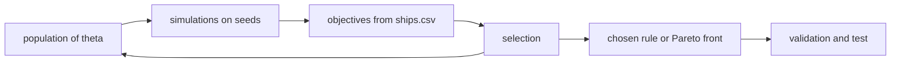

# Evolved Priority Rule for the VTS

Status: **design and implementation specification (nothing implemented)**.
This document has two uses: it describes the strategy for the team and, in section 17, it is a
ready-to-use prompt for whoever implements it (a person or a model). Hook, lever and file names come
from `VTS_API.md`, `README.md` and `MODEL.md`. Anything marked **(to verify)** must be confirmed in the
code before it is relied on.

---

## 1. Summary

The strategy replaces the hand-written service order of the baseline (class, then request time) with a
**priority function learned automatically** on the simulator. The function scores every waiting ship
request and determines who is served first. Learning happens offline (a hyper-heuristic); during a
simulation run the VTS applies the finished, fixed rule.

Learning runs in two stages on the same controller and the same objectives:

- **Stage 1, single-objective optimisation:** one weighted sum of normalised objectives, CMA-ES. It
  yields one rule and a simple reference point.
- **Stage 2, multi-objective optimisation:** the objectives stay separate, NSGA-II. It yields a **Pareto
  front**: a set of rules none of which is better than another in everything. Choosing a trade-off is
  left to a human and done after training.

The objectives are: waiting, delay against the berth window, fuel and emissions, and fairness between
ship classes.

## 2. Research questions

1. Does a rule found by an evolutionary algorithm reduce waiting, delay and fuel use compared with the
   baseline and hand-written rules, without worsening fairness between classes?
2. What does the Pareto front between waiting, delay, fuel and fairness look like? Is it convex, or does
   it have clear "knees" (trade-offs cheap on one side, dear on the other)?
3. Are there rules that improve fuel without worsening waiting, that is, are the objectives in conflict
   at all, at today's traffic and at loaded traffic?
4. What does fairness cost: by how much does mean waiting rise when equal treatment of classes is forced?
5. Do rules learned on base traffic keep their quality on loaded traffic?
6. Where on the front do the FCFS baseline, `container_first` and the stage 1 single-objective solution lie?

## 3. Place among the strategies

| Strategy | What it changes | How this strategy differs |
|---|---|---|
| Baseline FCFS, `container_first` | a fixed ordering rule | this strategy learns the shape of the rule and searches for a set of trade-offs; baselines are reference points |
| Arrival-time game (A) | ship decisions and the queue key in a game | here ship choices are not modelled; only the VTS side is optimised |
| Lock control (L) | chamber closing, ship selection per lockage | here the subject is admission order and priorities, not the lock cycle |
| Emissions | a fuel and CO2 metric | fuel is one of the objectives and the emissions module is not changed |

The strategy is one class (`EvolvedPriority`). Stages 1 and 2 differ in the optimiser and in how
candidates are judged, not in the decision code inside the simulation.

## 4. Scope

**In scope:** a controller with a priority rule for `clearance`, objective definitions from `ships.csv`
and `timeseries.csv`, a single-objective (CMA-ES) and a multi-objective (NSGA-II) optimiser, handling of
noise (simulation randomness), front analysis, solution selection, a validation and test protocol,
documentation and tests.

**Out of scope:** changes to the simulation engine, changes to the emissions module, calibration of the
model, changes to the safety constraints in `VTS_API.md` §7.

## 5. Overview

## 6. The controller

The strategy `EvolvedPriority` inherits from `Baseline`. In `on_tick` it sorts the waiting ships that
need a pilot by the key `(distress, tide_dependent, score(ship), request_t)` and calls `control.clear`,
like the `DeepFirst` example in `VTS_API.md` §1. The weight vector `theta` arrives through
`--vts-option`, with values read as JSON. Levers: `("clearance", "anchorage")`.

`score = sum(theta_i * feature_i)`; a lower score is served earlier.

**Rule representations** (to choose from, in the recommended order):

1. **Linear model** (start): about a dozen weights, optimised with CMA-ES or NSGA-II.
2. **Small neural network** (one hidden layer), also with an evolution strategy.
3. **GP tree**: the most readable, needs many evaluations. Optionally with a surrogate model.

Branke, Hildebrandt, Scholz-Reiter (2015) show that the GP tree wins when many candidates can be
evaluated, with the network close behind. With about 10 minutes per simulated week the evaluation
budget is small, so we start with the linear model.

**Features, all from `ShipView`:** `waited_min` (in hours), `loa`, `draught`, `teu` (0 if absent), slack
to the window `scheduled_berth_min - now` (clipped, 0 if there is no window), an indicator for the
`container` class. Each feature is scaled by a fixed constant written in the code (e.g. `loa/400`) so
the weights have comparable magnitudes. The scaling constants are part of the description of a solution
and are saved with the result. The fair-comparison rule of `VTS_API.md` §6 applies: only what is in `view`.

**Hard constraints (not learned):**

- ships in distress and tide-dependent ships stay ahead of the rest, as in the baseline,
- the rule does not bypass engine checks (`control.check`); rejected orders are handled as in the baseline,
- the order within classes 0 and 1 and the exclusive chamber use by the largest container ships are
  unchanged (constraints from the document on lock control).

**The zero solution `theta0`:** reproduces the baseline order (the longest-waiting ship first, i.e. a
negative weight on `waited_min`, the rest zero). It serves as a correctness test (section 15) and as the
starting point of the optimisation.

**Controller variants.** Each is a separate experiment with its own result; they are not combined in one run:

- **Variant 1 (required):** only the order of `clearance`. Dimension of `theta`: about 6–8.
- **Variant 2 (optional):** the same score function also sets `lock_priority` (tier 2, value 1–4) and the
  order of `set_rank`, through quantile thresholds of the score. Adds 2–3 threshold parameters.
- **Variant 3 (optional):** two parameters: the maximum `wait_at_sea` time before going to an anchorage,
  and a speed factor (`set_speed`, tier 1). It touches fuel most, so it needs care when interpreting the
  fuel objective (section 7).

## 7. Objectives

All objectives are **minimised**. Ships from the warm-up period are excluded (`--warmup`, 2 days by
default). The objectives are computed after the run from `ships.csv`; the column names are **(to
verify)** in the file, because the README describes them only in general (minutes in states, fuel and
emissions in kg, planned and actual berthing times).

| Objective | Definition | Notes |
|---|---|---|
| f1: waiting | mean time per ship in waiting states (anchorage, waiting for clearance, lock queue, waiting for a pilot), all classes | MODEL.md §19 defines the "Waiting" state |
| f2: window delay | mean positive part of `actual - planned` berth time for container ships with a window | the window is issued by the terminal and cannot be moved |
| f3: fuel | total fuel (kg) after warm-up, or CO2 as a variant | values relative to the baseline on the same seeds |
| f4: fairness | the largest ratio (mean waiting of class c in the run) / (the same in the baseline on the same seed) over classes with enough ships | variant: Jain's index on class waiting |

**Normalisation.** Each objective is divided by the baseline's value **on the same seed** (a paired
ratio) and then averaged over seeds. The objectives become dimensionless, and common random numbers
(arrivals and weather have their own streams, MODEL.md §1) cut the noise. The baseline therefore equals
1 in every objective.

**Note on fuel.** `PINNED.md` records that container ships on the river sail faster than in the AIS
(14.6 kn against 12.3 kn), which gives about +37 % fuel, and that the movement model is not to be
corrected for this and the emissions module must not mask it with a factor. So f3 is interpreted
**relatively** (strategy against baseline on the same model) and no correcting factor may be added to
it. No conclusions about absolute fuel use are drawn.

**Feasibility constraints.** A candidate is discarded as infeasible if, in any run: the run stopped
early (`stopped_early`), the number of removed or dropped ships rose against the baseline beyond a
tolerance, or the `silent` block in `summary.json` shows more "hidden shortages" than the baseline (see
`PINNED.md`, "Read the `silent` block first"). The reason: a rule that "wins" by hiding a shortage
would not show up in waiting times.

## 8. Stage 1: single-objective optimisation

- **Cost function:** `J(theta) = w1*f1 + w2*f2 + w3*f3 + w4*f4`, on the normalised objectives of
  section 7. The weights `w1..w4` are fixed **before training**, recorded in `config.json` and not
  changed after looking at validation or test results. An infeasible candidate gets a large penalty.
- **Algorithm:** CMA-ES (Hansen, Ostermeier 2001), e.g. through the `cma` library or a custom
  implementation. For dimension about 7 the default CMA-ES population is a handful of individuals
  (about 9 by the standard formula, to be checked in the library used).
- **Starting point:** `theta0` with an initial step chosen so the first generations are not extremely
  far from the baseline.
- **Output:** the vector `theta*` and a history (value of `J` per generation). This is one rule, the
  reference point for stage 2, and a simple result once the cost weights have been agreed.

## 9. Stage 2: multi-objective optimisation

- **Base algorithm:** NSGA-II (Deb et al. 2002), real-coded, SBX crossover, polynomial mutation.
  Objectives f1–f4 stay separate.
- **With more than 3 objectives:** consider NSGA-III (Deb, Jain 2014), as NSGA-II discriminates poorly
  in many objectives. Four objectives are the limit: start with NSGA-II and move to NSGA-III if
  selection is weak.
- **Implementation:** the `pymoo` library (Blank, Deb 2020) or a minimal custom one. The library must
  allow external parallel evaluation and saving the state of a generation.
- **Starting parameters:** population 24, 15–20 generations, `theta` range `[-1, 1]`, one individual in
  the population is `theta0` and another is `theta*` from stage 1.
- **Infeasibility:** handled by constraint-domination, not by a penalty.
- **Output:** a Pareto front. The choice of solutions from the front is described in section 12, item 4.

Stage 2 starts only after stage 1 passes the tests of section 15.

## 10. Computational budget

The README says a 7-day run takes about 10 minutes. Examples, to be recomputed on real hardware (3
seeds, 5 simulated days, i.e. 2 warm-up plus 3 measured, about 7 minutes per run):

- stage 1: 9 individuals, 30 generations: `9 * 30 * 3 * 7 min = 5670 min`, about 95 h serial, about 19 h
  with 5 parallel processes,
- stage 2: 24 individuals, 15 generations: `24 * 15 * 3 * 7 min = 7560 min`, about 126 h serial, about
  25 h with 5 processes.

That is a lot, so we use:

1. **A short horizon** in training (3 days after warm-up), the full horizon only in validation and test.
2. **Racing:** a new candidate is first evaluated on 1–2 seeds, and only those not clearly worse get the
   full set of seeds.
3. **Seed rotation:** in successive generations use different subsets of training seeds, so the rule
   does not fit one set. The elite is re-evaluated every few generations on a larger set.
4. **Caching:** a run's result is keyed by `(theta, seed, horizon, scenario)` and never computed twice.
5. **Optionally a surrogate model** for pre-selection (the idea of evaluating on a simplification:
   Nguyen, Zhang, Tan 2017).

## 11. Handling noise

The simulation is random, so an objective value is an estimate. Rules:

- the same seeds for all candidates in a generation (common random numbers),
- paired comparisons against the baseline,
- the elite (the best individual or the current front) is recomputed on additional seeds before the final choice,
- we report the uncertainty of objectives (spread over seeds), and for the final solutions confidence
  intervals through `replicate.py` (Student's t over the replications).

## 12. Evaluation protocol

1. **Seeds:** three disjoint ranges, e.g. training `1001..`, validation `2001..`, test `3001..` (numbers
   to be fixed; disjointness is what matters). The test range is looked at **once**, at the end, after
   the choice is frozen.
2. **Scenarios:** (a) base traffic, (b) loaded traffic. For loaded traffic the README gives
   `--containers nhpp --container-rate 1.2` as a 20 % rate increase; larger values to be tested.
   **Note from `PINNED.md`:** the `weeks` mode has no rate factor yet, and in `nhpp` calls overlap more
   than in a planned schedule. Conclusions from (b) are described as conclusions for traffic "as in the
   fitted process", not for a real distribution of weeks.
3. **Reference points:** FCFS baseline, `container_first`, a hand-written weighted rule (to compare with
   the learned one), the `theta0` solution.
4. **Choosing solutions from the front (before the test):** (i) the knee point (the largest gain
   relative to the distance from the ideal point), (ii) extreme points, one per objective, (iii) the
   solution with f4 below a threshold agreed with the team. We record them, together with `theta*` from
   stage 1, before looking at the test.
5. **Robustness:** each chosen solution is also run on scenario (b), although we trained on (a) (Branke
   et al. 2015 test the robustness of rules to scenario changes).
6. **Statistics:** paired differences on the same seeds, with 95 % confidence intervals.

## 13. Metrics

- **Waiting** mean and p95 by class, **window delay**, **fuel and emissions**, **fairness** (f4), number
  of ships at anchor, number of rejected orders.
- **Front quality:** hypervolume against a reference point derived from the baseline (e.g. 1.5 times
  the baseline value for every objective; record the value; indicator: Zitzler, Thiele 1999), coverage
  of the reference points (which of them the front dominates), spread and the number of non-dominated
  solutions.
- **Stability:** the change of hypervolume between validation and test and between scenarios (a) and (b).
- **A per-ship-class table** for every chosen solution, not only overall means.

## 14. Outputs

In `results/evolved_priority/<label>/`:

- `single.json`: the stage 1 result (`theta*`, history of `J`, cost weights, scaling constants)
- `front.csv`: the stage 2 result (`theta`, objectives with intervals, seeds, horizon, scenario)
- `generations.csv`: generation statistics (value of `J` or hypervolume, front size, number of runs)
- `selected.json`: the chosen solutions (knee, extremes, fairness threshold, `theta*`) with `theta` and
  scaling constants
- `report.md`: plots and tables (front in objective pairs, class table, comparison with reference points)
- `config.json`: the full configuration, seeds, commit hash, library versions

## 15. Tests and acceptance criteria

1. **Baseline reproduction.** The strategy with `theta0` on one seed gives the same `summary.json` and
   `ships.csv` as `baseline`. Note: `VTS_API.md` §10 says the baseline's agreement with the model before
   the API has not yet been checked. If this test fails, first determine whether the strategy code or
   the baseline is at fault.
2. **Hard constraints:** no rule overtakes a tide-dependent ship or a ship in distress; no rise in
   `rejected` under the `clearance` lever.
3. **Reproducibility:** the same `theta` and seed give the same objective values.
4. **Objective functions:** unit tests on a small hand-computed `ships.csv` (warm-up exclusion, paired
   normalisation, no division by zero, classes with few ships skipped).
5. **Optimisers:** CMA-ES finds the minimum of a simple test function (e.g. the sphere), and NSGA-II
   finds a front close to the known one on a synthetic problem (e.g. ZDT1), before use on the simulator.
6. **Stage 1:** after training the rule beats the baseline in `J` on validation seeds, or the report
   states clearly that no improvement was found.
7. **Stage 2:** at least one solution on the front is not dominated by the baseline on validation seeds,
   or the report states clearly that none was found.

## 16. Risks and notes

- **Light traffic.** With today's data about 2 of 28 container ships are at anchor on average, so
  differences between rules may be small and the objectives may nearly coincide (the front "collapses"
  to a point). That is also a result, but it needs a loaded scenario to distinguish anything.
- **Noise and cost.** Objective estimates are noisy and every evaluation costs minutes. Racing and seed
  rotation reduce but do not remove this risk.
- **Overfitting to seeds.** Mitigation: validation and test on disjoint seeds.
- **Relative fuel.** See section 7.
- **Hidden shortages.** Enforced by the feasibility constraints of section 7.
- **Uncertain model parameters** (lock times, pilot pools). Relative comparisons are more reliable than
  absolute ones.
- **Interpretability.** For the linear model the weights can be read directly. For networks and GP, add
  simplification and visualisation of the rule.
- **Short AIS record.** Validation against reality is limited.
- **Too many objectives.** With four objectives the front is hard to read. Report in pairs and through
  chosen points, not as one cloud.

## 17. Implementation prompt

The text below can be pasted as an instruction for a person or model implementing the strategy.

> **Role.** You are implementing the strategy "evolved priority rule" for the Port of Antwerp
> simulation. You have the repository with `src/agents/vts_api.py`, `src/strategies/`,
> `src/sim/pipeline.py`, `src/sim/replicate.py`, `tests/`, and the documents `README.md`, `MODEL.md`,
> `VTS_API.md`, `PINNED.md` and this file.
>
> **Before writing code:** read `VTS_API.md` in full and `MODEL.md` §1, §9, §17, §17.1, §19; open
> `src/strategies/template.py`, `baseline.py`, `container_first.py`; check the headers of `ships.csv`
> and the keys of `summary.json` from one real run and write down which columns correspond to
> objectives f1–f4. If something is missing, say so instead of guessing.
>
> **Task** (do these in order; stage 2 only after the stage 1 tests pass):
> 1. Create `src/strategies/evolved_priority.py`: class `EvolvedPriority(Baseline)`,
>    `name = "evolved_priority"`, `levers = ("clearance", "anchorage")`, weights from
>    `self.options["weights"]`, sort key `(distress, tide_dependent, score, request_t)`, features from
>    section 6, scaling constants stored as module constants. Override only `on_tick` (and `start` if
>    needed). Do not use `view._sim` or any private engine attribute. Optionally log decisions with
>    `control.note`.
> 2. Write an objectives module `objectives.py`: a function that reads `ships.csv` and `summary.json`
>    from a run directory and returns f1–f4 and a feasibility flag, as in section 7 (warm-up exclusion,
>    paired normalisation against the baseline on the same seed, classes with few ships skipped in f4,
>    constraints on `silent`, `stopped_early` and removed ships).
> 3. Write an evaluation runner: for a `theta` and a list of seeds it runs the simulation (through
>    `replicate.py` or `pipeline.py` as a subprocess, with `--vts evolved_priority --vts-option
>    weights=[...]`, a separate results directory per run), in parallel, with a cache keyed by
>    `(theta, seed, horizon, scenario)`.
> 4. **Stage 1:** write a CMA-ES loop (the `cma` library or custom) minimising `J` from section 8, with
>    racing, seed rotation, re-evaluation of the elite, saving state every generation and resumability.
> 5. **Stage 2:** write an NSGA-II optimiser (pymoo or custom) as in sections 9–11, with a population
>    containing `theta0` and `theta*`, constraint-domination, and the same noise and caching mechanisms.
> 6. Write an analysis script: hypervolume, coverage of reference points, choice of the knee, extreme
>    points and the fairness-threshold solution, objective-pair plots, class table, `report.md`.
> 7. Write the tests from section 15 (where an expensive run is not needed, use small synthetic data).
>
> **Do not.** Do not change the engine, `vts.py`, `emissions.py` or model parameters. Do not add
> correcting factors to fuel. Do not tune anything on test seeds or look at them before the choice of
> solutions is frozen. Do not change the weights `w1..w4` after seeing validation or test results. Do
> not combine the controller variants of section 6 in one run. Do not re-implement the safety
> constraints of `VTS_API.md` §7 in the strategy (the engine already enforces them).
>
> **File layout (adapt to the repository's conventions):** `src/strategies/evolved_priority.py`,
> `src/opt/evolved_priority/objectives.py`, `evaluate.py`, `cmaes.py`, `nsga2.py`, `analyze.py`,
> `tests/test_evolved_priority_*.py`, results in `results/evolved_priority/<label>/`.
>
> **Definition of done.** Points 1–7 of section 15 are met; a short trial run (1 generation, 2 seeds,
> 3 days) works from start to end in both stages and writes the files of section 14; report what
> worked, what did not and what assumptions you made. At the end give the commands to run training,
> validation and test and an estimated time.
>
> **Reporting ambiguities.** If a column name, key or hook behaviour differs from this description,
> stop and describe the difference instead of quietly adjusting the document to the code.

## 18. Milestones

1. Confirm the output columns and keys, define the objectives, cost weights and scaling constants.
2. Baseline reproduction test with `theta0`.
3. Objectives module plus tests.
4. Evaluation runner with a cache, short trial run.
5. Stage 1 on base traffic, validation.
6. Stage 2 on base traffic, validation.
7. Loaded scenario, solution selection, test.
8. Controller variants 2 and 3 as separate experiments.
9. A report with the stage 1 result, the front and the comparison with reference points.

## 19. References

- Branke, Nguyen, Pickardt, Zhang (2016). *Automated Design of Production Scheduling Heuristics: A
  Review*. IEEE TEVC 20(1), 110–124. A review of hyper-heuristics; stresses their usefulness for
  dynamic and stochastic scheduling problems.
- Branke, Hildebrandt, Scholz-Reiter (2015). *Hyper-heuristic Evolution of Dispatching Rules: A
  Comparison of Rule Representations*. Evolutionary Computation 23(2), 249–277. Compares GP trees,
  networks and a linear model, and checks the robustness of the rules.
- Nguyen, Mei, Zhang (2017). *Genetic Programming for Production Scheduling: A Survey with a Unified
  Framework*. Complex & Intelligent Systems 3, 41–66. Attribute selection, representation, fitness
  functions.
- Nguyen, Zhang, Tan (2017). *Surrogate-Assisted Genetic Programming with Simplified Models for
  Automated Design of Dispatching Rules*. IEEE Trans. Cybernetics 47(9), 2951–2965. Surrogate models
  that cut the cost of evaluation.
- Zhang, Mei, Nguyen, Zhang (2024). *Survey on Genetic Programming and Machine Learning Techniques for
  Heuristic Design in Job Shop Scheduling*. IEEE TEVC 28(1), 147–167. The latest review, including
  feature selection.
- Hansen, Ostermeier (2001). *Completely derandomized self-adaptation in evolution strategies*.
  Evolutionary Computation 9(2). (from memory, to verify)
- Deb, Pratap, Agarwal, Meyarivan (2002). *A fast and elitist multiobjective genetic algorithm:
  NSGA-II*. IEEE TEVC 6(2), 182–197. (from memory, to verify)
- Deb, Jain (2014). *An evolutionary many-objective optimization algorithm using reference-point-based
  nondominated sorting approach (NSGA-III)*. IEEE TEVC 18(4), 577–601. (from memory, to verify)
- Zitzler, Thiele (1999). *Multiobjective evolutionary algorithms: a comparative case study and the
  strength Pareto approach*. IEEE TEVC 3(4), 257–271. (hypervolume; from memory, to verify)
- Blank, Deb (2020). *pymoo: Multi-objective optimization in Python*. IEEE Access 8, 89497–89509.
  (from memory, to verify)
